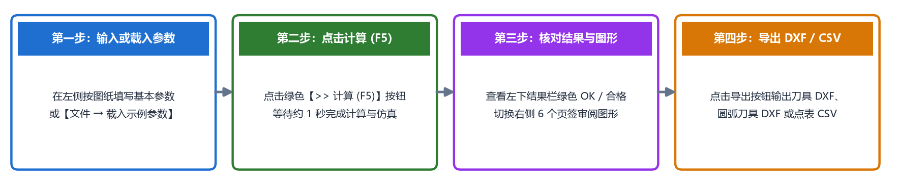

# 快速开始

欢迎阅读 **TrackForm** 快速开始章节！通过本章的学习，您将快速掌握软件的安装启动、主界面布局、核心交互方式，并在三分钟内完成您的第一次成型刀具设计与图纸导出。

## 本章内容导航

1. **[软件安装与启动](installation.md)**  
   介绍 Windows 安装包（`.msi`）的安装与版本升级步骤、桌面快捷方式启动，以及用户默认数据文件夹（参数、导出文件与自动记忆配置）的存放位置。

2. **[界面布局与基本操作](ui_overview.md)**  
   全面解析主界面的六大功能分区，介绍**鼠标悬停查看参数示意图提示**、**不同截面类型下输入框的自动切换**、**状态栏颜色提示**等贴心交互特性。

3. **[三分钟快速上手](quickstart.md)**  
   以标准椭圆球道零件（`AC3300-G`）为例，带您一步步走完“载入/确认参数 $\rightarrow$ 点击计算（F5） $\rightarrow$ 核对计算结果与图形页签 $\rightarrow$ 导出 CAD 图纸与点表”的完整工作闭环。

