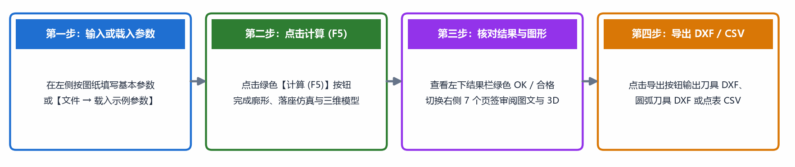

# 快速开始

欢迎阅读 **TrackForm（等速万向节球道成型刀具设计软件）**快速开始章节！

通过本章学习，您可以快速完成以下准备：
- 掌握软件的安装、升级、硬件加密狗授权保护与数据目录位置；
- 熟悉“左控右图”主界面布局与 **7 大可视化图形页签（含 OpenGL 三维实时演示）**；
- 在三分钟内跑通从参数载入、计算校核到 CAD / CSV 导出的完整闭环。

---

## 本章内容导航

1. **[软件安装与启动](installation.md)**
   - Windows `.msi` 安装包安装与平滑覆盖升级；
   - 硬件加密狗启动检测与运行期插拔保护（自动保存会话）；
   - `%USERPROFILE%\TrackForm\` 用户数据文件夹结构说明。

2. **[界面布局与基本操作](ui_overview.md)**
   - 解析主界面六大功能分区（含 **21 项基本参数 + 25 项高级参数**、**7 个图形页签**）；
   - 掌握**鼠标悬停图文提示**（按 `工件类型` 实时适配几何图）、**参数智能显隐**、**计算进度遮罩**与**单子图独立放大（`⤢`）**。

3. **[三分钟快速上手](quickstart.md)**
   - 以标准固定节星形套（`AC3300-G`）为例，演示完整四步闭环操作：
     1. 载入 / 确认参数（含 6 种 `工件类型` 选择）；
     2. 点击计算（`F5`）；
     3. 核对结果面板与 7 个图形页签（含三维动画）；
     4. 一键导出 DXF 工程图与 CSV 点表。

