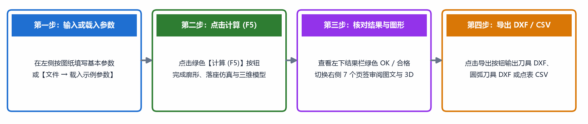
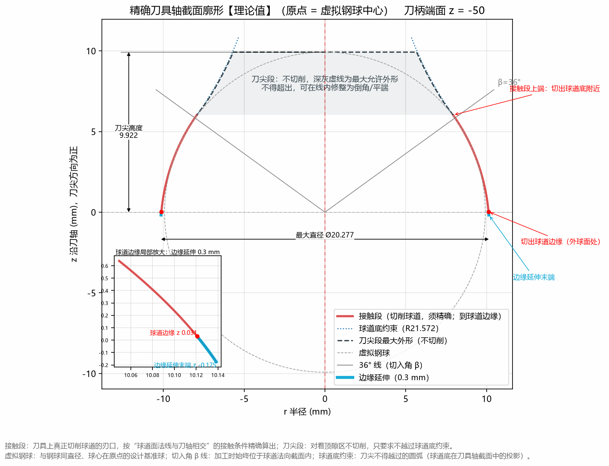

# 三分钟快速上手

本节以经典的 **AC3300-G 星形套（椭圆球道截面）** 为例，带您在三分钟内体验从载入参数、执行计算、审阅结果与图形，到导出数控磨刀 DXF 图纸和 CSV 点表的完整流程。



---

## 第一步：确认或载入示例参数

1. 启动 **TrackForm** 软件。
2. 点击顶部菜单栏 **文件(F) $\rightarrow$ 载入示例参数 $\rightarrow$ AC3300-G_星形套_参数**（或直接按出厂默认参数操作）。
3. 载入后软件会清空旧图表并在图形区提示点击 **计算 (F5)**，此时左侧 **基本参数** 面板中已填入 `AC3300-G` 核心参数：
   - **① 钢球与球道轨迹**：`工件类型 = 星形套（固定节）`，`钢球直径 Dw = 19.844` mm，`节圆直径 PCD = 62.464` mm，`球道偏移 e = 4.27` mm
   - **② 球道法向截面**：`截面类型 = 椭圆`，`定义方式 = 给定相似度`，`接触角 α = 42.0` °，`相似度 k = 1.04`，`法向余量 = 0.0` mm
   - **③ 刀具安装**：`切入角 β = 36.0` °
   - **④ 工件外形**：`外球面直径 = 61.113` mm，`工件宽度 W = 23.1` mm，`球心至端面 H = 13.31` mm

---

## 第二步：点击“计算”（或按 F5）

1. 点击左侧面板中部醒目的绿色大按钮 **▶ 计 算 (F5)**（或直接按键盘上的 `F5` 键）。
2. 计算期间右侧图形区盖上半透明暗色遮罩与蓝色旋转进度环；约 **1 秒** 后状态完成，左下 **计算结果** 面板与右侧 **7 个图形页签（含 OpenGL 三维演示）** 全部自动刷新。

---

## 第三步：核对计算结果与审阅图形

### 1. 查看左下“计算结果”面板（可点击 `⤢ 展开` 放大查看）

重点核对顶部的 **`■ 校验结论`** 以及五大分块中带颜色标记的关键结论（详细解读见[第 4 章：计算结果面板解读](../4_result_panel/README.md)）：

```text
■ 校验结论
  全部校验通过

理论值 = 按图纸参数算出的设计值；实际值 = 反向仿真：刀具沿球道运动后实际切出的球道

■ 一、球道截面设计【理论值】
  截面：椭圆（给定相似度）
  工件类型：星形套（固定节）
  钢球中心轨迹半径 Rp：31.5225
  椭圆半轴 a(横向)：10.1762   b(径向) = 10.6436
  椭圆中心高 uc：+0.6929（相对钢球中心，朝球道开口为正；距球道底 10.6436）
  接触角 α：42.000°（公差 -2/+2°，实际接触角应在 40.000 ~ 44.000）
  相似度：1.0400
  顶隙：0.0287  OK（图纸 0.019 ~ 0.04）
  接触角跨距：13.2782（未给范围，不校验）
  球道边缘接触角：81.17°

■ 二、精确刀具廓形【理论值】
  接触段 r（到球道边缘）：7.9269 ~ 10.1209
  接触段 z（到球道边缘）：0.0310 ~ 6.0205
  边缘延伸：0.3 mm（在球道边缘 z = 0.0310 之外继续到 z = -0.1747（r 10.1384），为外球面尺寸偏差和定位误差留的余量）
  刀头最大直径：20.2768（含边缘延伸）
  刀尖高度：9.922
  廓形单调（无自交）：是
  过切校验 最小间隙：1.75e-07  OK（< 0 为过切）

■ 三、精确刀具切出的球道【实际值·仿真】
  最大过切：0.00e+00  OK
  侧面（钢球接触区）欠切：2.27e-05  OK
  球道底欠切：0.0000（顶隙区）
  ▸ 钢球放进切出的球道（实际落座）
  实际顶隙：0.0287  OK（图纸 0.019 ~ 0.04）
  实际接触角：41.982°  OK（图纸 40 ~ 44）
  实际接触角跨距：13.2736（未给范围）
  实际 PCD：62.4640  OK（偏差 +0.0 μm；图纸 62.454 ~ 62.474）
  钢球中心相对设计位置移动：+0.0 μm（朝开口为正）

■ 四、圆弧近似刀具：单圆弧，拟合精确廓形（取整到 3 位，磨刀尺寸）
  圆弧半径 R：12.3600
  圆心 径向 / 轴向：-2.1920 / +1.0710（径向负 = 在刀轴另一侧，轴向朝刀柄为正）
  圆柱直径：Ø20.3360
  刀尖直径：Ø15.7952
  ▸ 刃口分段（z 沿刀轴）
  圆弧过渡：-1.071 ~ -0.175（长 0.896）
  边缘延伸：-0.175 ~ 0.031（长 0.206）
  接触段：0.031 ~ 6.068（长 6.037）
  刀尖端面：z 6.0683
  刀尖延伸：0.000（刀尖最多可沿原圆弧延伸到 z = 11.0931（距切出球道底处 5.025，圆弧已到刀轴（刀尖成尖点）））
  ▸ 该刀具切出的球道【实际值·仿真】
  与设计截面偏差：3.78 μm  合格（轮廓度 ±10）
  实际顶隙：0.0347  OK（图纸 0.019 ~ 0.04）
  实际接触角：41.905°  OK（图纸 40 ~ 44）
  实际接触角跨距：13.2538（未给范围）
  实际 PCD：62.4685  OK（偏差 +4.5 μm；图纸 62.454 ~ 62.474）
  钢球中心相对设计位置移动：+2.2 μm（朝开口为正）
```

- **顶部汇总结论**：最上方 **`■ 校验结论`** 直接显示绿色 **`全部校验通过`**，表明所有几何校验与落座指标均合格。
- **理论与实际落座双重校核**：钢球实际放入精确刀具切出的球道后，**实际顶隙** `0.0287 mm`、**实际接触角** `41.982°`、**实际 PCD** `62.4640 mm` 全部显示绿色 **OK**。
- **圆弧近似刀具结论**：
  - 磨刀尺寸：圆弧半径 `R = 12.3600 mm`、圆心径向 `-2.1920 mm`、圆心轴向 `+1.0710 mm`、圆柱直径 `Ø20.3360 mm`、刀尖直径 `Ø15.7952 mm`（端面 `z = 6.0683 mm`）；
  - 切出球道精度：与设计截面最大偏差仅 **`3.78 μm`**（远小于轮廓度公差 `±10 μm`），钢球落座后的**实际顶隙** `0.0347 mm`、**实际接触角** `41.905°`、**实际 PCD** `62.4685 mm` 全部合格（**OK**）！

### 2. 切换右侧图形页签审图

点击右侧顶部页签标题（或按 `Ctrl+1` ~ `Ctrl+7`）依次检查：
- **精确刀具廓形（`Ctrl+1`）**：查看**红色**切削接触段、**青色**边缘延伸段（含左下角局部放大框）与**深灰虚线**刀尖段最大外形（如下图所示）。
- **球道设计截面（`Ctrl+2`）**：查看左上角**球道底放大图（纵向夸大）**、接触角上下限虚线及接触角跨距标注。
- **工件轴向剖面（`Ctrl+3`）**：核对工件外径/外球面、宽度、内孔壁厚与球道底圆弧半径。
- **加工姿态（`Ctrl+4`）**：检查刀具在球道两端极限位置时，刀柄端面与工件是否安全无干涉。
- **圆弧近似刀具（`Ctrl+6`）**：查看左半刃口分段着色、右半刀尖可延伸范围、立体圆柱段示意与切出球道落座/偏差/半径差五子图。
- **三维演示（`Ctrl+7`）**：在 OpenGL 三维视图中点击 **▶ 播放** 或拖动进度条，直观检查工件旋转、半剖内部球道及圆弧刀具切入全过程。



---

## 第四步：一键导出工程文件

根据您的加工与制图需求，在左侧 **计算与导出** 面板中点击对应的导出按钮：

1. **采用圆弧近似刀具磨刀（最常用）**：
   - 点击 **圆弧刀具 DXF** $\rightarrow$ 默认保存为 `arc_tool.dxf`。图内圆弧刃口为标准 CAD `ARC` 圆弧实体，标注齐全，可直接交给工具磨床编程磨刀。
   - 如需编制客户格式的产品开发图，可继续点击 **方程常数（Table 1）** 和 **基本轮廓（Table 2）**，导出图纸所需的常数表与 117 点基本轮廓坐标表。
2. **采用精确自由曲线成型刀具磨刀**：
   - 点击 **刀具 DXF**（保存为 `tool_profile.dxf`）和 **刀具点表 CSV**（保存为 `tool_profile_points.csv`），获取沿弧长等距间隔 `0.01 mm` 的高密度精确坐标点表。

导出完成后，软件会弹出提示框显示文件保存路径。您也可以随时点击菜单 **帮助(H) $\rightarrow$ 打开数据文件夹**，在 `output\` 子目录中找到所有导出的文件。
