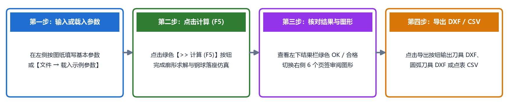
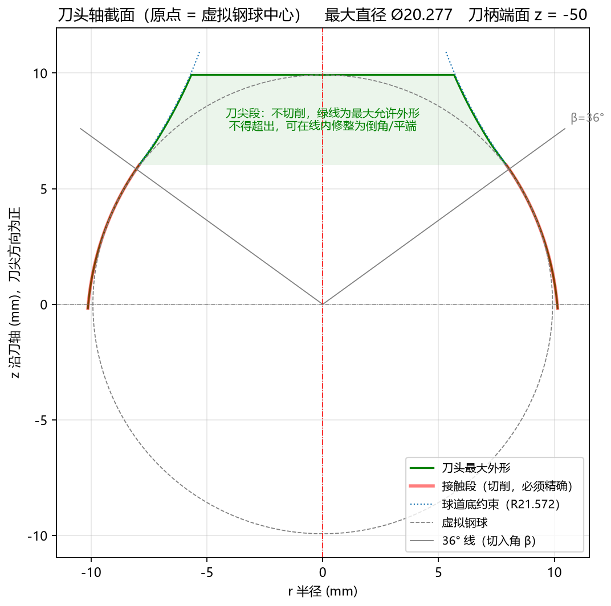

# 三分钟快速上手

本节以经典的 **AC3300-G 星形套（椭圆球道截面）** 为例，带您在三分钟内体验从载入参数、执行计算、审阅结果与图形，到导出数控磨刀 DXF 图纸和 CSV 点表的完整流程。



---

## 第一步：确认或载入示例参数

1. 启动 **TrackForm** 软件。
2. 点击顶部菜单栏的 **文件(F) $\rightarrow$ 载入示例参数 $\rightarrow$ AC3300-G_参数**（或者点击 **文件(F) $\rightarrow$ 恢复默认设置**）。
3. 此时左侧 **基本参数** 面板中已填入 AC3300-G 零件图纸的核心参数：
   - **① 钢球与球道轨迹**：`钢球直径 Dw = 19.844` mm，`节圆直径 PCD = 62.464` mm，`球道偏移 e = 4.27` mm
   - **② 球道法向截面**：`截面类型 = 椭圆`，`定义方式 = 给定相似度`，`接触角 α = 42.0` °，`相似度 k = 1.04`，`法向余量 = 0.0` mm
   - **③ 刀具安装**：`切入角 β = 36.0` °
   - **④ 工件外形**：`外球面直径 = 61.113` mm，`工件宽度 W = 23.1` mm，`球心至端面 H = 13.31` mm

---

## 第二步：点击“计算”（或按 F5）

1. 点击左侧面板中部醒目的绿色大按钮 **▶ 计 算 (F5)**（或直接按键盘上的 `F5` 键）。
2. 按钮下方的状态栏会显示计算阶段与用时，约 **0.8 秒** 后状态栏变为绿色的 `计算完成`，同时左下方的 **计算结果** 面板和右侧的 **6 个图形页签** 全部自动刷新。

---

## 第三步：核对计算结果与审阅图形

### 1. 查看左下“计算结果”面板（可点击 `⤢ 展开` 放大查看）

重点核对面板五大分块中带颜色标记的关键结论（详细解读见[第 4 章：计算结果面板解读](../4_result_panel/README.md)）：

```text
理论值 = 按图纸参数算出的设计值；实际值 = 反向仿真：刀具沿球道运动后实际切出的球道

■ 一、球道截面设计【理论值】
  截面：椭圆（给定相似度）
  钢球中心轨迹半径 Rp = 31.5225
  椭圆半轴 a(横向) = 10.1762   b(径向) = 10.6436   中心高 uc = 0.6929
  接触角 α = 42.000°（图纸 40 ~ 44）  OK
  相似度 = 1.0400
  顶隙 = 0.0287（图纸 0.019 ~ 0.04）  OK
  接触角跨距 = 13.2782（未给范围，不校验）
  球道边缘接触角 = 67.32°

■ 二、精确刀具廓形【理论值】
  接触段 r: 7.9269 ~ 10.1384   z: -0.1747 ~ 6.0205
  刀头最大直径 = 20.2768   刀尖高度 = 9.922
  廓形单调(无自交)  OK
  过切校验 最小间隙 = 0.00e+00  OK

■ 三、精确刀具切出的球道【实际值·仿真】
  最大过切 = 0.00e+00  OK
  侧面（钢球接触区）欠切 = 1.98e-05  OK
  球道底欠切 = 0.0000（顶隙区）
  钢球放进切出的球道（实际落座）：
    实际顶隙 = 0.0287（图纸 0.019 ~ 0.04）  OK
    实际接触角 = 42.001°（图纸 40 ~ 44）  OK
    实际接触角跨距 = 13.2785（未给范围）
    钢球中心相对设计位置移动 +0.0 μm（朝开口为正）

■ 四、圆弧近似刀具：单圆弧，拟合精确廓形（取整到 3 位，磨刀尺寸）
  R=12.3600  圆心 -2.1920 / +1.0710  圆柱 Ø20.3360
  该刀具切出的球道【实际值·仿真】：
    与设计截面偏差 = 3.78 μm（轮廓度 ±10）  合格
    实际顶隙 = 0.0325（图纸 0.019 ~ 0.04）  OK
    实际接触角 = 41.988°（图纸 40 ~ 44）  OK
    实际接触角跨距 = 13.2751（未给范围）
    钢球中心相对设计位置移动 +1.2 μm（朝开口为正）
```

- **理论与实际落座双重校核**：理论设计的接触角 `42.000°` 和顶隙 `0.0287 mm` 均显示绿色 **OK**；把钢球放进精确刀具实际切出的球道（实际落座）后，实测顶隙 `0.0287 mm`、实测接触角 `42.001°` 也全部显示绿色 **OK**。
- **圆弧近似刀具结论**：可将成型刀简化为 **圆弧半径 $R = 12.360\text{ mm}$、圆心径向偏置 $-2.192\text{ mm}$（交叉到刀轴另一侧）、圆心轴向位置 $+1.071\text{ mm}$（距虚拟球心朝刀柄方向）、圆柱段直径 $\varnothing 20.336\text{ mm}$** 的单圆弧刀具；该圆弧刀切出的球道与设计截面的最大偏差仅为 **`3.78 μm`**（远小于轮廓度公差 `±10 μm`），判定为绿色 **合格**，且钢球落座后的实际顶隙 `0.0325 mm`、实际接触角 `41.988°` 均在图纸范围内（**OK**）！

### 2. 切换右侧图形页签审图

点击右侧顶部的页签标题（或按 `Ctrl+1` ~ `Ctrl+6`）依次检查：
- **刀具廓形（`Ctrl+1`）**：查看红色切削接触段与绿色刀尖允许外形（如下图所示）。
- **球道截面（`Ctrl+2`）**：查看左上角新增的**球道底放大图（纵向夸大）**、接触角上下限虚线及接触角跨距标注。
- **加工姿态（`Ctrl+4`）**：检查刀具在球道两端摆动极限位置时，刀柄端面与星形套是否安全无干涉。
- **圆弧近似（`Ctrl+6`）**：查看圆弧刀具切出球道的钢球实际落座图及偏差曲线是否完全处于两条红色公差虚线内部。



---

## 第四步：一键导出工程文件

根据您的加工与制图需求，在左侧 **计算与导出** 面板中点击对应的导出按钮：

1. **采用圆弧近似刀具磨刀（最常用）**：
   - 点击 **圆弧刀具 DXF** $\rightarrow$ 默认保存为 `arc_tool.dxf`。图内圆弧刃口为标准 CAD `ARC` 圆弧实体，标注齐全，可直接交给工具磨床编程磨刀。
   - 如需编制客户格式的产品开发图，可继续点击 **方程常数（Table 1）** 和 **基本轮廓（Table 2）**，导出图纸所需的常数表与 117 点基本轮廓坐标表。
2. **采用精确自由曲线成型刀具磨刀**：
   - 点击 **刀具 DXF**（保存为 `tool_profile.dxf`）和 **刀具点表 CSV**（保存为 `tool_profile_points.csv`），获取沿弧长等距间隔 `0.01 mm` 的高密度精确坐标点表。

导出完成后，软件会弹出提示框显示文件保存路径。您也可以随时点击菜单 **帮助(H) $\rightarrow$ 打开数据文件夹**，在 `exports\` 子目录中找到所有导出的文件。
