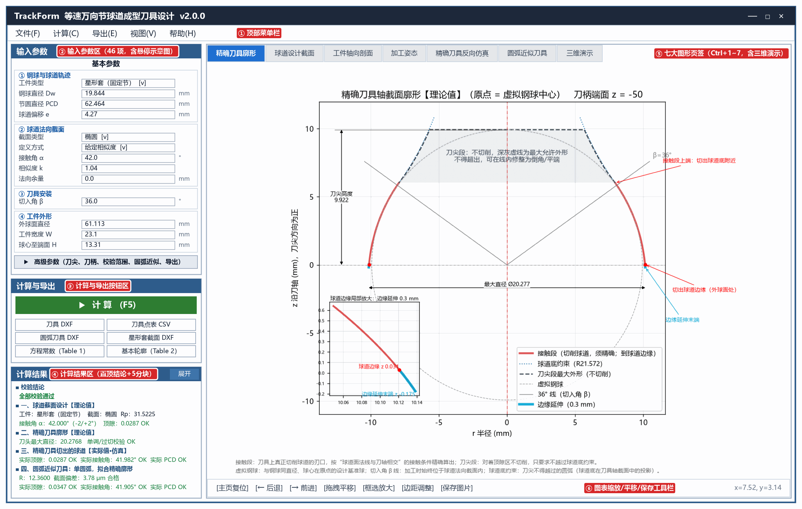
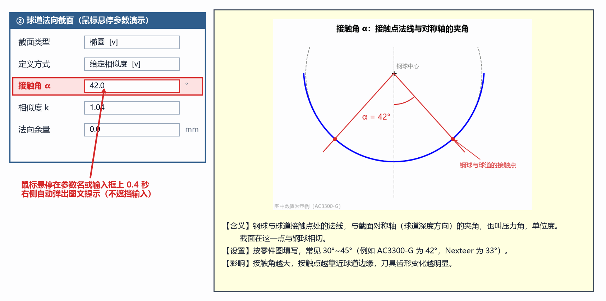
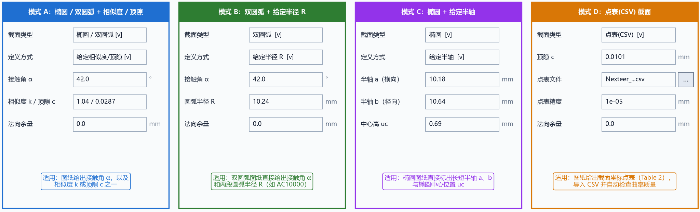
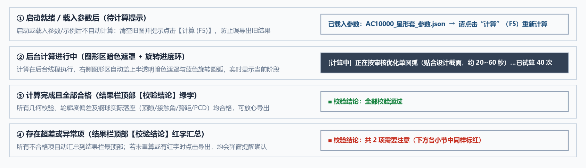

# 界面布局与基本操作

TrackForm 采用直观的**“左控右图”**工程界面布局：
- **左侧控制区**：集中完成 **46 项参数输入**、一键计算触发、6 类文件导出与结构化数值结果核对；
- **右侧图形区**：通过 **7 个专业图形页签（含 OpenGL 硬件加速三维演示）**，全方位展示刀具廓形、球道截面、零件剖面、加工姿态、反向落座仿真、圆弧近似误差与三维加工动画。

## 1. 六大功能分区概览

对照上图中的红色编号徽标，主界面分为以下六个区域：

| 区域编号与名称 | 核心功能与操作说明 |
| :---: | :--- |
| **① 顶部菜单栏** | 包含 **文件(F)**、**计算(C)**、**导出(E)**、**视图(V)**、**帮助(H)** 五大菜单： • 支持参数载入/保存、按工件类型分组的内置示例调用（如星形套 **`AC3300-G_星形套_参数`**；内部版另附 `AC10000_星形套_参数`、`Nexteer_34205673_星形套_参数`、`AC0706-E_星形套_参数` 及斜筒形壳 `EVL12508M.0F2-1_斜筒形壳_参数`）与恢复默认设置； • 提供结果窗口展开、高级参数折叠、页签切换（`Ctrl+1` ~ `Ctrl+7`）、打开在线手册与数据文件夹等入口。 |
| **② 输入参数区** | 按 **`参数名称 / 输入框 / 单位`** 三列整齐排列，全软件共 **46 项工程参数**： • 上方为决定齿形的 **基本参数**（4 个分组，**21 项**，含 `工件类型` 与 `球道斜角 γ`）； • 下方为可展开/折叠的 **▸ 高级参数**（6 个分组，**25 项**）； • 面板高度自适应，支持鼠标滚轮平滑滚动且自动防误改下拉框。 |
| **③ 计算与导出区** | • 顶部为醒目的绿色 **▶ 计算 (F5)** 大按钮（计算期间右侧图形区自动显示进度遮罩与旋转圆弧）； • 下方为两列排布的 **6 个导出按钮**（一键导出 3 种 DXF 图纸与 3 种 CSV 表格）。 |
| **④ 计算结果区** | • 顶部置顶显示 **`■ 校验结论`**（`全部校验通过` 或标红汇总所有超差/干涉警示项）； • 下方按 **`■ 一` ~ `■ 五` 五大分块**输出【理论值】与【实际值·仿真】（含钢球实际落座指标、工件与刀具干涉校验、刃口四分段）； • 点击标题栏右侧 **`⤢ 展开`**（或**双击文本框**）可在独立宽窗口中以**四列对齐斑马纹表格**查看，支持 **`Ctrl+F` 查找**与**一键复制粘贴到 Excel**。 |
| **⑤ 七大图形页签** | 包含 **精确刀具廓形**、**球道设计截面**、**工件轴向剖面**、**加工姿态**、**精确刀具反向仿真**、**圆弧近似刀具** 与 **三维演示** 共 **7 个页签**： • 支持鼠标点击或快捷键 `Ctrl+1` ~ `Ctrl+7` 快速切换； • **2D 页签交互**：支持滚轮以光标为中心缩放、左键/中键拖动平移、左键双击复原（多子图与内嵌放大窗各自独立操作）； • **子图放大查看**：悬停任意 2D 子图右上角浮现 **`⤢` 展开按钮**，点击可铺满大窗口（`Esc` / `✕` / 点暗处关闭）； • **3D 三维演示页签**：支持左键旋转视角、右键平移、滚轮缩放、左键双击复原、模式切换与连续/逐帧摆动播放。 |
| **⑥ 图表导航工具栏** | 位于每个 2D 图形页签底部（第 7 页签三维演示配有专属播放与视角控制栏）： • 提供**主页复位**、**前后视图回退**、**拖拽平移**、**框选放大**、**边距调整**与**单张图片保存**； • 右侧实时显示鼠标所在位置的精确工程坐标 `(x, y)`。 |

---

## 2. 四项高效交互设计

### （1）鼠标悬停查看“参数示意图 + 说明卡片”

填写参数时若对某个尺寸定义或图纸位置不确定，将**鼠标指针悬停在参数名称或输入框上约 0.4 秒**，右侧即会弹出图文提示卡片：

- **随 `工件类型` 实时切换示意图**：上方几何图由后台按您当前选定的 **`工件类型`**（固定节星形套 / 钟形壳、DO 直球道、VL 斜球道等）真实绘制，并用**红色（`#d62728`）**精准标出该参数位置；
- **下方三段式说明**：
  - **【含义】**：物理定义、正负号约定与单位；
  - **【设置】**：如何对照零件图填写及常见数值范围；
  - **【影响】**：修改该参数对刀具齿形、外形干涉或校验结果的影响；
- **不遮挡输入**：固定在参数栏右外侧，点击打字或移开鼠标自动收起；下方 6 个导出按钮同样支持悬停提示。

### （2）参数智能显隐与文案自动适配

- **按 `工件类型` 自动适配**：切换 **`工件类型`**（共 6 种：`星形套（固定节）`、`钟形壳（固定节）`、`星形套（DO 直球道）`、`筒形壳（DO 直球道）`、`星形套（VL 斜球道）`、`斜筒形壳（VL 斜球道）`）时：
  - 外形参数名称与说明自动切换为对应结构尺寸（如 `外球面直径 / 内球面直径 / 内孔直径`、`工件宽度 W / 球道有效长度 L`、`球心至端面 H / 系统面至开口端面 H`），导出按钮文字同步变为 `<零件名>截面 DXF`；
  - 仅在适用的工件类型下显示专用参数（例如 **`球道斜角 γ`** 仅 `VL 斜球道` 显示，`内孔直径` 仅内圈星形套显示，`球道偏移` 在圆柱内孔外圈下隐藏）；
  - *注：当前客户发行版完整开放 `星形套（固定节）`；选其余“开发中”类型点击计算时将提示 `“<类型>”尚在开发中，当前版本只支持“星形套（固定节）”。`。*
- **按 `截面类型` 与 `定义方式` 切换**：在 **`② 球道法向截面`** 分组中，自动隐藏无关输入框，**只保留当前模式所需项**：

- **在 `▸ 高级参数 → 圆弧近似` 分组中**：
  - 当 `圆弧段数 = 1`（单圆弧）时显示 `单圆弧求法`（`拟合精确廓形` / `按审核优化`）；
  - 当 `单圆弧求法 = 按审核优化` 时，进一步显示 **`审核优化目标`**（`贴合设计截面` / `审核范围硬约束` / `审核范围中值`）；
  - 当 `圆弧段数 = 2 ~ 5`（多段相切圆弧）时，自动隐藏单圆弧专属选项。

### （3）贴心的输入容错与防误触设计

- **中英文小数点自动兼容**：在中文输入法下不小心将小数点打成中文逗号 `，` 或英文逗号 `,`（如 `19，844`），计算时会自动识别为标准小数点 `19.844`。
- **滚轮防误改下拉框**：在左侧参数区滚动鼠标滚轮时，即使光标经过下拉选择框，**也只会滚动面板而不会误改动下拉框选项**。

### （4）清晰的计算进度遮罩、置顶结论与防呆保护

软件通过图形区遮罩与结果栏顶部的 `■ 校验结论` 实时反馈计算与合格状态：

- **启动或载入参数后不自动计算（防误导出旧结果）**：启动软件、载入参数文件或示例参数后，右侧图形区清空并提示 `已载入参数：... 请点击左侧“计算”按钮（或按 F5）重新计算`，避免误导出旧结果。
- **后台计算图形区暗色遮罩**：点击计算后，右侧图形区显示半透明暗色遮罩、旋转圆弧与阶段提示（如 `正在按审核优化单圆弧…已试算 40 次`），界面流畅不卡顿。
- **未重算与异常导出双重弹窗防呆**：若修改参数后尚未重新计算，或当前结果存在标红报警/工件干涉警告，点击导出按钮时均会弹窗提醒确认。
