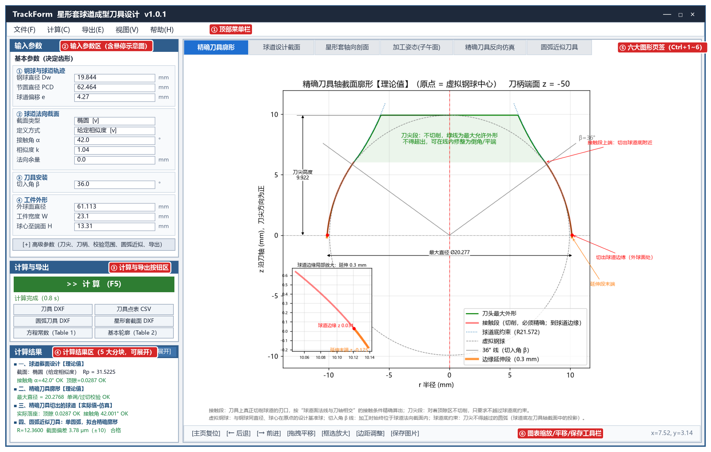
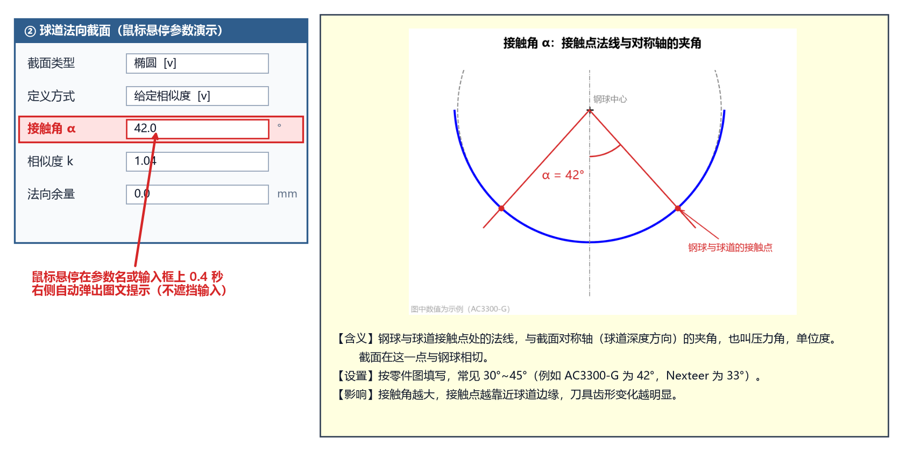
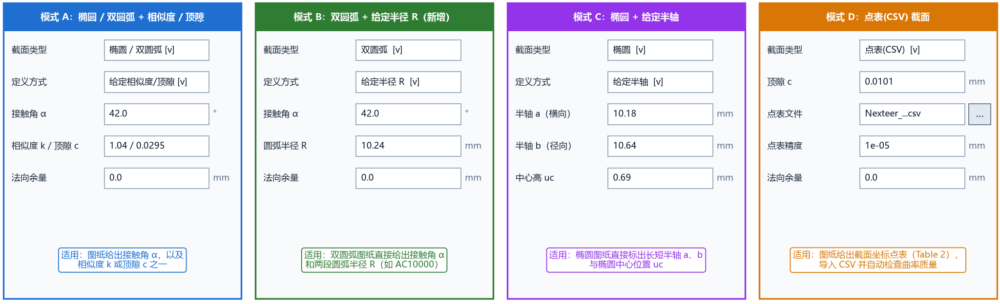
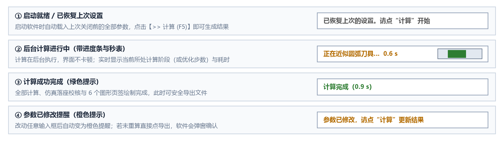

# 界面布局与基本操作

TrackForm 采用直观的**“左控右图”**工程界面布局：左侧集中完成参数输入、计算触发、文件导出与数值结果核对；右侧通过 6 个专业图形页签全方位展示刀具廓形、球道截面、零件剖面、加工姿态与偏差曲线。

## 1. 六大功能分区概览

对照上图中的红色编号徽标，主界面分为以下六个区域：

| 区域编号与名称 | 核心功能与操作说明 |
| :--- | :--- |
| **① 顶部菜单栏** | 包含 **文件(F)**、**计算(C)**、**导出(E)**、**视图(V)**、**帮助(H)** 五大菜单，提供参数载入/保存、内置示例调用（`AC3300-G`、`AC10000`、`Nexteer_34205673`、`AC0706-E`）、恢复默认设置、页签切换、一键打开**用户操作手册（在线）**与打开数据目录等功能。 |
| **② 输入参数区** | 按 `参数名称 \| 输入框 \| 单位` 三列整齐排列。上方为决定刀具齿形的 **基本参数**（4 个分组，19 项），下方为可点击展开/折叠的 **▸ 高级参数**（6 个分组，18 项）。面板高度随内容自适应，超出屏幕时支持鼠标滚轮平滑滚动。 |
| **③ 计算与导出区** | 顶部为醒目的绿色 **▶ 计算 (F5)** 大按钮；中间为实时状态栏与进度条；下方为两列排布的 **6 个导出按钮**（一键导出 3 种 DXF 图纸与 3 种 CSV 表格）。 |
| **④ 计算结果区** | 按 **5 大分块**清晰输出：**一、球道截面设计【理论值】**、**二、精确刀具廓形【理论值】**、**三、精确刀具切出的球道【实际值·仿真】**（含钢球实际落座测量）、**四、圆弧近似刀具**（支持单圆弧与多段相切圆弧，含实际落座审核）、**五、轮廓方程常数 Table 1**，且每个分块下方均配有灰字术语定义小注。点击标题栏右侧的 **⤢ 展开** 按钮（或**双击文本框**）可在独立宽窗口中查看并一键复制。 |
| **⑤ 六大图形页签** | 包含 **精确刀具廓形**、**球道设计截面**、**星形套轴向剖面**、**加工姿态(子午面)**、**精确刀具反向仿真**、**圆弧近似刀具** 6 个页签，支持鼠标点击或按快捷键 `Ctrl+1` ~ `Ctrl+6` 快速切换；每个页签底部还配有灰字小注解释该图中首次出现的术语。 |
| **⑥ 图表导航工具栏** | 位于每个图形页签底部，提供**主页复位**、**前后视图回退**、**拖拽平移**、**框选局部放大**、**边距调整**与**单张图片保存**功能；右侧实时显示鼠标所在位置的精确坐标 `(x, y)`。 |

---

## 2. 四项高效交互设计

### （1）鼠标悬停查看“参数示意图 + 说明卡片”

填写参数时如果对某个尺寸的定义或图纸位置不确定，只需将**鼠标指针悬停在参数名称或输入框上约 0.4 秒**，参数栏右侧就会自动弹出图文提示卡片：

- **上方高清几何示意图**：基于真实星形套与刀具几何绘制，并用**鲜艳的红色（`#d62728`）**精准标出当前参数在球道、工件或刀具上的几何位置。
- **下方结构化说明**：按 **【含义】**（物理定义与单位）、**【设置】**（如何对照零件图填写及常见数值范围）、**【影响】**（修改该参数会对刀具齿形或校验结果产生什么影响）三段清晰呈现。
- **不遮挡输入**：提示卡片固定显示在左侧参数框的右外侧，绝不遮挡您正在编辑的输入框；点击输入框开始打字或移开鼠标时自动收起。
- **导出按钮同样支持悬停提示**：将鼠标悬停在下方 6 个导出按钮上，也会弹出该导出文件的具体内容说明。

### （2）参数智能显隐（只显示当前起作用的项）

- 在 **② 球道法向截面** 分组中，当您切换 `截面类型`（`椭圆` / `双圆弧` / `点表(CSV)`）时，`定义方式` 下拉框会自动过滤为该截面适用的选项（例如选 `椭圆` 时提供 `给定相似度 / 给定顶隙 / 给定半轴`；选 `双圆弧` 时提供 `给定相似度 / 给定顶隙 / 给定半径 R`），并自动隐藏无关输入框，**只保留当前模式下需要您填写的项**：

- 在 **▸ 高级参数 → 圆弧近似** 分组中，当 `圆弧段数` 选 `1`（单圆弧）时会显示 `单圆弧求法`（`拟合精确廓形` / `按审核优化`）；当 `圆弧段数` 选 `2 ~ 5`（多段相切圆弧）时会自动隐藏 `单圆弧求法`。

### （3）贴心的输入容错与防误触设计

- **中英文小数点自动兼容**：在中文输入法状态下不小心把小数点打成了中文逗号 `，` 或英文逗号 `,`（例如输入 `19，844`），软件在计算时会自动将其识别为标准小数点 `19.844`，无需反复切换输入法。
- **滚轮防误改下拉框**：在左侧参数区使用鼠标滚轮上下滚动浏览参数时，即使鼠标经过下拉选择框，**也只会滚动面板而不会误改动下拉框的选项**。

### （4）清晰的状态栏颜色反馈与导出防呆

状态栏位于绿色 **▶ 计算 (F5)** 按钮正下方，通过不同颜色和文字实时反馈软件当前状态：

- **启动时自动恢复上次设置**：软件启动时自动载入上次关闭前的参数，状态栏显示 `已恢复上次的设置。请点“计算”开始`。
- **后台多线程计算不卡顿**：点击计算后，右侧出现动态进度条，状态栏依次显示当前阶段（`正在计算刀具廓形…` $\rightarrow$ `正在过切校验…` $\rightarrow$ `正在反向仿真…` $\rightarrow$ `正在近似圆弧刀具…` / `正在按审核优化圆弧（第 N 步）…` $\rightarrow$ `正在计算轮廓方程常数…`）及实时秒表，计算期间窗口仍可正常拖动或展开查看。
- **未重算与异常导出防呆保护**：只要您改动了任何一个参数输入框，状态栏立即变为橙色提示 `参数已修改，请点“计算”更新结果`。如果您忘记点击“计算”就直接点导出按钮，或者当前计算结果存在异常报警（如刀尖截断导致实际顶隙不足、过切、圆弧刀具超差、实际接触角/跨距/顶隙超出范围），软件在导出前都会弹出确认对话框提醒您，防止误将过期或不合格的刀具图纸发往车间。
