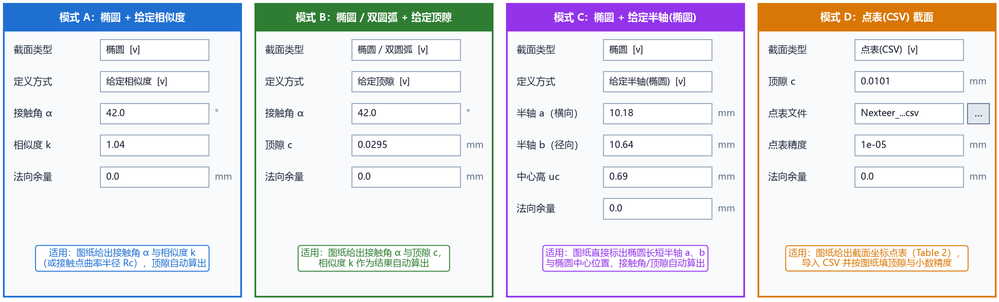

# 基本参数设置

在主界面左侧的 **输入参数** 面板中，上方区域为 **基本参数（决定齿形）**。只要零件图纸和刀具安装角度确定，这一区域的设置将直接决定星形套球道的几何尺寸、空间形状以及成型刀具切削刃口的形状和长度。

---

## 1. 基本参数分组总览

基本参数按照从“球道轨迹 $\rightarrow$ 法向截面 $\rightarrow$ 刀具姿态 $\rightarrow$ 零件外形”的工程识图顺序分为 4 个分组，共 **18 个参数项**：

| 分组名称 | 包含参数 | 核心作用 |
| :--- | :--- | :--- |
| **[① 钢球与球道轨迹](track_params.md)** | `钢球直径 Dw`、`节圆直径 PCD`、`球道偏移 e` | 决定传动钢球尺寸，以及钢球中心沿球道摆动运动的轨迹圆弧半径 $R_p$。 |
| **[② 球道法向截面](section_params.md)** | `截面类型`、`定义方式`、`接触角 α`、`相似度 k`、`顶隙 c`、`半轴 a/b`、`中心高 uc`、`点表文件`、`点表精度`、`法向余量` | 决定球道垂直于中心线切开的法向截面形状（支持**椭圆**、**双圆弧(尖底)**、**点表(CSV)**三种模式）及精加工/半精加工单边余量。 |
| **[③ 刀具安装](tool_and_part_params.md)** | `切入角 β` | 决定成型刀相对球道法向截面的安装倾角（如常用的 $36^\circ$），直接改变刀具齿形。 |
| **[④ 工件外形](tool_and_part_params.md)** | `外球面直径`、`工件宽度 W`、`球心至端面 H` | 决定球道在星形套外球面上的开口边界与两端面范围，从而确定刀具切削接触段需要加工到多高（不改变齿形曲线本身的弯曲形状）。 |

---

## 2. 不同零件图纸的参数填写模式速查

拿到一张星形套产品图时，请先查看图纸上是如何定义**球道法向截面**的，然后在 **② 球道法向截面** 中选择对应的模式（软件会自动隐藏当前模式用不到的输入框）：

| 图纸上的标注方式 | 软件中的选择 | 需要您填写的截面参数 | 自动作为结果算出的项 |
| :--- | :--- | :--- | :--- |
| **椭圆球道**，标注了接触角（如 $42^\circ$）与相似度（如 $1.04$）或接触点曲率半径 | `截面类型 = 椭圆` `定义方式 = 给定相似度` | `接触角 α`、`相似度 k` | 椭圆半轴 $a, b$、中心高 $u_c$、**顶隙 $c$** |
| **椭圆球道**，标注了接触角（如 $42^\circ$）与顶隙（如 $0.0295\text{ mm}$） | `截面类型 = 椭圆` `定义方式 = 给定顶隙` | `接触角 α`、`顶隙 c` | 椭圆半轴 $a, b$、中心高 $u_c$、**相似度 $k$** |
| **椭圆球道**，直接标出横向半轴 $a$、径向半轴 $b$ 及椭圆中心位置 | `截面类型 = 椭圆` `定义方式 = 给定半轴(椭圆)` | `半轴 a`、`半轴 b`、`中心高 uc` | **接触角 $\alpha$**、**相似度 $k$**、**顶隙 $c$**、钢球贴合间隙 |
| **双圆弧（哥特式尖底）球道**，标注了接触角与相似度（或圆弧半径 $R$） | `截面类型 = 双圆弧(尖底)` `定义方式 = 给定相似度` | `接触角 α`、`相似度 k` | 圆弧半径 $R$、交叉圆心坐标、**顶隙 $c$** |
| **双圆弧（哥特式尖底）球道**，标注了接触角与顶隙 | `截面类型 = 双圆弧(尖底)` `定义方式 = 给定顶隙` | `接触角 α`、`顶隙 c` | 圆弧半径 $R$、交叉圆心坐标、**相似度 $k$** |
| **点表球道**，图纸附有基本轮廓坐标表（如 `Table 2: No, Z, Y`） | `截面类型 = 点表(CSV)` | `顶隙 c`、`点表文件`、`点表精度` | **接触角 $\alpha$**、**相似度 $k$**、钢球最小间隙、光顺偏差 |

