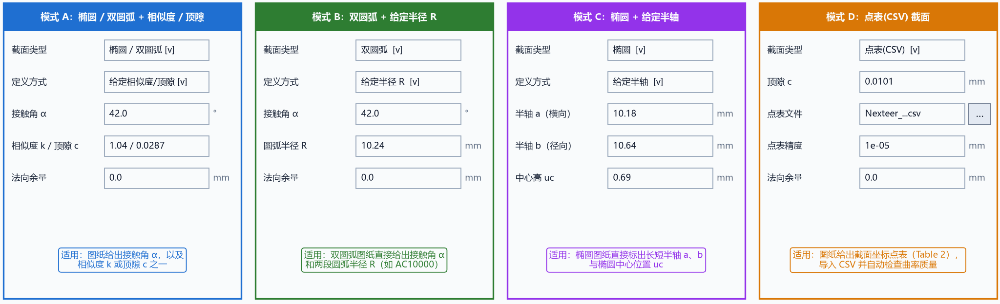

# 基本参数设置

在主界面左侧的 **输入参数** 面板中，上方区域为 **基本参数（决定齿形）**。

本区域共包含 **4 个分组、21 项参数**：一旦确定了万向节工件类型、零件图纸尺寸与刀具安装倾角，这些参数将直接决定球道几何形状、三维包络切削范围以及成型刀具切削刃口的完整廓形。

---

## 1. 基本参数分组总览

基本参数按照**“工件与球道轨迹 $\rightarrow$ 法向截面 $\rightarrow$ 刀具安装 $\rightarrow$ 工件外形”**的工程识图顺序分为 4 个分组（共 **21 项**）：

| 分组名称 | 包含参数 | 核心作用 |
| :--- | :--- | :--- |
| **[① 钢球与球道轨迹](track_params.md)**（5 项） | `工件类型`、`钢球直径 Dw`、`节圆直径 PCD`、`球道偏移 e`、`球道斜角 γ` | 选定 6 种万向节构件形式（内/外圈、固定/伸缩、直/斜球道），确定钢球尺寸与球道中心轨迹特性。 |
| **[② 球道法向截面](section_params.md)**（12 项） | `截面类型`、`定义方式`、`接触角 α`、`相似度 k`、`顶隙 c`、`半轴 a`、`半轴 b`、`中心高 uc`、`圆弧半径 R`、`点表文件`、`点表精度`、`法向余量` | 决定垂直于球道中心线切开的法向截面形状（**椭圆** / **双圆弧** / **点表(CSV)**）及精/半精加工法向余量。 |
| **[③ 刀具安装](tool_and_part_params.md)**（1 项） | `切入角 β` | 决定成型刀相对球道法向截面的安装倾角（如 $36^\circ$），显著影响刀具齿形。 |
| **[④ 工件外形](tool_and_part_params.md)**（3 项） | `外球面直径`、`工件宽度 W`、`球心至端面 H`（标签随 `工件类型` 自动适配） | 决定球道开口边界与工件两端面范围，限定红色切削接触段起点及外框防干涉检查边界。 |

---

## 2. 不同零件图纸的参数填写模式速查

拿到产品图纸时，按以下步骤快速匹配截面填写方式（软件会自动筛选并隐藏当前模式下用不到的输入框）：

1. 先在 **① 钢球与球道轨迹** 中选定 **`工件类型`**（如 `星形套（固定节）`、`斜筒形壳（VL 斜球道）` 等）；
2. 查看图纸上如何标注 **② 球道法向截面**，对照下表选择 **`截面类型`** 与 **`定义方式`**：

| 图纸上的标注方式 | 软件中的选择 | 需要您填写的截面参数 | 自动作为结果算出的项 |
| :--- | :--- | :--- | :--- |
| **椭圆球道**，标注接触角（如 $42^\circ$）与相似度（如 $1.04$）或曲率半径 | `截面类型 = 椭圆` `定义方式 = 给定相似度` | `接触角 α`、`相似度 k` | 椭圆半轴 $a, b$、中心高 $u_c$、**顶隙 $c$**、**接触角跨距** |
| **椭圆球道**，标注接触角（如 $42^\circ$）与顶隙（如 $0.0287\text{ mm}$） | `截面类型 = 椭圆` `定义方式 = 给定顶隙` | `接触角 α`、`顶隙 c` | 椭圆半轴 $a, b$、中心高 $u_c$、**相似度 $k$**、**接触角跨距** |
| **椭圆球道**，直接标出横向半轴 $a$、径向半轴 $b$ 及椭圆中心位置 | `截面类型 = 椭圆` `定义方式 = 给定半轴` | `半轴 a`、`半轴 b`、`中心高 uc` | **接触角 $\alpha$**、**相似度 $k$**、**顶隙 $c$**、**接触角跨距** |
| **双圆弧（尖底）球道**，标注接触角（如 $42^\circ$）与圆弧半径 $R$（如 $10.24\text{ mm}$） | `截面类型 = 双圆弧` `定义方式 = 给定半径 R` | `接触角 α`、`圆弧半径 R` | 交叉圆心坐标、**相似度 $k$**、**顶隙 $c$**、**接触角跨距** |
| **双圆弧（尖底）球道**，标注接触角与相似度 | `截面类型 = 双圆弧` `定义方式 = 给定相似度` | `接触角 α`、`相似度 k` | **圆弧半径 $R$**、交叉圆心坐标、**顶隙 $c$**、**接触角跨距** |
| **双圆弧（尖底）球道**，标注接触角与顶隙 | `截面类型 = 双圆弧` `定义方式 = 给定顶隙` | `接触角 α`、`顶隙 c` | **圆弧半径 $R$**、交叉圆心坐标、**相似度 $k$**、**接触角跨距** |
| **点表球道**，图纸附有基本轮廓坐标表（如 `Table 2: No, Z, Y`） | `截面类型 = 点表(CSV)` | `顶隙 c`、`点表文件`、`点表精度` | **接触角 $\alpha$**、**相似度 $k$**、**接触角跨距**、钢球最小间隙、曲率质量校验 |
