# ② 球道法向截面

**球道法向截面**是指垂直于钢球中心轨迹圆弧切开的球道横截面。本组参数直接决定了球道槽的几何形状、钢球与球道的接触状态以及精加工/半精加工余量。

---

## 1. 截面类型

* **可选项**：`椭圆` / `双圆弧(尖底)` / `点表(CSV)`
* **默认值**：`椭圆`
* **参数含义**：选择球道法向截面的几何曲线类型。

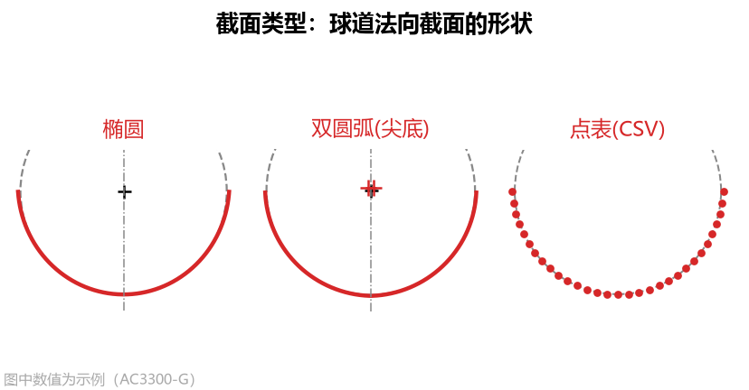

* **三种类型对比与选择依据**：
  1. **椭圆**：标准椭圆截面，椭圆中心位于截面对称轴上。这是球笼式万向节星形套**最常用**的球道形式，既能保证良好的接触应力分布，又非常适合使用**单圆弧近似刀具**加工。
  2. **双圆弧(尖底)**：又称哥特式（Gothic）圆弧截面，由左右两段等半径圆弧交叉而成，两侧圆心交叉到对称轴另一侧，球道底部交汇形成一个尖点棱线。
     > **重要提示**：双圆弧（尖底）截面在底部存在折角尖点，**无法使用单圆弧近似刀具加工**（单圆弧页签会标红提示超差），必须导出 **刀具 DXF** 或 **刀具点表 CSV** 按精确成型刀廓形磨刀。
  3. **点表(CSV)**：当客户产品图纸没有给出椭圆或双圆弧参数，而是直接给出一张球道截面坐标点表（如图纸上的 `Table 2 Basic Profile`）时选用。

---

## 2. 定义方式（椭圆 / 双圆弧模式可见）

* **可选项**：`给定相似度` / `给定顶隙` / `给定半轴(椭圆)`
* **默认值**：`给定相似度`
* **参数含义**：在椭圆或双圆弧截面下，由于曲线在接触角 $\alpha$ 处与钢球相切，还剩下一个几何自由度，需根据图纸标注的已知条件选择求解方式。

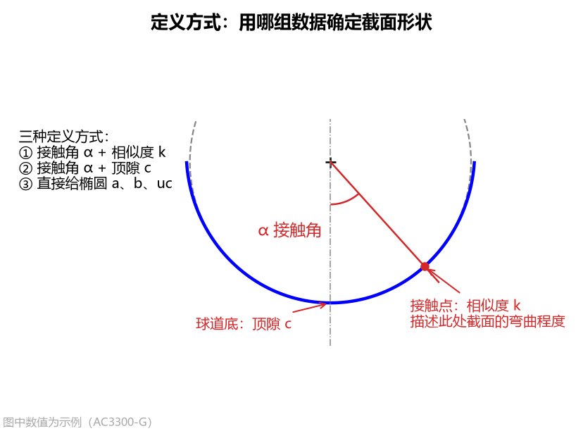

* **设置指南**：
  * **给定相似度**：图纸给出了**接触角 $\alpha$** 和**相似度 $k$**（或接触点处的截面曲率半径 $R_c$）时选用。此时软件自动算出**顶隙 $c$**。
  * **给定顶隙**：图纸给出了**接触角 $\alpha$** 和**球道底顶隙 $c$** 时选用。此时软件自动算出**相似度 $k$**。
  * **给定半轴(椭圆)**：仅在选择 `椭圆` 截面时可用。当图纸直接标出了椭圆的横向半轴 $a$、径向半轴 $b$ 和中心高 $u_c$ 时选用；此时接触角、相似度、顶隙全部由软件自动算出。

---

## 3. 接触角 α

* **单位**：`°`（度）
* **默认值**：`42.0`
* **可见条件**：`椭圆` 或 `双圆弧(尖底)` 截面，且定义方式为 `给定相似度` 或 `给定顶隙` 时可见。
* **参数含义**：钢球与球道侧面接触点处的法线，与截面对称轴（球道深度方向）之间的夹角，图纸上也常称为**压力角（Pressure Angle）**。球道截面在该角度方向上与钢球精确相切。

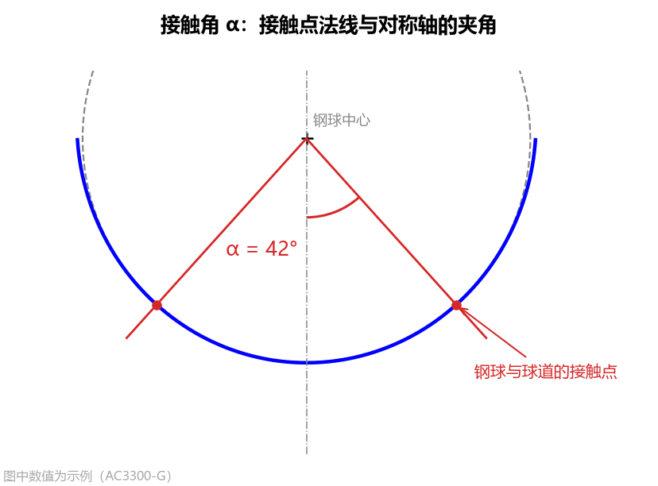

* **设置方法**：按零件图纸标定的名义接触角填写，常见范围为 `30° ~ 45°`（例如 AC3300-G 图纸为 `42°`，AC0706-E 图纸为 `36°`，Nexteer 图纸为 `33°`）。
* **对结果的影响**：接触角 $\alpha$ 越大，钢球与球道的接触点越靠近球道开口边缘，球道底部顶隙随之变化，刀具齿形变化越显著。

---

## 4. 相似度 k

* **单位**：无量纲（比值）
* **默认值**：`1.04`
* **可见条件**：定义方式为 `给定相似度` 时可见。
* **参数含义**：钢球接触点处球道截面的弯曲半径（曲率半径 $R_c$）与钢球半径（$D_w / 2$）的比值，也称为**密合度（Conformity）**。$k = 1$ 表示截面与钢球完全贴合；$k > 1$ 表示球道曲率半径大于钢球半径。

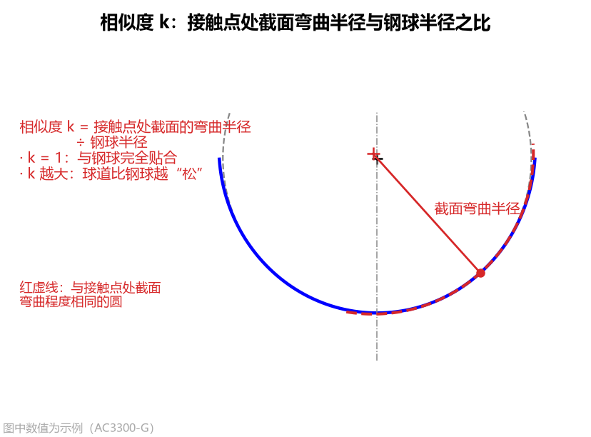

* **设置方法与图纸换算**：
  * 如果图纸直接标明了相似度（如 `1.04`、`1.035`），直接填入即可（常见范围 `1.01 ~ 1.10`，双圆弧截面必须 $> 1.0$）。
  * **图纸只标“接触点曲率半径 $R_c$”时的换算公式**：
    $$k = \frac{R_c}{D_w / 2} = \frac{2 R_c}{D_w}$$
    **换算示例**：若图纸标注钢球直径 $D_w = 21.4313\text{ mm}$（半径 $10.71565\text{ mm}$），接触角处曲率半径为 $11.123\text{ mm}$，则相似度 $k = 11.123 \div 10.71565 = 1.0380$，填入 `1.038` 即可。

### 相似度 k 调整前后的效果对比

下图对比了保持其他参数不变，将 `相似度 k` 分别设为 `1.02`、`1.04`、`1.08` 时球道底顶隙和刀具接触段的变化：

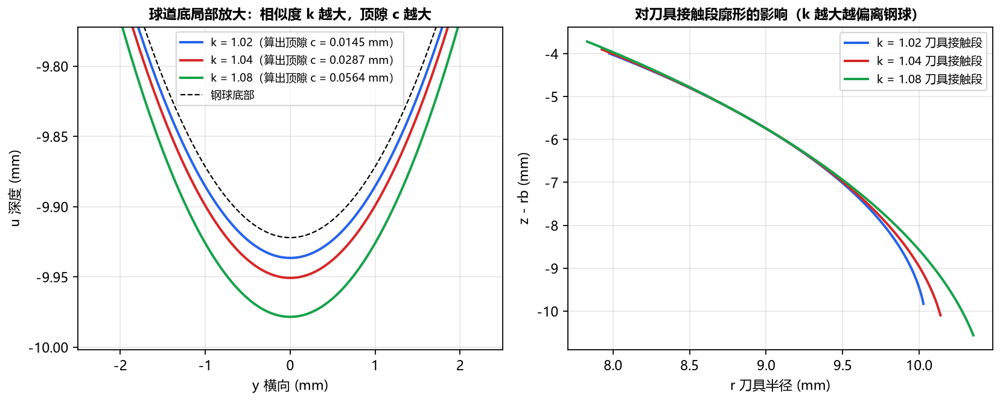

可以看到，**相似度 $k$ 越大，球道相对钢球越“宽松”，算出的球道底顶隙 $c$ 越大**，同时刀具接触段廓形偏离标准球面的程度也越大。

---

## 5. 顶隙 c

* **单位**：$\text{mm}$
* **默认值**：`0.0295`
* **可见条件**：定义方式为 `给定顶隙` 时，或截面类型为 `点表(CSV)` 时可见。
* **参数含义**：当钢球与球道两侧面正常接触时，钢球最低点与球道底部之间的径向间隙（即：钢球中心到球道底的距离减去钢球半径 $D_w/2$）。

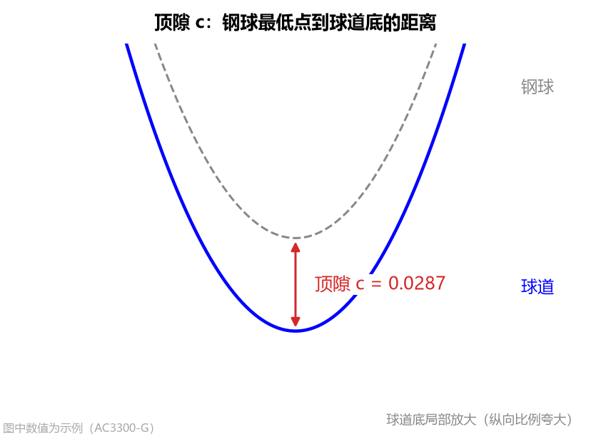

* **在两种模式下的不同作用与设置方法**：
  1. **在“给定顶隙”模式下**：它是确定椭圆或双圆弧形状的输入条件（通常取图纸顶隙公差带的中间名义值，如 `0.0295`），软件据此反算出相似度 $k$。
  2. **在“点表(CSV)”模式下（极其重要）**：由于导入的点表坐标是以球道底为原点（$Y=0$）向上测量的，软件需要用您填写的 `顶隙 c` 来确定钢球中心在点表中的高度（钢球中心距球道底距离 = 钢球半径 + 顶隙）：
     * **如何填写**：请务必按该点表图纸上规定的名义顶隙填写（例如 Nexteer 34205673 填 `0.0101`；若图纸标注了钢球中心距球道底距离，用该距离减去钢球半径即可得到顶隙）。
     * **填错提醒**：如果 `顶隙 c` 填得与点表实际几何不匹配，计算结果栏会标红提示 **`钢球未与截面贴合，请核对顶隙/椭圆中心！`** 或 **`钢球与截面干涉！`**。

---

## 6. 椭圆半轴 a、半轴 b 与中心高 uc（仅“给定半轴”模式可见）

当 `截面类型` 选 `椭圆` 且 `定义方式` 选 `给定半轴(椭圆)` 时，直接通过以下三个参数确定椭圆截面尺寸：

### （1）半轴 a（横向）
* **单位**：$\text{mm}$（默认 `10.18`）
* **含义与设置**：椭圆在球道宽度方向（横向 $y$）的半轴长度，按零件图填写，通常略大于钢球半径。

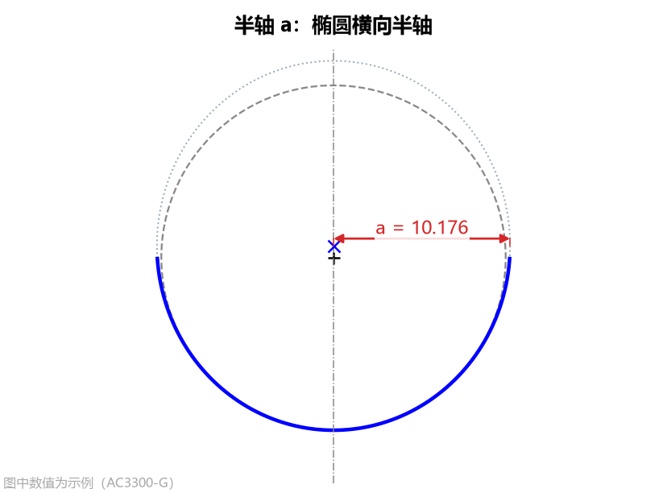

### （2）半轴 b（径向）
* **单位**：$\text{mm}$（默认 `10.64`）
* **含义与设置**：椭圆在球道深度方向（径向 $u$）的半轴长度，按零件图填写。$a$ 与 $b$ 的大小关系决定了椭圆截面是偏宽还是偏深。

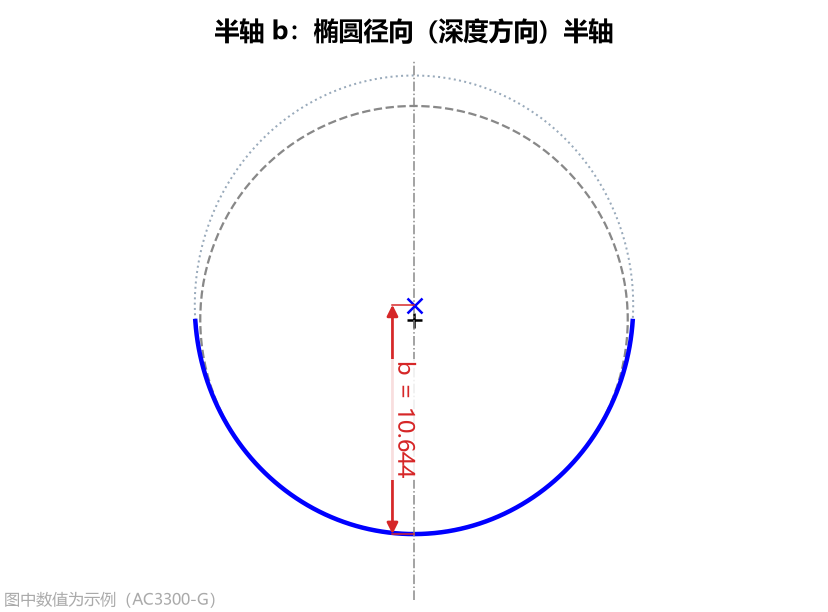

### （3）中心高 uc
* **单位**：$\text{mm}$（默认 `0.69`）
* **含义**：椭圆中心相对于钢球中心沿对称轴的距离，**朝球道开口方向（位于钢球中心上方/离开球道底）为正**。

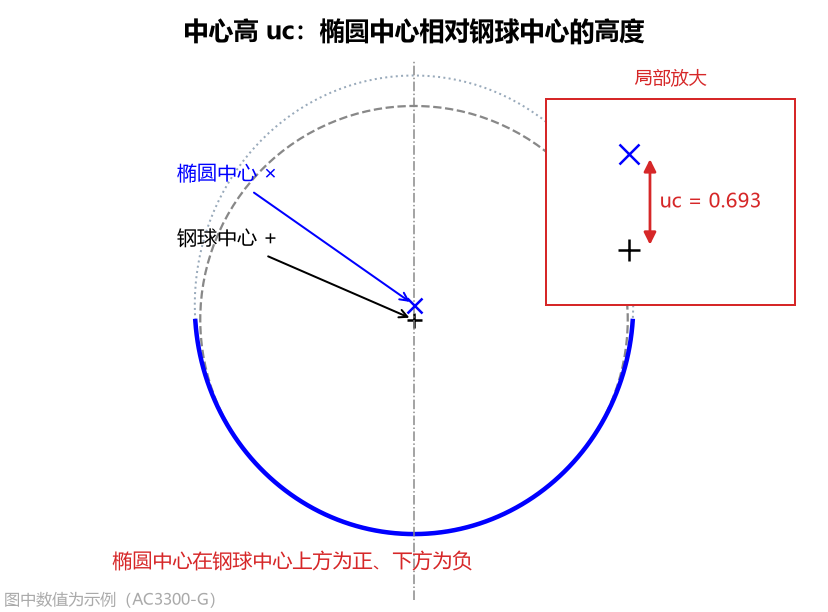

* **设置与换算方法**：
  * 按零件图换算填写：用椭圆中心到球道底的距离（即径向半轴 $b$），减去钢球半径和顶隙即可得到 `中心高 uc`。
  * **自动贴合校验**：计算后，软件会自动搜寻钢球与该椭圆的接触点；如果 $u_c$ 填得不合适导致钢球悬空或卡入椭圆壁面，结果栏会标红提示 `钢球未与截面贴合`（$u_c$ 偏小）或 `钢球与截面干涉`（$u_c$ 偏大）。

---

## 7. 点表文件与点表精度（仅“点表(CSV)”模式可见）

当 `截面类型` 选择 `点表(CSV)` 时，用于导入外部坐标文件并控制曲线光顺程度。

### （1）点表文件
* **操作方式**：点击输入框右侧的 **`…`** 按钮，在文件对话框中选择球道截面坐标文件（支持 `.csv`、`.txt`、`.dat`）。

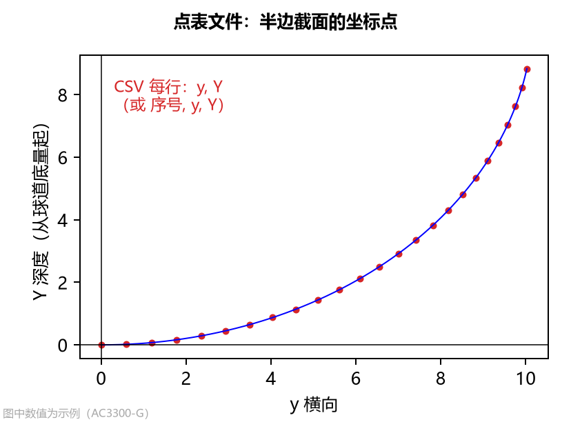

* **点表文件格式要求与智能识别规则**：
  软件对点表格式具有极强的兼容性，您无需繁琐修改表头即可直接导入：
  1. **列格式（支持 2 列或 3 列）**：
     * **两列格式**：每行两个数 `横向坐标 y, 深度 Y`（深度 $Y$ 从球道底量起，朝球道开口方向为正，单位 $\text{mm}$）。
     * **三列格式（同客户图纸 Table 2）**：每行三个数 `序号 No, 横向 Z, 深度 Y`，软件会自动取最后两列作为 `(横向, 深度)`！因此软件导出的 `基本轮廓 CSV（Table 2）` 可以一字不改直接再作为点表导入。
  2. **分隔符**：逗号 `,`、空格、制表符（Tab）或分号 `;` 均可自动识别。
  3. **表头与注释**：文件中包含的文字表头、空行或以 `#` 开头的注释行会自动跳过（有效数值行不少于 5 行即可）。
  4. **半边或全截面均可**：可以只给右半边（横向 $y \ge 0$），也可以只给左半边（$y \le 0$，自动镜像翻正），或给完整的左右对称截面。
  5. **自动归零与补底点**：深度方向会自动以最低点归零；如果点表第一点不在对称轴（$y=0$）上，软件会按偶函数对称特性自动在 $y=0$ 处外推补齐球道底点。

* **点表文件标准内容示例**：
  ```text
  # 示例：球道半边截面点表（支持两列 y, Y 或三列 No, Z, Y）
  No, Z(±), Y
  1, 0.00000, 0.00000
  2, 0.12287, 0.00088
  3, 0.24574, 0.00351
  ...
  116, 8.94812, 9.12450
  117, 8.95004, 9.23715
  ```

### （2）点表精度
* **单位**：$\text{mm}$
* **默认值**：`1e-05`（即 $0.00001\text{ mm}$）
* **参数含义**：点表坐标数据本身的舍入误差或三坐标测量误差量级，用于对离散点表做样条光顺处理。

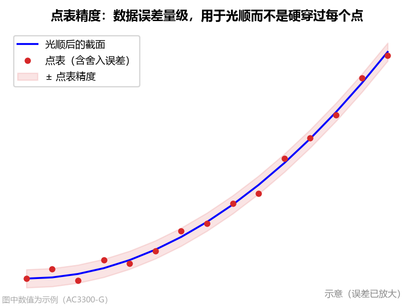

* **为什么要设置点表精度（光顺 vs 硬插值对比）**：
  图纸上的点表坐标通常只保留到小数点后 4 位或 5 位，存在微小的截断舍入误差。而空间包络计算出的**刀具廓形对球道截面的曲率变化极其敏感**——如果直接硬性穿过每一个带舍入误差的点（即设 `点表精度 = 0`），微小的坐标舍入误差会被放大成截面曲率的剧烈抖动，进而导致算出的刀具刃口出现波纹！

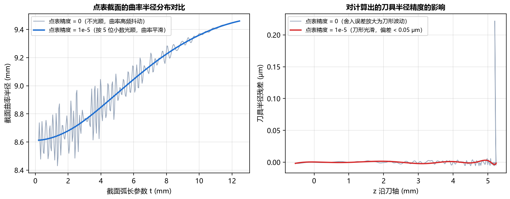

* **设置指南**：
  * **5 位小数点表**（如 `0.12287`，最常见客户图纸）：保持默认 `1e-05`（或输入 `0.00001`）。
  * **4 位小数点表**（如 `0.1229`）：请设为 `1e-04`（或 `0.0001`）。
  * **三坐标实测点表**：按测量机的实际测量精度填写（如 `0.001`）。
  * **质量自动检查**：若球道底到接触点之间的点表数据存在缺点（被线性插值）或明显错行，导致曲率异常起伏甚至反向凸起，计算结果栏会标红发出警告提醒您核查点表。

---

## 8. 法向余量

* **单位**：$\text{mm}$
* **默认值**：`0.0`
* **参数含义**：球道截面沿法线方向（朝球道内部/钢球方向）整体均匀偏置的单边留料量。

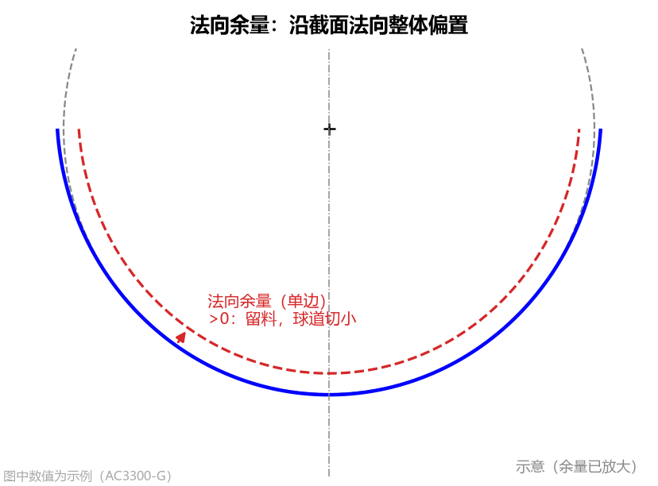

* **设置方法**：
  * **精加工刀具（一次干到位）**：填 `0.0`。
  * **粗加工 / 半精加工刀具（需给后续精密磨削或精铣留余量）**：填入正的单边余量值，例如留单边 $0.15\text{ mm}$ 余量就填 `0.15`（负值则表示过切多切）。

### 法向余量对球道与刀具的影响对比

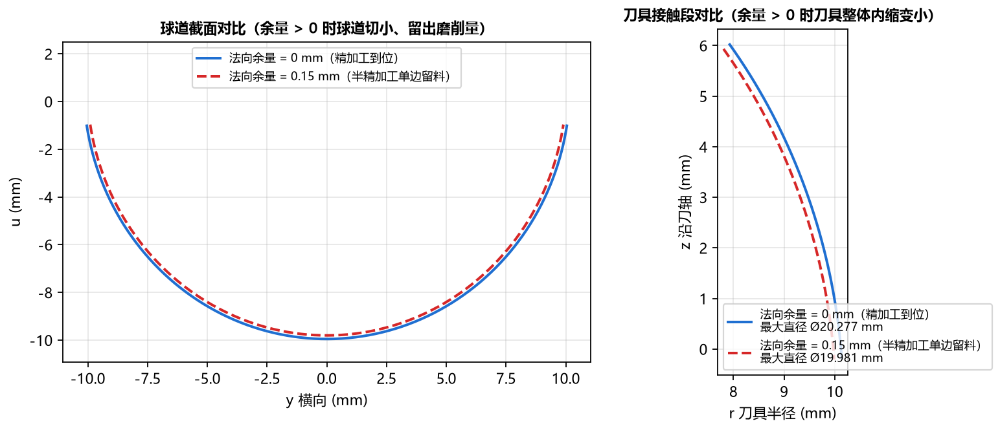

- 当 `法向余量 > 0` 时，加工出的球道槽比最终设计截面小一圈（留出材料），因此计算出的**成型刀具半径也相应内缩变小**。
- 为了方便您核对图纸，左下“计算结果”面板中显示的 `相似度` 和 `顶隙` 始终是扣除余量后的名义设计值，而右侧 **球道截面** 页签标题会明确标注 `（含法向余量 0.15）`。
