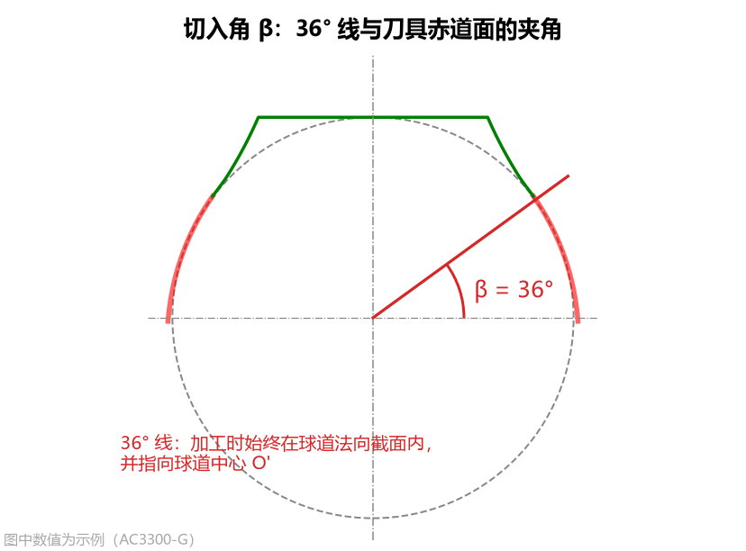
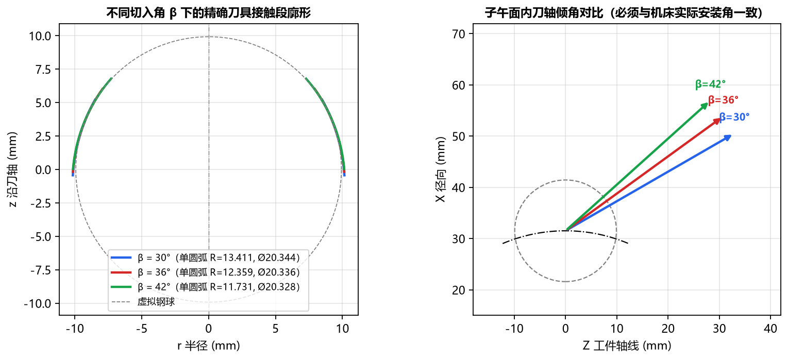
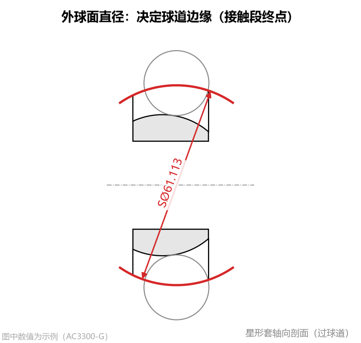
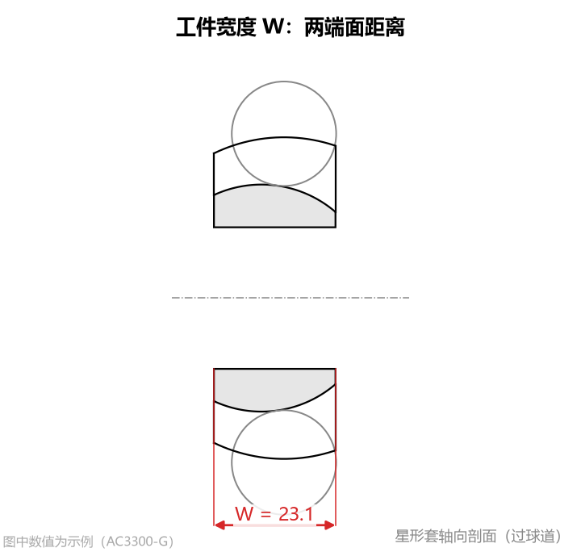
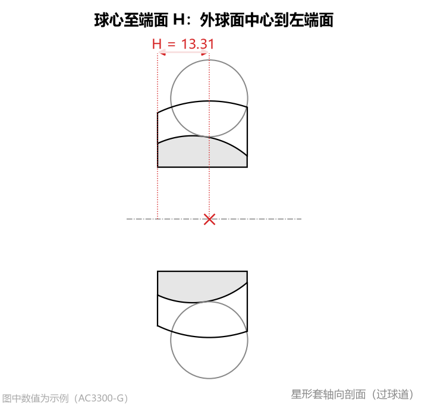

# ③ 刀具安装与 ④ 工件外形

在确定了球道轨迹和法向截面之后，还需要指定**成型刀具在机床上的安装倾角（切入角）**以及**星形套工件的外形边界尺寸**，以最终算出完整的刀具切削接触段。

---

## 1. ③ 刀具安装：切入角 β

* **单位**：`°`（度）
* **默认值**：`36.0`
* **参数含义**：成型刀具加工球道时的安装倾角。在刀具上，从**虚拟钢球中心（刀具原点）**出发、与**刀具赤道面（垂直于刀轴的横截面）**夹角为 $\beta$ 的那条基准线（工程上常称为“$36^\circ$ 线”），在加工摆动过程中**始终位于球道法向截面内，并指向球道中心 $O'$**。此时刀轴与球道径向的夹角为 $90^\circ - \beta$。

* **设置方法**：
  * 请严格按照机床摆头方案或刀具图纸规定的主轴切入角填写（允许输入范围 `15° ~ 75°`，行业最常用标准值为 **`36.0°`**）。

### 切入角 β 改变对刀具齿形的影响对比

切入角 $\beta$ 是除球道截面本身外**对刀具齿形影响最大的参数**。下图展示了同一球道在 $\beta = 30^\circ$、$36^\circ$、$42^\circ$ 三种不同切入角下算出的刀具廓形与刀轴倾角对比：

* **重要结论**：
  * 随着切入角 $\beta$ 的改变，刀具接触段的高低范围、弯曲曲率以及拟合出的单圆弧半径 $R$ 和圆柱直径都会发生显著变化（如上图中 $\beta=30^\circ$ 时圆柱直径为 $\varnothing 20.692\text{ mm}$，而 $\beta=42^\circ$ 时变为 $\varnothing 20.063\text{ mm}$）。
  * 因此，**软件中填写的 `切入角 β` 必须与实际数控机床加工程序中的刀轴倾角 100% 一致**，不能混用！

---

## 2. ④ 工件外形

星形套的外球面直径、总宽度和球心位置共同决定了**球道槽在零件上实际存在的范围**。

> **核心规律**：这 3 个工件外形参数**不会改变刀具齿形曲线本身的弯曲形状**，它们只决定球道边缘切到哪里为止——即决定刀具红色切削接触段的**起点位置（靠近刀柄一侧需要做到多长）**以及加工姿态图中球道沿长度方向的**摆角范围**。

### （1）外球面直径
* **单位**：$\text{mm}$
* **默认值**：`61.113`
* **参数含义**：星形套外球面的公称直径（零件图上常标注为 `SØ...`，如 `SØ61.113`）。球道槽侧面与外球面的空间交线就是**球道开口边缘**。

* **设置方法**：
  * 按零件图上的外球面直径填写（必须大于内孔直径，且保证球道能露出外球面）。
  * **特殊情况（仅研究完整圆弧截面时）**：如果客户图纸只给了截面点表（如到圆弧终点 $C_9$ 的 Table 2），没有给具体外球面直径，或者您希望把整段点表全部算进接触段，可以将 `外球面直径` 填为一个足够大的数值（如 `200.0`），此时接触段将一直算到点表末端。
* **对结果的影响**：外球面直径越大，球道槽越深、开口边缘越高，所需的刀具红色接触段（靠刀柄侧）就越长。

### （2）工件宽度 W
* **单位**：$\text{mm}$
* **默认值**：`23.1`
* **参数含义**：星形套沿工件轴线方向的总宽度（左右两个端面之间的轴向距离）。

* **设置方法**：按零件图上的星形套总宽 $W$ 填写。
* **对结果的影响**：与 `球心至端面 H` 一起确定星形套左右两端面的轴向位置，从而决定刀具沿球道摆动加工的起始摆角 $\varphi_{\min}$ 与终止摆角 $\varphi_{\max}$（显示在右侧 **星形套截面** 和 **加工姿态(子午面)** 页签中）。

### （3）球心至端面 H
* **单位**：$\text{mm}$
* **默认值**：`13.31`
* **参数含义**：星形套**外球面中心**到**左端面**（加工基准端面，即图中轴向坐标 $Z$ 较小一侧的端面）的轴向距离。

* **设置方法**：
  * 按零件图上标注的外球面中心至基准端面距离填写。
  * 如果零件外球面关于两端面对称居中，则填写宽度的一半（即 $H = W / 2$）。
  * **注意**：左右两端面到球道中心 $O'$ 的距离不能超出钢球中心轨迹半径 $R_p$，否则软件会提示核对宽度 $W$ 与距离 $H$。

