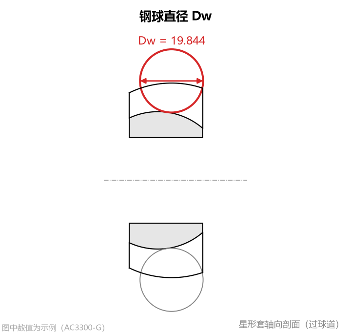
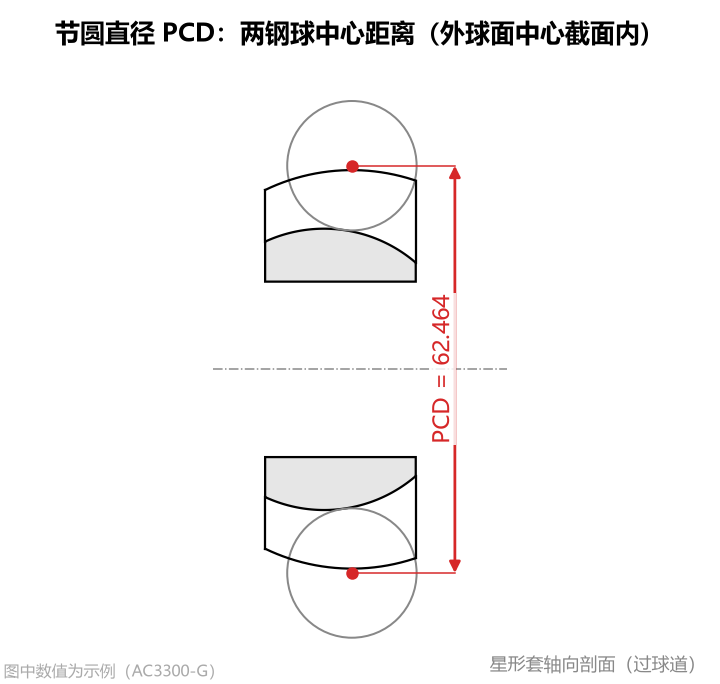
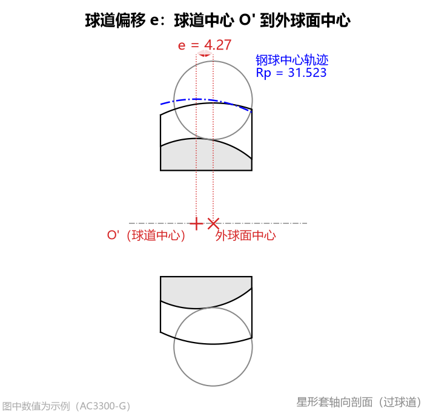

# ① 钢球与球道轨迹

本组参数定义万向节传动钢球的尺寸以及球道沿零件轴向弯曲的基准轨迹，是所有截面和刀具计算的基础。

---

## 1. 钢球直径 Dw

* **单位**：$\text{mm}$
* **默认值**：`19.844`
* **参数含义**：星形套球道内滚动的传动钢球公称直径（图纸上常标为“量规球直径”或“钢球 $\varnothing D_w$”）。它不仅决定了球道截面的基本宽度和深度，也是成型刀具设计时的**“虚拟钢球”（刀具坐标系原点所在的设计基准球）**直径。

* **设置方法**：请严格按照产品零件图填写完整的公制小数（建议保留图纸给出的全部小数位，如 3~4 位小数）。如果图纸只标注了英制钢球规格（英寸分数），请对照下表换算填入：

| 常见英制钢球规格（英寸） | 对应公制直径 `钢球直径 Dw` ($\text{mm}$) |
| :---: | :---: |
| $5/8"$ | `15.875` |
| $11/16"$ | `17.4625` |
| $3/4"$ | `19.050` |
| $25/32"$ | `19.8438` 或 `19.844`（按图纸标注） |
| $27/32"$ | `21.4313` |
| $7/8"$ | `22.225` |

* **对结果的影响**：直接决定球道截面大小和刀具整体直径，是对刀具齿形尺寸影响最大的基础参数。

---

## 2. 节圆直径 PCD

* **单位**：$\text{mm}$
* **默认值**：`62.464`
* **参数含义**：钢球中心所在分布圆的直径（Pitch Circle Diameter），在**外球面中心所在的横截面（垂直于工件轴线的平面）**内测量。

* **设置方法**：
  * **常规图纸**：按零件图上标注的“钢球中心 PCD”或“球心圆 $\varnothing$”直接填写（必须大于钢球直径 $D_w$）。
  * **同心球道图纸**：若图纸直接给出了球道中心轨迹圆弧半径 $R_p$ 且无球道偏移（`球道偏移 e = 0`），则直接按两倍轨迹半径填写即可（例如 Nexteer 34205673 图纸轨迹半径为 $27.9707\text{ mm}$，则填 `PCD = 55.9414`）。
* **对结果的影响**：与 `球道偏移 e` 一起决定钢球中心沿球道运动的轨迹圆弧半径 $R_p$（即球道沿长度方向的纵向弯曲程度）。

---

## 3. 球道偏移 e

* **单位**：$\text{mm}$
* **默认值**：`4.27`
* **参数含义**：球道中心 $O'$（球道沿长度方向弯曲的回转圆心）相对于星形套外球面中心，沿工件轴线方向的偏移距离。正值表示外球面中心位于球道中心 $O'$ 的 $+Z$ 侧。

* **设置方法**：
  * 对于球心偏置型等速万向节（用于在球笼上产生控制角），按零件图上标出的球道中心与外球面中心之间的轴向偏置量填写（常见范围为 `3.0 ~ 6.0 mm`）。
  * 若球道弯曲圆心与外球面中心重合（同心球道），请填 `0`。
* **轨迹半径自动计算**：软件会根据您输入的 `节圆直径 PCD` 和 `球道偏移 e`，自动算出钢球中心绕球道中心 $O'$ 运动的轨迹半径 $R_p$，并显示在左下“计算结果”面板第二行（如 `轨迹半径 Rp = 31.5225`）。
* **对结果的影响**：改变轨迹半径 $R_p$ 以及球道在星形套宽度方向上的轴向位置；对刀具齿形曲线本身的弯曲度影响很小，但会改变两端面处的球道摆角范围。

