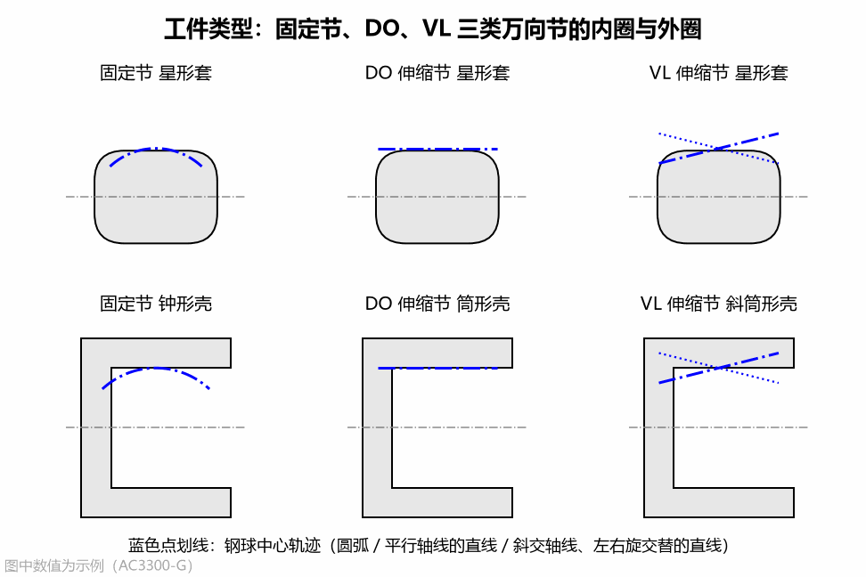
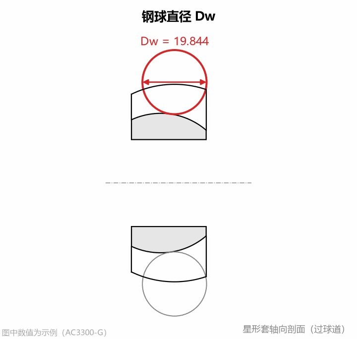
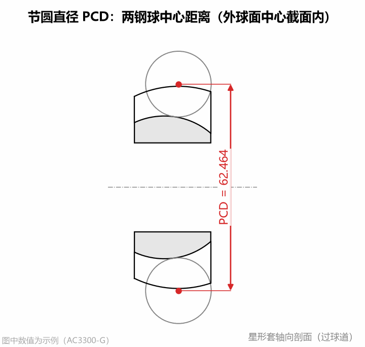
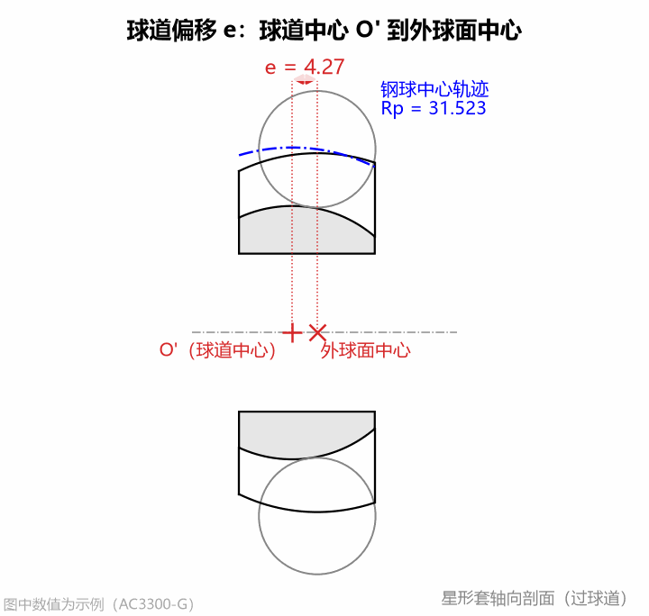
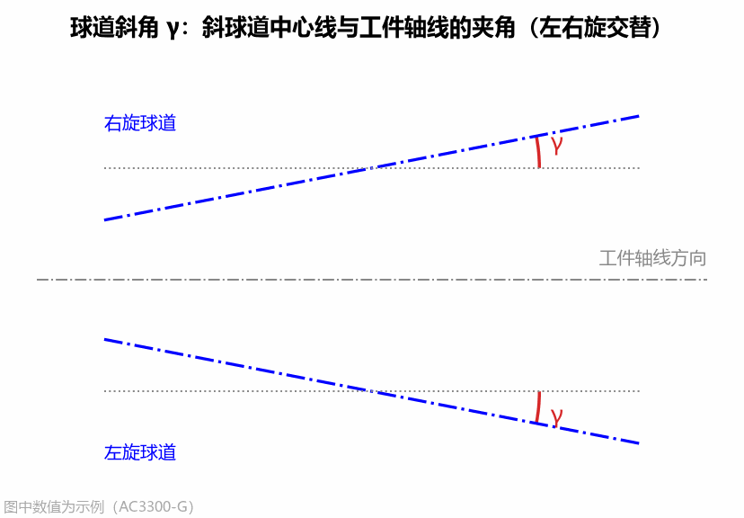

# ① 钢球与球道轨迹

本组包含 **5 项基础参数**，用于确定等速万向节工件类型、传动钢球尺寸以及球道中心线沿零件长度方向的轨迹特征。

---

## 1. 工件类型 (`workpiece`)

* **可选项**：共 6 种等速万向节零件（默认 **`星形套（固定节）`**）
* **参数含义**：选择要加工球道的万向节构件。球笼式等速万向节分为三类结构，每类包含**内圈（材料在内侧，球道在外表面）**与**外圈（材料在外侧，球道在内腔表面）**：

| 下拉框选项 | 万向节类型 | 内圈 / 外圈 | 球道中心线形态 | 球道所在工作面 | 当前开放状态 |
| :--- | :---: | :---: | :--- | :---: | :--- |
| **`星形套（固定节）`**（默认） | 固定节 | 内圈（外表面有槽） | 圆弧（绕球道中心 $O'$ 弯曲） | 外球面 | **完整开放**（计算、7 大图表与全部 6 类导出） |
| **`钟形壳（固定节）`** | 固定节 | 外圈（内腔有槽） | 圆弧（绕球道中心 $O'$ 弯曲） | 内球面 | **开发中**（客户发行版暂未开放；内部版开放试算） |
| **`星形套（DO 直球道）`** | DO 双偏置伸缩节 | 内圈 | 直线（平行于工件轴线） | 外球面 | **开发中**（客户发行版暂未开放；内部版开放试算） |
| **`筒形壳（DO 直球道）`** | DO 双偏置伸缩节 | 外圈 | 直线（平行于工件轴线） | 圆柱内孔 | **开发中**（客户发行版暂未开放；内部版开放试算） |
| **`星形套（VL 斜球道）`** | VL 交叉滑移伸缩节 | 内圈 | 直线（与轴线斜交 $\gamma$，左右旋交替） | 外球面 | **开发中**（客户发行版暂未开放；内部版开放试算） |
| **`斜筒形壳（VL 斜球道）`** | VL 交叉滑移伸缩节 | 外圈 | 直线（与轴线斜交 $\gamma$，左右旋交替） | 圆柱内孔 | **开发中**（客户发行版暂未开放；内部版开放试算） |

* **设置与界面自动适配**：
  * 切换 `工件类型` 后，软件会自动隐藏不适用的参数（如圆柱内孔外圈隐藏 `球道偏移` 与 `内孔直径`），并同步把下方外形标签和提示示意图切换为该零件专属尺寸；
  * 对处于“开发中”的类型，其余内核计算（刀具廓形、反向仿真、圆弧近似、刀颈干涉检查与三维演示）已接入，但零件截面 DXF 与 Table 1 方程常数仍在开发中。

---

## 2. 钢球直径 Dw (`ball_d`)

* **单位**：$\text{mm}$
* **默认值**：`19.844`
* **参数含义**：球道内滚动的传动钢球公称直径（图纸常标“量规球直径”或“钢球 $\varnothing D_w$”），也是刀具坐标系原点处的**“虚拟钢球”设计基准直径**。

* **设置方法**：按图纸完整公制小数填写；若图纸标注英制分数，请对照下表换算：

| 常见英制钢球规格（英寸） | 对应公制直径 `钢球直径 Dw` ($\text{mm}$) |
| :---: | :---: |
| $5/8"$ | `15.875` |
| $11/16"$ | `17.4625` |
| $3/4"$ | `19.050` |
| $25/32"$ | `19.8438` 或 `19.844`（按图纸标注） |
| $27/32"$ | `21.4313` |
| $7/8"$ | `22.225` |

* **对结果的影响**：直接决定球道截面大小和刀具整体直径，是对齿形影响最大的基础参数。

---

## 3. 节圆直径 PCD (`pcd`)

* **单位**：$\text{mm}$
* **默认值**：`62.464`
* **参数含义**：钢球中心所在分布圆的直径（Pitch Circle Diameter），在以下基准横截面（**系统平面**）内测量：
  * **固定节（星形套 / 钟形壳）**：在**外球面中心（或内球面中心）所在横截面**内测量；
  * **DO / VL 伸缩节**：在**系统平面（规定测量 PCD 的横截面）**内测量（斜球道离开系统平面后 PCD 按双曲线规律增大）。

* **设置方法**：
  * **常规图纸**：按“钢球中心 PCD”或“球心圆 $\varnothing$”直接填入（必须大于 `钢球直径 Dw`）；图纸给范围时可取下限或中值，并配合高级参数 `PCD 上下偏差` 校验。
  * **同心圆弧图纸（`e = 0`）**：按轨迹半径 $R_p$ 的两倍填写（例如 `Nexteer 34205673` 的 $R_p = 27.9707\text{ mm}$，则 `PCD = 55.9414`）。
* **对结果的影响**：
  * 圆弧球道中，与 `球道偏移 e` 共同决定轨迹半径 $R_p$；
  * 直线球道中，钢球中心在系统平面到轴线的距离为 $\text{PCD}/2$（不影响刀具齿形本身）。

---

## 4. 球道偏移 e (`track_offset`)

* **界面名称与可见性**：
  * **固定节**：显示 **`球道偏移 e`**（默认值 `4.27 mm`）；
  * **DO / VL 内圈星形套**：显示 **`球心偏移 e`**（表示外球面中心相对系统平面的轴向偏移）；
  * **DO / VL 外圈筒形壳**：圆柱内孔无球心，软件**自动隐藏此项**。
* **参数含义**：
  * **固定节**：球道中心 $O'$（弯曲圆心）相对于球面中心沿工件轴线的偏移距离（正值表示球面中心位于 $O'$ 的 $+Z$ 侧），常见 `3.0 ~ 6.0 mm` 用于形成球笼控制角；同心球道填 `0`。
  * **固定节轨迹半径**：软件自动算出钢球中心轨迹半径 $R_p$ 并显示在结果面板（如 `Rp = 31.5225`）。

---

## 5. 球道斜角 γ (`skew_angle`，仅 VL 斜球道可见)

* **单位**：`°`（度）
* **默认值**：`0.0`（仅当 `工件类型` 选 **`星形套（VL 斜球道）`** 或 **`斜筒形壳（VL 斜球道）`** 时显示）
* **数值范围**：$0^\circ < |\gamma| < 45^\circ$（工业常见 `8° ~ 16°`）
* **参数含义**：VL 伸缩节中直线斜球道中心线与工件中心轴线之间的夹角（相邻两条球道左右旋斜角大小相同、方向交替）。

* **设置方法**：
  * 按图纸标注填入斜交角（例如 `EVL12508M.0F2-1` 斜筒形壳图纸标 `8-11°±0.2°`，则填 `11.0`）。
* **对结果的影响**：
  * **不改变刀具齿形本身**：成型刀具齿形只取决于法向截面与切入角，与斜角无关；
  * **决定斜向球道范围与非系统面 PCD**：离开系统平面越远，所在截面 PCD 越大；同时决定加工姿态与刀颈防干涉包络空间。

