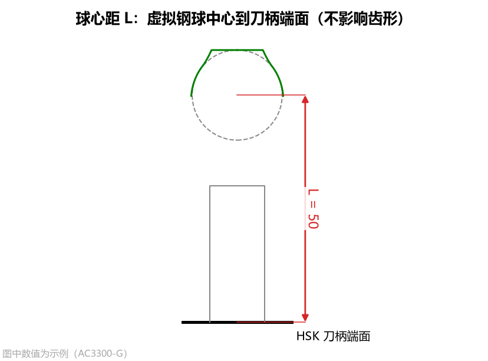
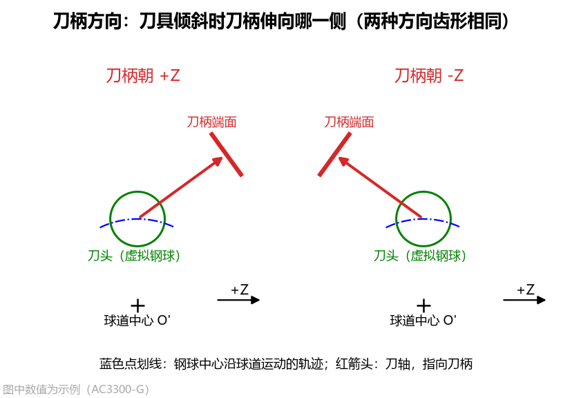
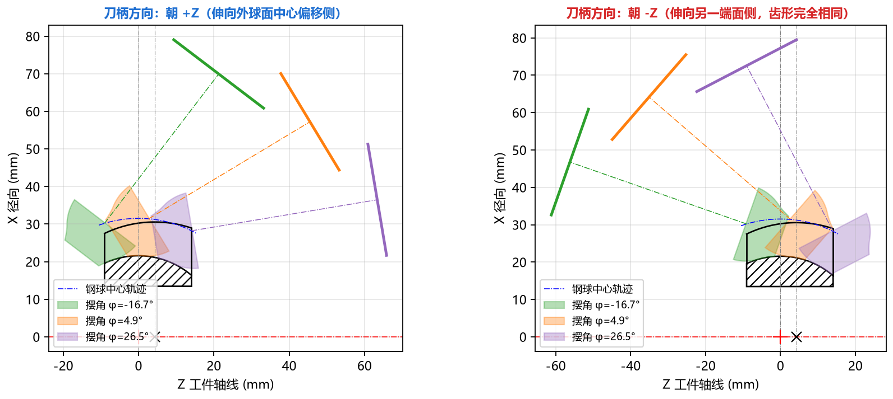
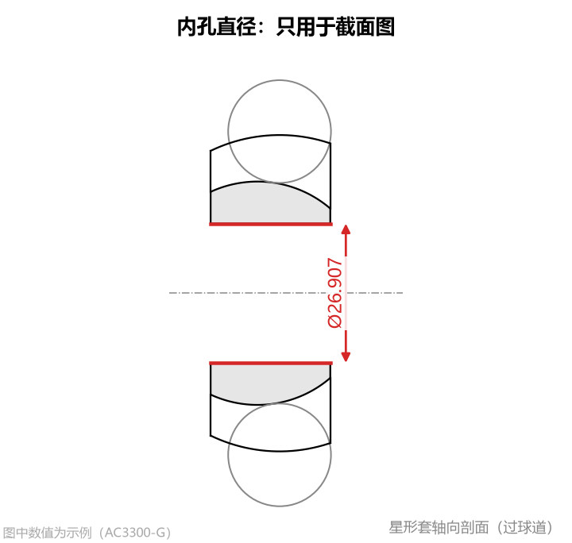

# 3.2 刀柄姿态与工件细节参数

本节介绍高级参数中的 **`刀柄与姿态`**（2 项参数）和 **`工件细节`**（1 项参数）。这两组参数**完全不改变刀具切削齿形**，主要用于确定 DXF 图纸中的刀柄端面基准位置、子午面加工姿态防干涉检查以及星形套轴向剖面图的绘制。

---

## 1. 球心距 L (`gauge_length`)

* **界面名称**：`球心距 L`
* **单位**：`mm`
* **默认值**：`50.0`
* **数值范围**：$> 0$

### 工程含义与用途
`球心距 L` 定义了沿着刀具轴线方向，从**虚拟钢球中心（刀具设计原点 $z=0$）到刀柄（如 HSK 刀柄）定位端面**的距离。

它在工程交付中有三个直接用途：
1. **刀具点表 CSV 对刀基准换算**：在导出的 `刀具点表 CSV` 中，软件会自动根据 `球心距 L` 计算出以刀柄端面为零点的轴向坐标列 `z_端面`（`z_端面 = z_球心 + L`），方便直接以刀柄端面为基准进行磨刀和机床对刀编程；
2. **刀具 DXF 与圆弧刀具 DXF 出图**：在导出的 CAD 图纸中自动画出位于 `z = -L` 处的刀柄端面基准线并标出球心距尺寸 `50`；
3. **加工姿态干涉检查**：在 **[Tab 4：加工姿态(子午面)](../5_tabs_charts/tab4_pose.md)** 页签中画出刀柄端面粗实线，直观检查刀具摆动到球道两端时刀柄端面是否会碰到星形套。

---

## 2. 刀柄方向 (`tilt_side`)

* **界面名称**：`刀柄方向`
* **可选项**：`朝 +Z`（默认） / `朝 -Z`

### 工程含义与正反装夹对比
成型刀具按切入角 $\beta$ 倾斜安装加工球道时，刀柄可以朝工件轴线的两个相反方向伸出：

1. **`朝 +Z`（默认）**：刀柄伸向 $+Z$ 方向（即外球面中心相对球道中心 $O'$ 偏移所在的一侧）；
2. **`朝 -Z`**：刀柄伸向 $-Z$ 方向（另一端面侧）。

> **核心规律**：无论选择 `朝 +Z` 还是 `朝 -Z`，**计算出的刀具齿形尺寸 100% 完全相同（镜像对称）**！它只改变 **[Tab 4：加工姿态(子午面)](../5_tabs_charts/tab4_pose.md)** 中的刀柄伸出方向，供您根据机床主轴、尾座或夹具的实际位置核对哪一侧装夹无干涉。

---

## 3. 内孔直径 (`bore_d`)

* **界面名称**：`内孔直径`
* **单位**：`mm`
* **默认值**：`26.907`
* **数值范围**：大于 `0` 且小于 `外球面直径`

### 图纸读取与用途
`内孔直径` 对应星形套零件图上的中心内孔（花键孔）直径（花键孔一般可填花键小径或大径包络圆）：
* **不参与刀具计算**：修改该值不会对刀具廓形或圆弧近似结果产生任何影响；
* **绘制零件剖面与核对壁厚**：专门用于 **[Tab 3：星形套截面](../5_tabs_charts/tab3_part.md)** 页签和导出的 **[星形套截面 DXF (`part_section.dxf`)](../6_exports_data/dxf_files.md)**，帮助工艺人员直观查看球道底圆弧到星形套内孔之间的实体壁厚（剖面线区域）。
