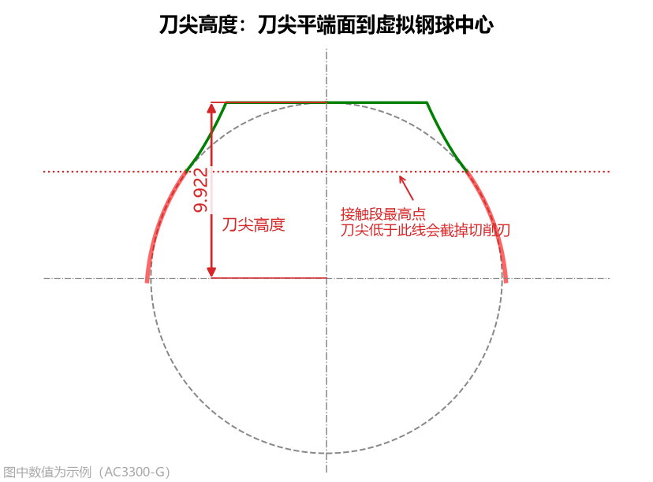
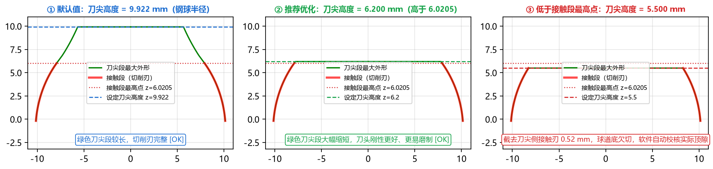
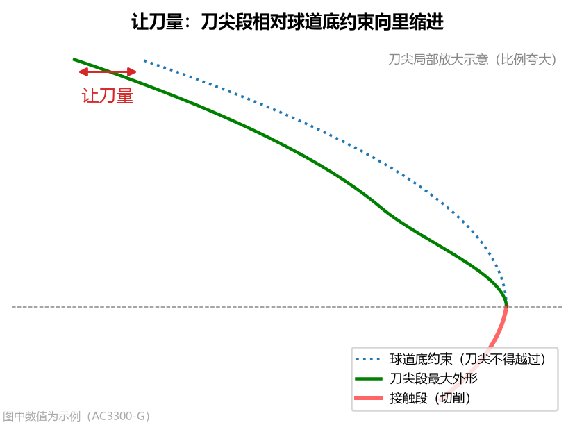
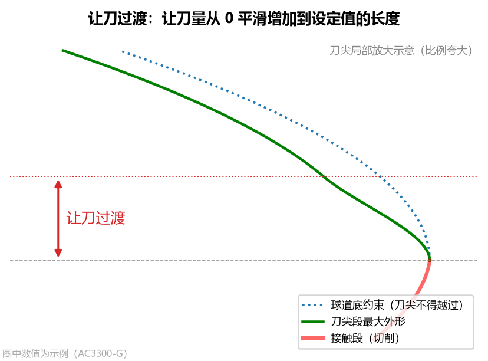
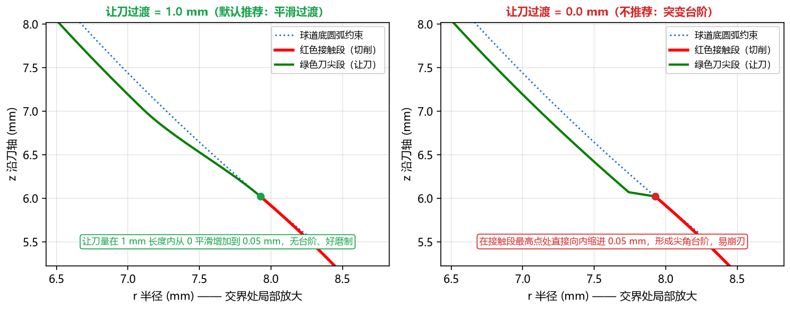
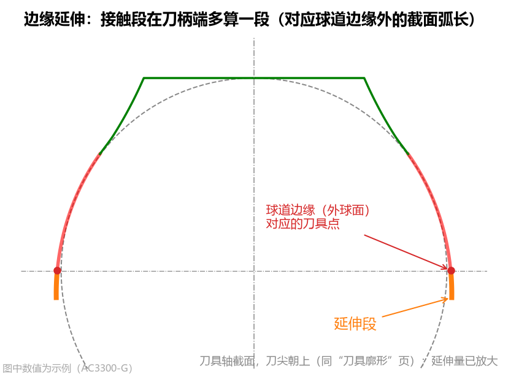
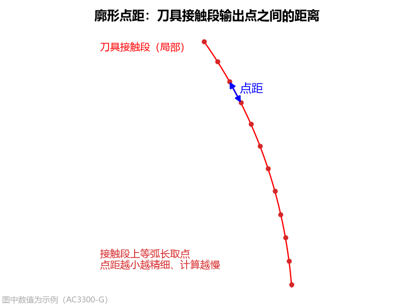

# 3.1 刀尖与廓形控制参数

本组参数位于高级参数面板的第一栏 **`刀尖与廓形`**，共包含 5 个参数，用于控制成型刀具在**刀尖端面（对应球道底部顶隙区）**与**接触段末端（对应球道外球面边缘）**的几何边界及输出点距。

---

## 1. 刀尖高度 (`tip_z`)

* **界面名称**：`刀尖高度`
* **单位**：`mm`
* **默认值**：`9.922`（默认等于虚拟钢球半径 $D_w/2$）
* **数值范围**：$> 0$

### 工程含义与设置原则
`刀尖高度` 定义了刀具轴向方向上，**刀尖平端面到虚拟钢球中心（刀具原点 $z=0$）的距离**（沿刀轴、朝刀尖方向为正）。

在球道加工中，刀头廓形分为两个功能区段：
* **接触段（红色实线）**：真正参与切削球道工作面（从外球面边缘一直到球道底部接触边界）的刀刃段，必须精确磨制；
* **刀尖段（绿色实线）**：从接触段最高点延伸到 `刀尖高度` 平端面的前端区域，正对着球道底部的非工作顶隙区，**不参与切削**，仅作为刀尖允许的最大外形边界（实际刀具可在此绿线内修整为倒角或平端）。

### 刀尖高度的三种状态与实际顶隙智能校核（关键！）

如上图所示，以默认 `AC3300-G` 零件为例，其接触段最高点为 **`z = 6.0205 mm`**（显示在左下计算结果栏的 `接触段 z` 最大值），虚拟钢球半径为 **`9.922 mm`**：

1. **① 默认值（`刀尖高度 = 9.922 mm`）**
   * **表现**：完整覆盖全部红色切削接触段，绿色刀尖段一直延伸到虚拟钢球半径高度处平切收口。
2. **② 推荐工程优化（`刀尖高度 = 6.200 mm`，略高于接触段最高点 `6.0205`）**
   * **工程技巧**：如果想让刀头前端更短促结实、刚性更好且更容易磨制，可先查看计算结果栏中 `接触段 z` 的最大值（如 `6.0205`），然后将 **`刀尖高度`** 减小到该值上方附近（如设为 `6.2`）。此时红色切削刃 100% 保持完整，而绿色不切削刀尖段大幅缩短！
3. **③ 低于接触段最高点（如双圆弧截面按钢球半径填 `9.875 mm`，而尖底接触段最高点为 `10.2269 mm`）**
   * **物理影响**：刀尖侧切球道底的那一小段刃口被刀尖平端截去，切出的球道底部会比理论设计略浅一点（即产生 `球道底欠切`），但**两侧钢球工作接触区丝毫不受影响**！
   * **软件的智能分级判定**：
     * **若钢球实际落座后的 `实际顶隙` 仍在图纸 `顶隙下限` 之上**（例如 `AC10000` 双圆弧球道，刀尖高度填 `9.875 mm` 截去了刀尖侧 `0.35 mm`，球道底欠切 `0.048 mm`，但钢球实际落座后的实际顶隙仍有 `0.038 mm > 下限 0.02 mm`）：此时软件将其判为**可用（不作为错误报警）**，并在结果栏清晰说明截去量与实际顶隙余量；
     * **若截去过多导致 `实际顶隙` 低于 `顶隙下限`（甚至擦碰钢球底）**：此时计算结果栏会标红报警 **`请把刀尖高度调大（至 X.XXXX 可完全消除）`**，提醒您必须增大 `刀尖高度`。
   * **与圆弧近似刀具 `刀尖延伸` 的联动**：
     * 对于圆弧近似刀具，`刀尖高度` 同样限制了圆弧刀尖端面的最大轴向高度 $z_{\text{tip}}$；
     * 若您在【圆弧近似】中设置了 `刀尖延伸 > 0`，请确保 `刀尖高度` 大于延伸后的终点 $z$，否则延伸量会被 `刀尖高度` 截断并标红提示 `未全部做到`。

---

## 2. 让刀量 (`tip_relief`)

* **界面名称**：`让刀量`
* **单位**：`mm`
* **默认值**：`0.05`
* **常见范围**：`0.02 ~ 0.05 mm`

### 工程含义与影响
`让刀量` 是指绿色刀尖段（不切削部分）相对于球道底约束圆弧**向内缩进的径向避空量**：
* **设置目的**：为主轴跳动、对刀误差和砂轮/刀具磨损留出安全余量，防止刀尖在摆动过程中擦伤或啃伤球道底。
* **对结果的影响**：只影响绿色刀尖段，**完全不影响红色切削接触段**。不建议设为 `0`（设为 `0` 时刀尖理论上正好贴着球道底擦过）。

---

## 3. 让刀过渡 (`tip_relief_len`)

* **界面名称**：`让刀过渡`
* **单位**：`mm`
* **默认值**：`1.0`
* **数值范围**：$\ge 0$

### 工程含义与对比效果
`让刀过渡` 定义了沿着刀轴方向，让刀量从 `0`（接触段最高点处）平滑增加到设定 `让刀量`（如 `0.05 mm`）所经过的轴向过渡长度。

* **`让刀过渡 = 1.0 mm`（默认推荐）**：红色接触段与绿色刀尖段在交界处平滑相切过渡，无台阶、无尖角，砂轮修整与磨刀走刀顺畅；
* **`让刀过渡 = 0.0 mm`（不推荐）**：在接触段最高点处刀刃直接向内突变缩进，形成尖角台阶，不仅难以磨制而且极易崩刃（当 `让刀量 = 0` 时此项不起作用）。

---

## 4. 边缘延伸 (`extra_extend`)

* **界面名称**：`边缘延伸`
* **单位**：`mm`
* **默认值**：`0.3`
* **常见范围**：`0.2 ~ 0.5 mm`（点表只到边缘时填 `0`）

### 工程含义与设置建议
星形套球道与外球面（直径 `sphere_d`）的交线即为球道开口边缘。`边缘延伸` 让刀具齿形在球道边缘之外**朝刀柄侧再多算一段**（对应球道边缘外的截面弧长，默认 `0.3 mm`）：
* **工程作用**：为工件外球面车削尺寸偏差和刀具对刀定位误差留出余量，确保球道开口边缘能够 100% 切到位，不留未切净的毛刺台阶；
* **图表与结果栏显示**：在 **`精确刀具廓形`** 页签中，边缘延伸段会单独以**橙色粗实线**标出，并在左下角提供 **`球道边缘局部放大`** 窗；在 **`计算结果`** 面板第 二 分块中，也会分别列出 `接触段（到球道边缘）` 与 `边缘延伸 ... mm` 的坐标范围；
* **特殊情况**：当 `截面类型` 选 `点表(CSV)` 且导入的点表数据刚好只给到球道边缘为止时，请将 `边缘延伸` 填为 **`0`**（若填了正数但点表未超出外球面，软件会自动提示 `边缘延伸未生效`）；
* **对结果的影响**：只延长接触段靠近刀柄一侧的长度；由于拟合范围略微加长，会轻微影响圆弧近似的拟合数值。

---

## 5. 廓形点距 (`profile_step`)

* **界面名称**：`廓形点距`
* **单位**：`mm`
* **默认值**：`0.01`
* **数值范围**：$\ge 0.001\text{ mm}$

### 工程含义与设置建议
`廓形点距` 控制刀具接触段沿廓形弧长等距输出的采样点间距，同时作用于界面绘图、`刀具 DXF` 和 `刀具点表 CSV`：
* **默认 `0.01 mm`**：兼顾极高的磨刀轮廓精度与秒级计算响应；
* **加密点表（如 `0.005 mm`）**：当精密磨床或三坐标检测需要更密集的点表时可设为 `0.005`；
* **注意**：该参数不影响 `基本轮廓（Table 2）` 的导出点数（后者由高级参数中的 `基本轮廓点数` 单独控制）。
