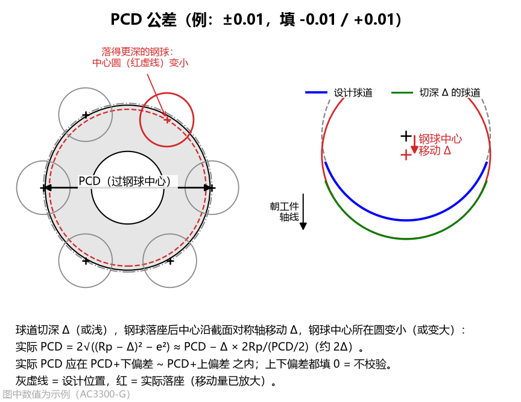
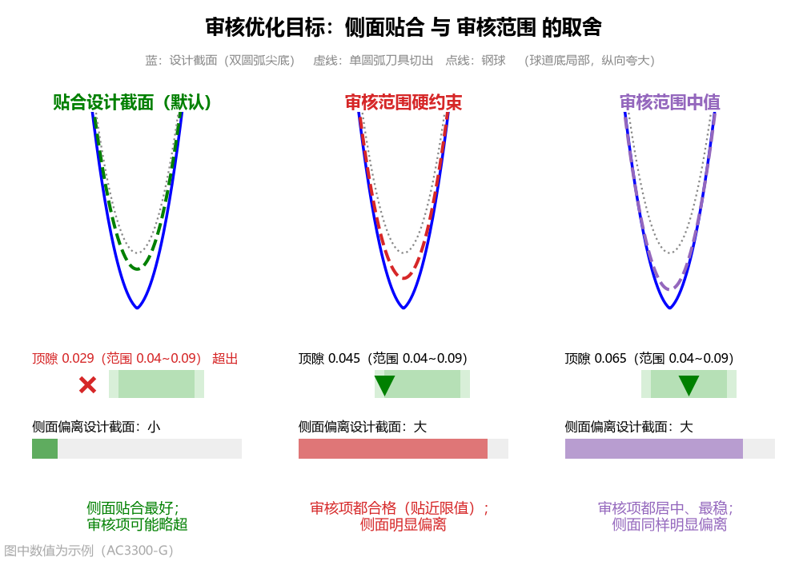
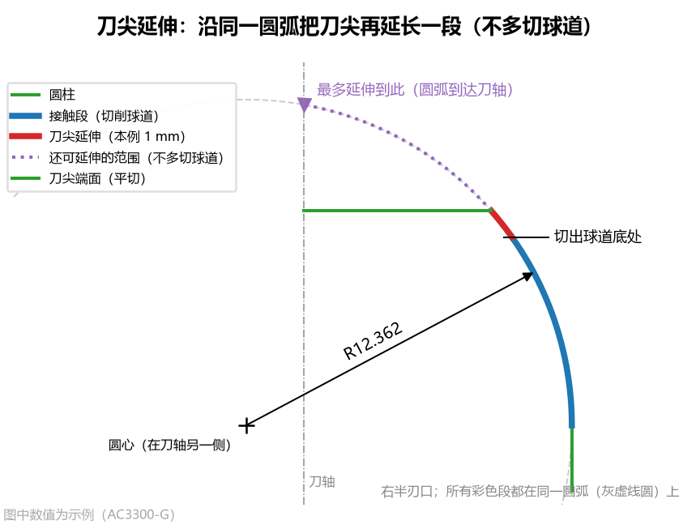

# 3.3 校验范围、圆弧近似与导出设置

本节介绍高级参数面板下半部分的三个核心分组：**`校验范围`**（9 项）、**`圆弧近似`**（5 项）以及 **`基本轮廓导出`**（3 项）。

---

## 一、`校验范围` 分组（共 9 项）

本组参数按产品零件图规定的公差范围填写，用于对以下三类结果进行全自动合格判定（当启用 `单圆弧求法 = 按审核优化` 时，优化器也会以本组范围作为优化目标约束）：
* **球道截面设计【理论值】**
* **精确刀具切出的球道【实际值·仿真】**
* **圆弧近似刀具切出的球道【实际值·仿真】**

### 1. 顶隙下限 (`clearance_min`) 与 顶隙上限 (`clearance_max`)

* **界面名称**：`顶隙下限` / `顶隙上限`（单位：`mm`，默认值：`0.019` / `0.040`）
* **设置方法**：按零件图规定的球道底顶隙允许范围填写（如 `AC3300-G` 为 `0.019 ~ 0.040 mm`，`AC10000` 为 `0.02 ~ 0.10 mm`）。
* **图表与结果联动**：
  * **[Tab 2：球道设计截面](../5_tabs_charts/tab2_section.md)** 与 **[Tab 5](../5_tabs_charts/tab5_sim.md) / [Tab 6](../5_tabs_charts/tab6_arc.md)** 的球道底放大图中，会用两条灰色水平点线标出 `顶隙下限` 和 `顶隙上限`；
  * 理论顶隙及仿真钢球落座后的 `实际顶隙` 在区间内时显示绿色 **`OK`**，否则标红显示 **`超出范围!`**。

---

### 2. 接触角跨距下限 (`span_min`) 与 接触角跨距上限 (`span_max`)

* **界面名称**：`接触角跨距下限` / `接触角跨距上限`（单位：`mm`，默认值：`0.0` / `0.0`）
* **什么是接触角跨距**：在球道法向截面内，钢球与左右两侧球道壁接触点之间的水平距离（理论值为 $D_w \sin\alpha$）。
* **设置方法**：
  * 若产品图直接标注了跨距范围（如 `AC10000` 标注 `12.3 ~ 14.0 mm`），按图纸填入下限和上限；
  * 若图纸未标此项，保持两项都填 **`0`**（代表不校验，仅作为参考数值输出）。

---

### 3. 接触角下偏差 (`alpha_tol_lo`) 与 接触角上偏差 (`alpha_tol_hi`)（升级！）

* **界面名称**：`接触角下偏差` / `接触角上偏差`（单位：`°`，默认值：`-2.0` / `2.0`）
* **相对偏差输入方式**：
  * 相对于设计接触角 $\alpha$ 的下偏差与上偏差，合格区间为 $[\alpha + \text{下偏差},\ \alpha + \text{上偏差}]$；
  * **示例 1**：图纸标注 `42° ± 2°`，则下偏差填 **`-2`**，上偏差填 **`2`**（合格范围 `40° ~ 44°`）；
  * **示例 2**：图纸标注 `42° ± 3.5°`（如 `AC10000`），则下偏差填 **`-3.5`**，上偏差填 **`3.5`**（合格范围 `38.5° ~ 45.5°`）；
  * **示例 3**：不对称公差如 `42° -1°/+2°`，则下偏差填 **`-1`**，上偏差填 **`2`**；
  * **不校验填法**：下偏差和上偏差**都填 `0`** 时表示不校验。
  * *兼容性提示：载入含旧版 `alpha_min / alpha_max` 的参数文件时，软件会自动换算为相对偏差。*

---

### 4. PCD 下偏差 (`pcd_tol_lo`) 与 PCD 上偏差 (`pcd_tol_hi`)（新增！）

* **界面名称**：`PCD 下偏差` / `PCD 上偏差`（单位：`mm`，默认值：`-0.01` / `0.01`）
* **为什么切出的球道会改变“实际 PCD”？**
  * 图纸上的 **PCD（节圆直径）** 是把量棒/钢球放进加工好的球道后，钢球中心所在分布圆的直径；
  * 当成型刀切出的球道比理论截面略深或略浅 $\Delta$ 时，钢球实际落座后的中心会沿截面对称轴移动 $\Delta$，从而使钢球中心所在的分布圆直径发生变化：
    $$\text{实际 PCD} = 2\sqrt{(R_p + \text{移动量})^2 - e^2} \approx \text{PCD} + 2 \times \text{移动量}$$
  * 也就是说，**钢球中心每向球道开口方向移动 `+5 μm`，实际 PCD 就会增大约 `+10 μm`（`+0.01 mm`）**！
* **设置方法**：
  * 按图纸规定的 PCD 公差填写相对偏差：例如 `PCD ± 0.01 mm`，则下偏差填 **`-0.01`**，上偏差填 **`0.01`**；
  * 若下偏差和上偏差**都填 `0`**，则只显示算出的 `实际 PCD` 数值而不做超限报警。

---

### 5. 轮廓度公差 (`profile_tol`)

* **界面名称**：`轮廓度公差`（单位：`mm`，默认值：`0.02`，即 `±10 μm`）
* **工程含义与图表联动**：
  * 零件图规定的球道法向截面轮廓度总公差带宽（判定时按正负一半即 $\pm \text{轮廓度公差} / 2$ 计算）；
  * 圆弧近似刀具切出球道与设计截面的最大法向偏差 $\le \text{轮廓度公差} / 2$ 时显示绿色 **`合格`**，超出则标红显示 **`超差!`**。

---

## 二、`圆弧近似` 分组（共 5 项）

为了方便车间使用标准圆弧砂轮修整和光学投影检测，本组参数可将精确接触段近似为**单圆弧**或**多段相切圆弧**刀具，并支持控制单圆弧审核优化目标与刀尖延伸。

### 1. 圆弧段数 (`arc_count`)

* **界面名称**：`圆弧段数`（可选项：`1` / `2` / `3` / `4` / `5` 段，默认值：`1`）
* **选型指南**：
  * **`1` 段（单圆弧 + 圆柱，默认）**：适用于**椭圆截面**和常规**点表截面**（精度可达 `2 ~ 5 μm`），或配合下方 `按审核优化` 用于双圆弧截面；可生成客户图纸 **Table 1（$C_1 \sim C_{10}$ 常数表）**。
  * **`2 ~ 5` 段（多段首尾相切圆弧 + 圆柱）**：适用于**双圆弧（尖底）截面**或曲率变化剧烈的截面。用 $n$ 段首尾相切（$G^1$ 连续）的外凸+内凹圆弧贴合“凸转凹”拐点（如 `AC10000` 选 `3` 段时截面偏差仅 `7.0 μm`）。

---

### 2. 单圆弧求法 (`arc_fit`，仅当 `圆弧段数 = 1` 时显示）

* **界面名称**：`单圆弧求法`（可选项：`拟合精确廓形` / `按审核优化`，默认值：`拟合精确廓形`）
* **两种求法对比**：
  1. **`拟合精确廓形`（默认，约 1 秒完成）**：直接对精确刀具接触段做几何最小二乘圆拟合，使整条刀刃与精确刀具最贴近。适用于所有 **`椭圆`** 截面和常规 **`点表(CSV)`** 截面。
  2. **`按审核优化`（专为双圆弧截面单圆弧刀设计，约需 20~60 秒）**：通过反向包络仿真与钢球实际落座循环优化单圆弧的 $R$ 与圆心坐标 $(r_c, z_c)$，球道底部非工作区允许从“尖底”适应为单圆弧切出的“圆底”，同时兼顾球道侧面贴合与钢球实际落座审核项（顶隙、接触角、跨距、实际 PCD）。

---

### 3. 审核优化目标 (`audit_goal`，仅当 `圆弧段数 = 1` 且 `单圆弧求法 = 按审核优化` 时显示）（新增！）

* **界面名称**：`审核优化目标`
* **可选项**：`贴合设计截面`（默认） / `审核范围硬约束` / `审核范围中值`
* **为什么要区分三种优化目标？**
  对于双圆弧（尖底）截面，单圆弧刀具没有拐点，因此**“球道侧面贴合设计双圆弧”**与**“球道底顶隙/PCD 等审核项严格达标”**之间往往存在几何取舍。您可根据客户验收标准在以下三种策略中自由切换：

| 优化目标选项 | 核心优化策略 | 适用场景与特点 |
| :--- | :--- | :--- |
| **`贴合设计截面`**（默认） | **球道侧面贴合优先**，审核范围为软约束（耗时约 20~40 秒） | 刀刃紧贴精确刀具的球道工作侧面（接触点一半以外偏差仅数微米）；若个别审核项（如顶隙）与贴合侧面存在几何冲突，允许审核项略超并在结果栏给出提示。 |
| **`审核范围硬约束`** | **所有已设审核范围作为硬约束必须满足**，在此前提下尽量贴合侧面（耗时约 30~60 秒） | 当客户只按**顶隙、接触角、接触角跨距、实际 PCD** 四个审核项的范围验收时选用；确保所有审核项 100% 落在公差带内（可能贴近限值边界），但球道侧面会偏离理论双圆弧。 |
| **`审核范围中值`** | **把顶隙、接触角、跨距、实际 PCD 都推向各自上下限的正中间**（耗时约 30~60 秒） | 追求各项审核指标都居中、留有最大安全余量且最稳定；同样会牺牲球道侧面与理论双圆弧的贴合度。 |

---

### 4. 取整位数 (`arc_decimals`)

* **界面名称**：`取整位数`（可选项：`不取整` / `0` ~ `5` 位，默认值：`3`）
* **工程含义**：将圆弧的 **半径 $R$、圆心径向、圆心轴向（及多段圆弧交界 $z$）** 按指定小数位四舍五入作为最终磨刀尺寸，并直接用取整后的尺寸进行反向包络仿真与落座校核。

---

### 5. 刀尖延伸 (`arc_tip_ext`)（新增！）

* **界面名称**：`刀尖延伸`（单位：`mm`，默认值：`0.0`）
* **工程痛点与作用**：
  * 默认情况下（`刀尖延伸 = 0`），圆弧近似刀具的圆弧刃口刚好在**切出球道底处**（$z = z_{\text{cut}}$）被刀尖平端面截断，这意味着切球道底的切削点正好落在圆弧与刀尖端面的**尖角交界处**，加工时该尖角容易集中磨损；
  * 当填入 **`刀尖延伸 > 0`**（例如填 `0.5` 或 `1.0 mm`）时，软件会让刀尖**沿着同一段圆弧（多段圆弧时为最靠近刀尖的那一段圆弧）继续朝刀尖方向延伸指定轴向长度**，然后再平切收口！
* **为什么刀尖沿同一圆弧延伸不会把球道底切深？**
  * 因为外凸圆弧在越过切球道底的切点之后，继续往刀尖方向走时，圆弧半径快速内缩，在包络摆动过程中处于球道底包络面之内，**既把尖角推离了实际切削区，又绝不会多切球道底一分一毫**！
* **最大可延伸范围自动计算**：
  * 软件会自动计算并显示该圆弧在不切深球道底、不过刀轴中心（$r \ge 0$）、不过圆弧最高点的前提下**最多可延伸到的位置 $z_{\max}$**（显示在结果栏第 四 分块、Tab 6 左上角紫色点线及 `arc_tool.dxf` 视图 ② 中）；
  * *注意：若设定的延伸终点超过了【刀尖与廓形】中的 `刀尖高度`，延伸会被 `刀尖高度` 截断并在结果栏提示 `未全部做到`，此时只需将 `刀尖高度` 一并调大即可。*

---

## 三、`基本轮廓导出` 分组（共 3 项，控制 Table 1 / Table 2 导出格式）

当您需要点击左下角的 **`方程常数（Table 1）`** 或 **`基本轮廓（Table 2）`** 导出客户图纸格式的数据表时，可通过以下 3 个选项控制输出方式（这 3 个选项均不影响刀具形状、DXF 图形和合格判定）：

### 1. 基本轮廓点数 (`n_basic`)

* **界面名称**：`基本轮廓点数`（单位：`点`，默认值：`117`）
* **工程含义**：控制导出 **`基本轮廓（Table 2）`**（`table2_basic_profile.csv`）时，在半边球道截面上等弧长取点的总数量。

### 2. 基本轮廓终点 (`basic_end`)

* **界面名称**：`基本轮廓终点`（可选项：`球道边缘` / `圆弧终点`，默认值：`球道边缘`）
* **选择建议**：
  * **`球道边缘`（默认）**：取到球道与星形套外球面相交处为止，即零件上实际存在的球道范围；
  * **`圆弧终点`**：仅单圆弧刀具（`圆弧段数 = 1`）有效，取到单圆弧刀具圆弧段的末端（圆弧与圆柱相切交界处，对应参数方程终点 $X = C_9$）。需与客户图纸 Table 2 逐点对照时选此项。

### 3. 常数依据 (`table_basis`)

* **界面名称**：`常数依据`（可选项：`拟合值` / `取整值`，默认值：`拟合值`）
* **选择建议**：
  * **`拟合值`（默认，同客户图纸做法）**：按单圆弧刀具**取整前的尺寸（保留 5 位小数）**计算 $C_1 \sim C_{10}$ 和基本轮廓；
  * **`取整值`**：按 `取整位数` 四舍五入后的磨刀尺寸计算 $C_1 \sim C_{10}$。
