# 3.3 校验范围、圆弧近似与导出设置

本节介绍高级参数面板下半部分的三个核心分组：**`校验范围`**（7 项）、**`圆弧近似`**（3 项）以及 **`导出`**（3 项）。

---

## 一、`校验范围` 分组（共 7 项）

本组参数按产品零件图规定的公差范围填写，用于对**球道截面设计【理论值】**、**精确刀具切出的球道【实际值·仿真】**以及**圆弧近似刀具切出的球道【实际值·仿真】**进行全自动合格判定（当启用 `单圆弧求法 = 按审核优化` 时，优化器也会以本组范围作为优化目标约束）。

### 1. 顶隙下限 (`clearance_min`) 与 顶隙上限 (`clearance_max`)

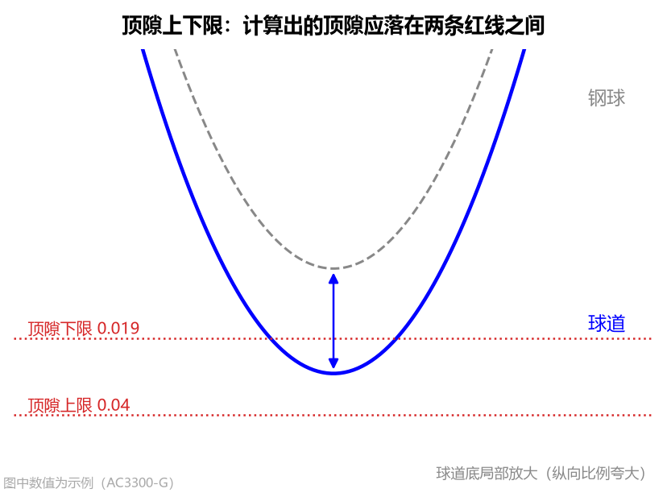

* **界面名称**：`顶隙下限` / `顶隙上限`
* **单位**：`mm`
* **默认值**：`0.019` / `0.040`
* **工程含义与设置**：按零件图规定的球道底顶隙允许范围填写（例如 `AC3300-G` 为 `0.019 ~ 0.040 mm`，`AC10000` 为 `0.02 ~ 0.10 mm`）。
* **图表与结果联动**：
  * 在 **[Tab 2：球道截面](../5_tabs_charts/tab2_section.md)** 左上角的 `球道底放大（纵向夸大）` 小窗中，会用两条灰色水平点线直观标出 `下限` 和 `上限`；
  * 当理论顶隙及仿真钢球落座后的 `实际顶隙` 落在该区间内时，结果面板和图表右上角核对框均显示绿色 **`OK`**，否则标红显示 **`超出范围!`**。

---

### 2. 接触角下限 (`alpha_min`) 与 接触角上限 (`alpha_max`)（新增！）

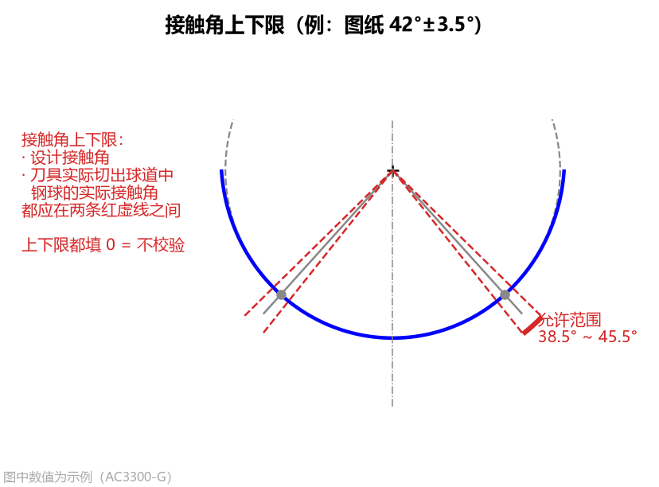

* **界面名称**：`接触角下限` / `接触角上限`
* **单位**：`°`（度）
* **默认值**：`40.0` / `44.0`
* **工程含义与设置**：
  * 按零件图上接触角的公差带填写。例如图纸标注接触角为 `42° ± 2°`，则下限填 `40`，上限填 `44`；若标注 `42° ± 3.5°`（如 `AC10000`），则下限填 `38.5`，上限填 `45.5`。
  * **不校验的填法**：如果图纸只标了参考接触角而未规定上下限，将**下限和上限都填 `0`**，软件即显示 `（未给范围，不校验）`。
* **为什么必须校验“实际接触角”？**
  当使用圆弧近似刀具（尤其是单圆弧或取整后的多段圆弧）切出球道时，球道侧壁微米级的形状差异会引起钢球实际落座接触点的偏移。设置好 `接触角下限 / 上限` 后，软件会自动把钢球放进仿真切出的球道中，检验**`实际接触角`**是否仍严格落在图纸允许范围内！

---

### 3. 接触角跨距下限 (`span_min`) 与 接触角跨距上限 (`span_max`)（新增！）

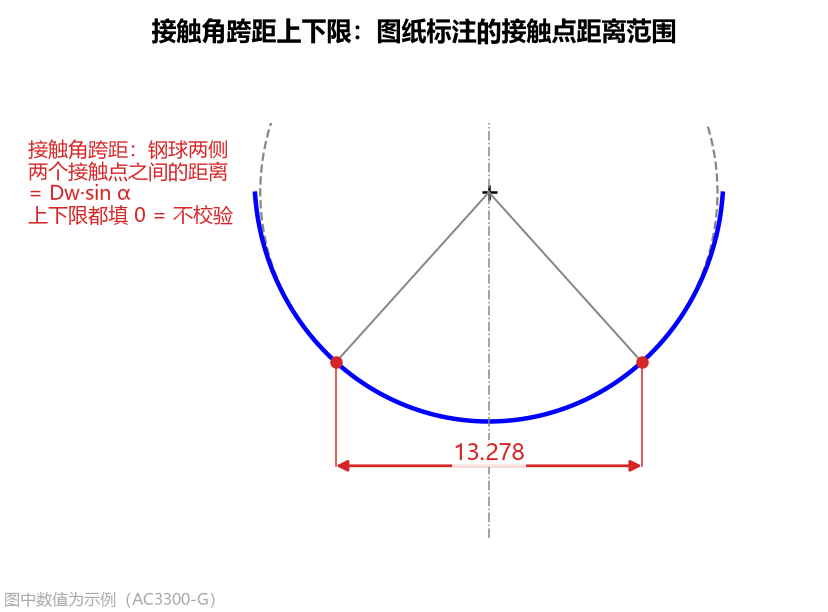

* **界面名称**：`接触角跨距下限` / `接触角跨距上限`
* **单位**：`mm`
* **默认值**：`0.0` / `0.0`（默认均填 `0` = 不校验）
* **工程含义与设置**：
  * **什么是接触角跨距？** 在球道法向截面内，钢球与左右两侧球道壁各有一个接触点，**左右两个接触点之间的水平距离**即为**接触角跨距**（理论值为 $D_w \sin\alpha$）。
  * 许多产品图纸（如 `AC10000`）会直接标注这两个接触点之间的跨距尺寸及公差范围（例如 `12.3 ~ 14.0 mm`）。
  * **设置方法**：若图纸标了该尺寸范围，直接按图纸填入下限和上限（如 `12.3` 和 `14.0`）；若图纸未标此项，保持两项都填 **`0`** 即可（软件仍会在结果面板和 `球道截面` 图、`刀具 DXF` 图上标出算出的跨距数值供参考，但不做超限报警）。

---

### 4. 轮廓度公差 (`profile_tol`)

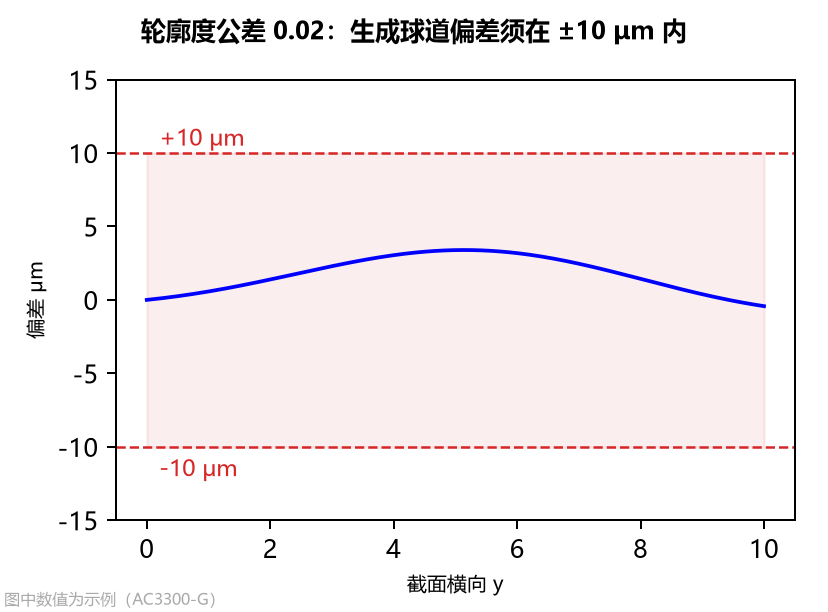

* **界面名称**：`轮廓度公差`
* **单位**：`mm`
* **默认值**：`0.02`（总带宽，判定时按正负一半即 `±0.01 mm = ±10 μm` 计算）
* **工程含义与图表联动**：
  * 零件图上规定的球道法向截面轮廓度总公差带宽（例如 `0.02 mm` 对应 `±10 μm`，`0.10 mm` 对应 `±50 μm`）。
  * 当圆弧近似刀具实际切出的球道与设计截面的最大法向偏差 $\le \text{轮廓度公差} / 2$ 时，结果栏显示绿色的 **`合格`**，且 **[Tab 6：圆弧近似](../5_tabs_charts/tab6_arc.md)** 右中子图的蓝色偏差曲线完全处于两条红色水平虚线之间；超出则标红显示 **`超差!`**。

---

## 二、`圆弧近似` 分组（共 3 项，重大升级！）

精确成型刀的接触段是一条空间包络自由曲线。为了方便车间使用标准圆弧砂轮修整和光学投影检测，本组参数可将精确接触段近似为**单圆弧**或**多段相切圆弧**刀具。

### 1. 圆弧段数 (`arc_count`)（新增！）

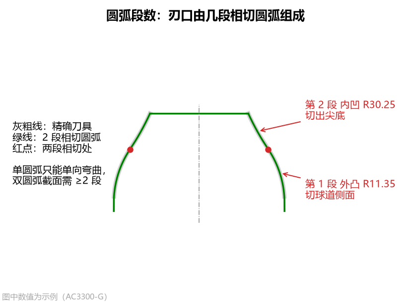

* **界面名称**：`圆弧段数`
* **可选项**：`1` / `2` / `3` / `4` / `5`（单位：`段`）
* **默认值**：`1`
* **工程含义与选型指南**：
  * **`1` 段（单圆弧 + 圆柱，默认）**：刀刃由刀尖侧的一段圆弧与刀柄侧相切的圆柱组成。对于**椭圆截面**和常规**点表截面**，其精确刀具接触段单向弯曲，仅用 **`1` 段圆弧**即可达到 `2 ~ 5 μm` 的极高精度，且能生成客户图纸所需的 **Table 1（$C_1 \sim C_{10}$ 常数表）**。
  * **`2 ~ 5` 段（多段首尾相切圆弧 + 圆柱）**：专门针对**双圆弧（尖底）截面**或曲率变化剧烈的截面！
    * **为什么双圆弧需要 $\ge 2$ 段圆弧？** 双圆弧（尖底）球道的精确刀具廓形具有明显的**“凸转凹”拐点**（靠近刀柄侧为外凸圆弧切球道工作侧面，靠近刀尖侧转为内凹圆弧切出哥特式尖底），一段圆弧只能单向弯曲，无法贴合拐点。
    * **选 `2` 或 `3` 段的效果**：软件会自动用 $n$ 段**首尾相切（$G^1$ 连续，交界处斜率相同无折角）**的圆弧（外凸 + 内凹）去拟合精确接触段，并对切出钢球接触点附近的刀刃加权精修。例如在 `AC10000` 双圆弧案例中，选 **`3` 段**相切圆弧后，切出的球道与设计截面的最大偏差从单圆弧的 `287 μm` 骤降至 **`7.0 μm`**，实际落座接触角精准达到 **`42.000°`**！
    * *注：当 `圆弧段数 > 1` 时，点击【圆弧刀具 DXF】会导出包含全部相切圆弧段 `ARC` 实体、圆心与交界标注的完整制造图；而客户图纸单圆弧专用公式 `Table 1 (C1~C10)` 不适用于多段圆弧。*

---

### 2. 单圆弧求法 (`arc_fit`，仅当 `圆弧段数 = 1` 时显示）（新增！）

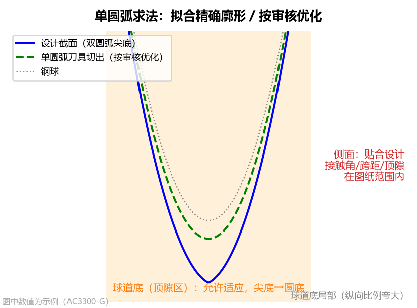

* **界面名称**：`单圆弧求法`
* **可选项**：`拟合精确廓形` / `按审核优化`
* **默认值**：`拟合精确廓形`
* **两种求法的本质区别与适用场景**：
  1. **`拟合精确廓形`（默认，约 1 秒完成）**：
     * 直接对精确刀具接触段做几何最小二乘圆拟合，使整条刀刃从球道底到球道边缘与精确刀具最贴近。
     * **适用**：所有 **`椭圆`** 截面和常规 **`点表(CSV)`** 截面（首选此项）。
  2. **`按审核优化`（专门解决“双圆弧图纸但现场必须用单圆弧刀”的工程难题，约需 20~40 秒）**：
     * **应用场景**：零件图纸画的是**双圆弧（尖底）截面**，但车间工艺要求**必须使用一把单圆弧刀具（并输出 Table 1 / Table 2）**来加工，同时客户审核要求加工出的球道满足图纸规定的**接触角范围、接触角跨距范围、顶隙范围**，而球道底部的非工作储油区允许从“尖底”自然适应为单圆弧刀切出的“圆底”。
     * **工作机制**：软件通过反向包络仿真与钢球实际落座循环优化单圆弧的 $R$ 与圆心坐标 $(r_c, z_c)$，确保切出的球道中**钢球的实际接触角、实际跨距、实际顶隙全部落在【校验范围】设定的上下限之内**，同时使**球道侧面工作区**（接触点一半以外，在 Tab 6 图中以浅色区外的白底显示，球道底标为浅橙色 `球道底：允许适应`）与设计截面的轮廓偏差最小！

---

### 3. 取整位数 (`arc_decimals`)

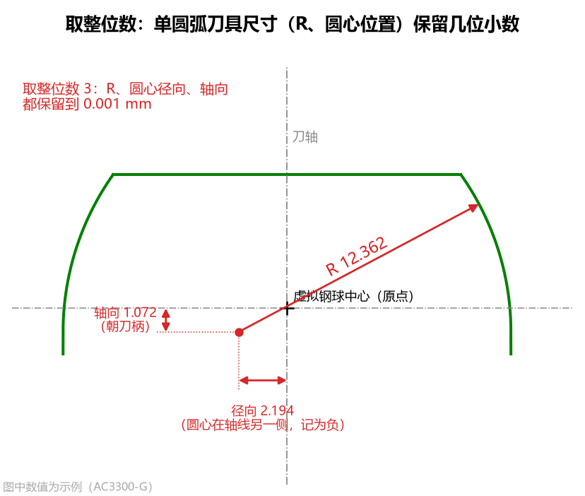

* **界面名称**：`取整位数`
* **可选项**：`不取整` / `0` / `1` / `2` / `3` / `4` / `5`（单位：`位`）
* **默认值**：`3`（即取整到 `0.001 mm`，与常规刀具图纸标注一致）
* **工程含义与取整影响对比**：
  软件在求出单圆弧或多段相切圆弧后，会将圆弧的 **半径 $R$、圆心径向坐标、圆心轴向坐标（及多段圆弧的交界 $z$）** 按 `取整位数` 四舍五入作为最终磨刀尺寸，然后再用取整后的刀具反算实际切出的球道偏差和钢球实际落座状态（因此取整引入的误差和交界微小错位已 100% 包含在仿真结果中）。

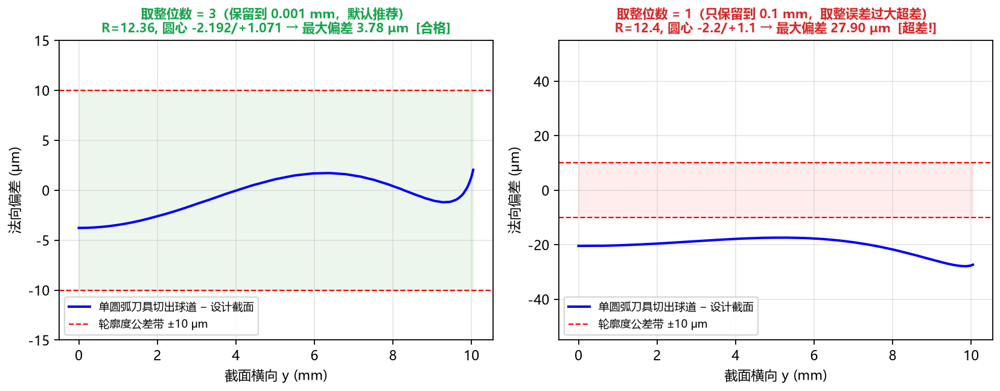

---

## 三、`导出` 分组（共 3 项，控制 Table 1 / Table 2 导出格式）

当您需要点击左下角的 **`方程常数（Table 1）`** 或 **`基本轮廓（Table 2）`** 导出客户图纸格式的数据表时，可通过以下 3 个选项控制输出方式（这 3 个选项均不影响刀具形状、DXF 图形和合格判定）：

### 1. 基本轮廓点数 (`n_basic`)

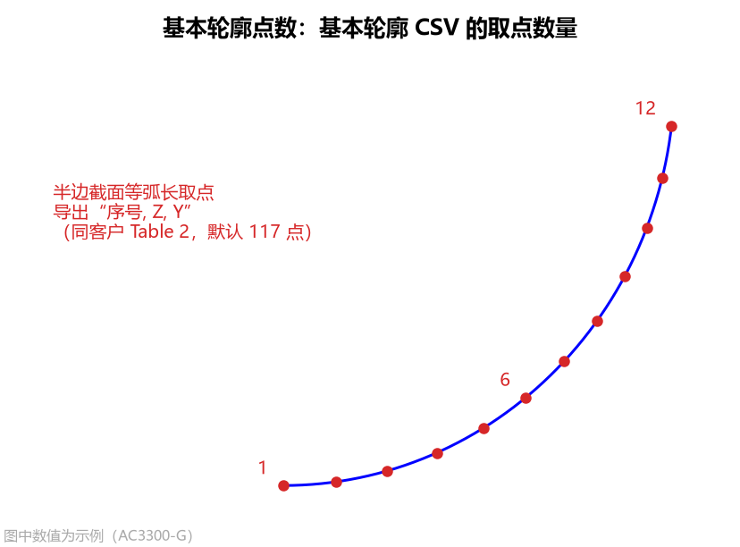

* **界面名称**：`基本轮廓点数`（单位：`点`，默认值：`117`）
* **工程含义**：控制导出 **`基本轮廓（Table 2）`**（`table2_basic_profile.csv`）时，在半边球道截面上等弧长取点的总数量。

### 2. 基本轮廓终点 (`basic_end`)

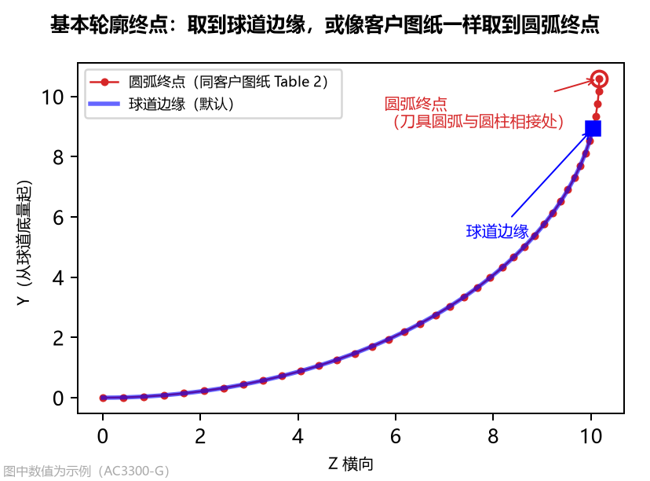

* **界面名称**：`基本轮廓终点`
* **可选项**：`球道边缘`（默认） / `圆弧终点`
* **工程含义与选择建议**：
  * **`球道边缘`（默认）**：取到球道与星形套外球面相交处为止，即零件上实际存在的那段球道范围；
  * **`圆弧终点`**：仅单圆弧刀具（`圆弧段数 = 1`）有效，取到单圆弧刀具圆弧段的末端（圆弧与圆柱相切交界处，对应参数方程终点 $X = C_9$）。当您需要将导出的 Table 2 首末点坐标与按参数方程生成的客户图纸 Table 2 逐点对照时，请选择 `圆弧终点`。

### 3. 常数依据 (`table_basis`)

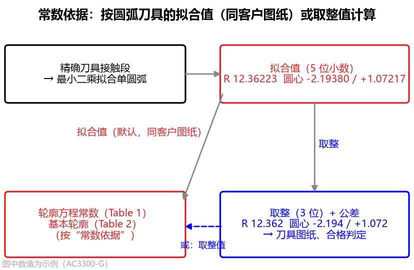

* **界面名称**：`常数依据`
* **可选项**：`拟合值`（默认） / `取整值`
* **工程含义与选择建议**：
  * **`拟合值`（默认，同客户图纸做法）**：按照单圆弧刀具**取整前的尺寸（保留 5 位小数）**计算 $C_1 \sim C_{10}$ 和基本轮廓；
  * **`取整值`**：按照按 `取整位数` 四舍五入后的名义磨刀尺寸计算 $C_1 \sim C_{10}$。
