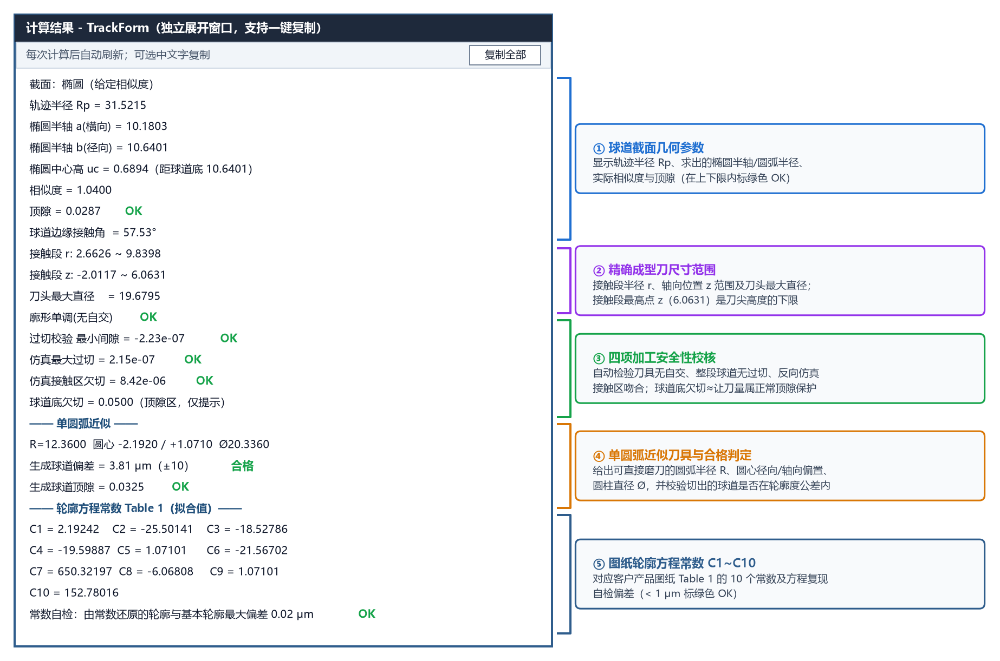

# 第四章：计算结果面板全面解读

每次点击 **`▶ 计 算 (F5)`** 后，左侧面板下方的 **`计算结果`** 区域会自动输出完整的工程计算与校核结论。通过该面板，您可以一眼确认求出的球道截面参数、精确刀具尺寸范围、四项加工安全校核是否全部通过（绿色 `OK`），以及单圆弧近似刀具尺寸与客户图纸常数（`C1 ~ C10`）。

---

## 计算结果面板操作与独立窗口展开

### 弹出独立宽窗口与一键复制（三种方式）
由于左侧栏宽度紧凑，您可以通过以下任一方式在独立的宽窗口中查看完整结果（独立窗口开启后，每次重新计算都会自动同步刷新）：
1. 点击 `计算结果` 标题栏右侧的 **`⤢ 展开`** 按钮；
2. 直接在 `计算结果` 文本框内**双击鼠标左键**；
3. 点击顶部菜单栏 **`视图(V) → 展开计算结果窗口`**。

在展开的 **`计算结果 - TrackForm`** 窗口右上角，点击 **`复制全部`** 按钮即可将全部文字一键复制到剪贴板，也可直接用鼠标拖选部分文字按 `Ctrl+C` 复制。

---

## 计算结果面板的五大信息分区

对照上图的编号批注，结果面板从上到下分为 5 个部分：

| 分区编号 | 分区名称 | 核心显示内容 | 对应详细教程 |
| :---: | :--- | :--- | :--- |
| **①** | **球道截面几何参数** | 截面类型与定义方式、轨迹半径 $R_p$、求出的椭圆半轴/圆弧半径/点表尺寸、实际相似度、顶隙及球道边缘接触角 | [4.1 精确廓形与加工安全校验指标](exact_and_check.md) |
| **②** | **精确成型刀尺寸范围** | 切削接触段半径范围 `接触段 r`、轴向范围 `接触段 z`（其最大值为刀尖高度的安全下限）、`刀头最大直径` | [4.1 精确廓形与加工安全校验指标](exact_and_check.md) |
| **③** | **四项加工安全性校核** | `廓形单调(无自交)`、`过切校验 最小间隙`、`仿真最大过切`、`仿真接触区欠切` 及 `球道底欠切` 提示 | [4.1 精确廓形与加工安全校验指标](exact_and_check.md) |
| **④** | **单圆弧近似刀具与合格判定** | 单圆弧半径 `R`、圆心径向/轴向坐标、圆柱段直径 `Ø`、`生成球道偏差`（合格/超差）与 `生成球道顶隙` | [4.2 单圆弧近似与轮廓方程常数 (Table 1)](arc_and_table1.md) |
| **⑤** | **轮廓方程常数 Table 1** | 客户产品图纸 Table 1 所需的 10 个常数 `C1 ~ C10` 以及 `常数自检` 结果 | [4.2 单圆弧近似与轮廓方程常数 (Table 1)](arc_and_table1.md) |

---

## 颜色标记说明

* **绿色 `OK` / `合格`**：表示该项几何指标或安全校验完全符合要求；
* **红色报警文字（如 `超出范围!`、`超差!`、`过切!` 等）**：表示当前参数存在刀尖截断切削刃、顶隙超限、钢球未贴合或单圆弧超差等问题，导出文件前软件也会弹窗拦截提醒。
