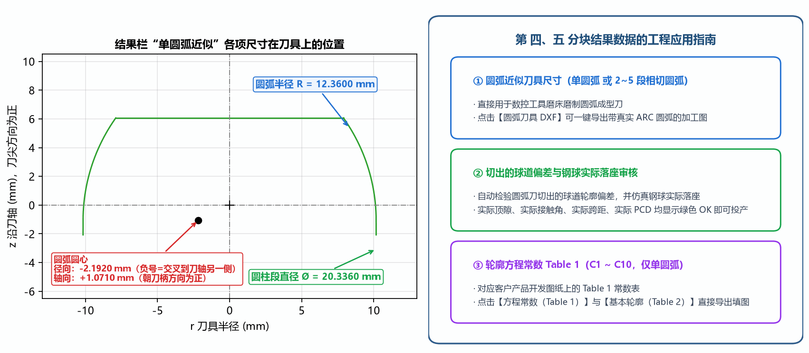

# 4.2 圆弧近似刀具与轮廓方程常数 (Table 1)

本节逐行解读计算结果面板下半部分的两大分块：**`■ 四、圆弧近似刀具`**（含磨刀尺寸、**刃口四分段与刀尖延伸**、实际落座审核）与 **`■ 五、轮廓方程常数 Table 1`**。

---

## 一、`■ 四、圆弧近似刀具` 的三种输出形态详解

根据您在【高级参数 → 圆弧近似】中所选的 **`圆弧段数`**（`1` 段 或 `2~5` 段）、**`单圆弧求法`**（`拟合精确廓形` 或 `按审核优化`）及 **`审核优化目标`**，第 四 分块会输出对应的磨刀尺寸、刃口分段范围与仿真落座审核结果：

### 形态 A：单圆弧 + 拟合精确廓形（默认，适用于椭圆与点表截面）

```text
■ 四、圆弧近似刀具：单圆弧，拟合精确廓形（取整到 3 位，磨刀尺寸）
  圆弧半径 R：12.3600
  圆心 径向：-2.1920（为负 = 圆心在刀轴另一侧）
  圆心 轴向：+1.0710（距虚拟钢球中心，刀柄方向为正）
  圆柱直径：Ø20.3360
  刀尖直径：Ø15.7952
  ▸ 刃口分段（z 沿刀轴）
  圆弧过渡：-1.071 ~ -0.175（长 0.896）
  边缘延伸：-0.175 ~ 0.031（长 0.206）
  接触段：0.031 ~ 6.068（长 6.037）
  刀尖端面：z 6.0683
  刀尖延伸：0.000（刀尖最多可沿原圆弧延伸到 z = 11.0931（距切出球道底处 5.025，圆弧已到刀轴（刀尖成尖点）））
  ▸ 该刀具切出的球道【实际值·仿真】
  与设计截面偏差：3.78 μm  合格（轮廓度 ±10）
  实际顶隙：0.0347  OK（图纸 0.019 ~ 0.04）
  实际接触角：41.905°  OK（图纸 40 ~ 44）
  实际接触角跨距：13.2538（未给范围）
  实际 PCD：62.4685  OK（偏差 +4.5 μm；图纸 62.454 ~ 62.474）
  钢球中心相对设计位置移动：+2.2 μm（朝开口为正）
```



#### 1. 核心磨刀尺寸
| 输出项 | 几何定义与正负号约定 |
| :--- | :--- |
| **`圆弧半径 R`** | 单圆弧刀具刀尖侧圆弧段的**圆弧半径 $R$**（单位 `mm`，已按 `取整位数` 取整）。 |
| **`圆心 径向 / 轴向`** | 分别为圆弧圆心的**径向位置**与**轴向位置**（单位 `mm`）：<br>• **圆心径向 `-2.1920`**：圆心到刀轴距离，**负号 `-` 表示圆心越过刀轴交叉到另一侧**；<br>• **圆心轴向 `+1.0710`**：圆心相对虚拟钢球中心沿刀轴距离，**朝刀柄方向为正**。 |
| **`圆柱直径`** | 靠近刀柄侧、与圆弧水平相切衔接的**圆柱段外径（刀头最大直径）**（单位 `mm`）。 |
| **`刀尖直径`** | 刀尖平端面（`z = 6.0683`）处的圆弧外径（单位 `mm`），方便磨刀后直接测量端面直径。 |

#### 2. `▸ 刃口分段（z 沿刀轴）` 与 `刀尖延伸`（新增！）
软件将整条圆弧刃口从刀柄侧（圆柱相切处）到刀尖端面，按实际功能精确划分为 **4 个轴向区段**（与 **[Tab 6](../5_tabs_charts/tab6_arc.md)** 左半刃口及 **[`arc_tool.dxf` 视图 ②](../6_exports_data/dxf_files.md)** 的四色分段一一对应）：
* **`圆弧过渡`**：从圆弧与圆柱相切处（`z = -1.071`）到边缘延伸起点，处于工作面之外，**不参与切削**；
* **`边缘延伸`**：球道开口边缘之外预留的延伸余量段（青色）；
* **`接触段`**：真正包络切出球道（从工作面边缘一直到球道底切点 $z_{\text{bottom}}$）的核心刃口段（红色）；
* **`刀尖延伸`**：当【圆弧近似】设置了 `刀尖延伸 > 0` 时，从切出球道底处沿原圆弧继续向刀尖延伸的区段（紫色，不切深球道底）；同时自动给出 **`刀尖最多可沿原圆弧延伸到 z = ...`** 供参考。

#### 3. `▸ 该刀具切出的球道【实际值·仿真】`
* **`与设计截面偏差`**：取整后圆弧刀具实际切出球道与设计截面的最大法向偏差（单位 `μm`），对照 `±轮廓度公差/2` 判定 **`合格`** 或 **`超差!`**；
* **`实际顶隙 / 实际接触角 / 实际接触角跨距 / 实际 PCD / 钢球中心相对设计位置移动`**：钢球放入切出球道后（**实际落座**，有余量时先退回余量还原成品边界）测得的装配指标，逐项校验 **`OK`** 或 **`超出范围!`**。

---

### 形态 B：单圆弧 + 按审核优化（支持 3 种 `审核优化目标`）

当对双圆弧（尖底）球道（如内部示例 `AC10000_星形套_参数`）选用单圆弧 `按审核优化` 时，输出如下：

```text
■ 四、圆弧近似刀具：单圆弧，按审核优化（取整到 3 位，磨刀尺寸）
  圆弧半径 R：11.3640
  圆心 径向：-1.3520（为负 = 圆心在刀轴另一侧）
  圆心 轴向：+0.6180（距虚拟钢球中心，刀柄方向为正）
  圆柱直径：Ø20.0240
  刀尖直径：Ø15.7827
  ▸ 刃口分段（z 沿刀轴）
  圆弧过渡：-0.618 ~ +0.139（长 0.757）
  边缘延伸：+0.139 ~ +0.325（长 0.185）
  接触段：+0.325 ~ 5.993（长 5.668）
  刀尖端面：z 5.9927
  刀尖延伸：0.000（刀尖最多可沿原圆弧延伸到 z = 10.6653（距切出球道底处 4.673...））
  ▸ 该刀具切出的球道【实际值·仿真】
  侧面偏差（|y| ≥ 3.30）：6.30 μm  合格（轮廓度 ±50；球道底允许适应）
  实际顶隙：0.0272  OK（图纸 0.02 ~ 0.1）
  实际接触角：44.475°  OK（图纸 38.5 ~ 45.5）
  实际接触角跨距：13.8368  OK（图纸 12.3 ~ 14）
  实际 PCD：63.8130  OK（偏差 -7.0 μm；图纸 63.81 ~ 63.83）
  钢球中心相对设计位置移动：-3.5 μm（朝开口为正）
```

* **`侧面偏差（|y| ≥ 3.30）`**：只考核球道侧面工作区（接触点横向位置一半以外）与设计截面的法向偏差，球道底允许从尖底自然过渡为圆底；
* **三种 `审核优化目标` 策略**：
  * `AC10000_星形套_参数` 在 **`贴合设计截面`** 模式下即可使侧面偏差低至 `6.30 μm` 且 4 项落座指标全部 **`OK`**；
  * 当其他产品图纸公差更严苛、按 **`贴合设计截面`** 优化导致顶隙/接触角/PCD 未全部满足（结果栏会提示建议切换）时，将 **`审核优化目标`** 改为 **`审核范围硬约束`** 或 **`审核范围中值`**，即可把指标拉回并居中在公差带内！

---

### 形态 C：多段相切圆弧（`圆弧段数 = 2 ~ 5`，适用于双圆弧尖底截面）

当针对 `AC10000_星形套_参数` 双圆弧球道将 `圆弧段数` 设为 **`3`** 时，输出如下：

```text
■ 四、圆弧近似刀具：3 段相切圆弧（取整到 3 位，磨刀尺寸）
  第 1 段（外凸）R：11.1170   圆心 径向 -1.1170 / 轴向 +0.5430；z 0.139 ~ 4.763
  第 2 段（外凸）R：18.4770   圆心 径向 -7.5840 / 轴向 +4.0550；z 4.763 ~ 6.291
  第 3 段（内凹）R：23.3230   圆心 径向 +27.0480 / 轴向 -19.3510；z 6.291 ~ 9.873
  圆柱直径：Ø20.0000
  刀尖直径：Ø11.4754
  交界错位：1.03 μm
```

* **`第 1~N 段（外凸 / 内凹）`**：从刀柄侧到刀尖侧依次列出每段相切圆弧的凹凸方向、半径 `R`、圆心 `径向 / 轴向` 坐标及轴向范围 `z`；
* **`交界错位`**：按 3 位小数取整后在交界点处的微米级径向差值；导出 `圆弧刀具 DXF` 时已自动绘制为**严格相切连续（$G^1$）的 `ARC` 圆弧链**。

---

## 二、`■ 五、轮廓方程常数 Table 1` 结果解读

当 **`工件类型` 为 `星形套（固定节）` 且 `圆弧段数 = 1`** 时，第 五 分块直接输出客户图纸 Table 1 所需的 10 个常数（`C1 ~ C10`）与还原自检结果：

```text
■ 五、轮廓方程常数 Table 1（拟合值）
  C1：2.19160     C2：-25.50227
  C3：-18.52849   C4：-19.59946
  C5：1.07098     C6：-21.56794
  C7：650.36593   C8：-6.06824
  C9：1.07098     C10：152.76417
  常数自检：0.10 μm  OK（由常数还原的轮廓与基本轮廓的最大偏差（应 < 1 μm））
```

* **一键导出填图**：点击左侧 **`方程常数（Table 1）`** 导出 `table1_constants.csv`，点击 **`基本轮廓（Table 2）`** 导出对应的 117 点坐标表 `table2_basic_profile.csv`；
* **不适用情况**：当 `圆弧段数` 设为 `2 ~ 5` 段时提示 `只适用于单圆弧刀具（圆弧段数 = 1），多段圆弧不提供`（仍可导出 `基本轮廓（Table 2）`）；其他扩展工件类型的 Table 1 常数尚在开发中，暂不提供。
