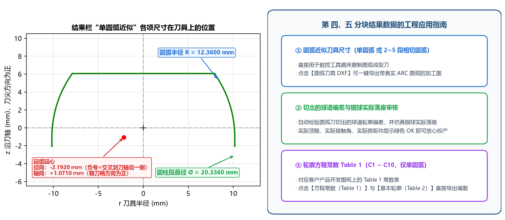

# 4.2 圆弧近似刀具与轮廓方程常数 (Table 1)

本节逐行解读计算结果面板下半部分的两大分块：**`■ 四、圆弧近似刀具`**（含磨刀尺寸、**刃口四分段与刀尖延伸**、实际落座审核）与 **`■ 五、轮廓方程常数 Table 1`**。

---

## 一、`■ 四、圆弧近似刀具` 的三种输出形态详解

根据您在【高级参数 → 圆弧近似】中所选的 **`圆弧段数`**（`1` 段 或 `2~5` 段）、**`单圆弧求法`**（`拟合精确廓形` 或 `按审核优化`）及 **`审核优化目标`**，第 四 分块会输出对应的磨刀尺寸、刃口分段范围与仿真落座审核结果：

### 形态 A：单圆弧 + 拟合精确廓形（默认，适用于椭圆与点表截面）

```text
■ 四、圆弧近似刀具：单圆弧，拟合精确廓形（取整到 3 位，磨刀尺寸）
  圆弧半径 R：12.3600
  圆心 径向 / 轴向：-2.1920 / +1.0710（径向负=在刀轴另一侧，轴向朝刀柄为正）
  圆柱直径（刀头最大直径）：Ø20.3360
  刀尖直径：Ø16.9539（刀尖端面 z = 6.0680）
  ▸ 刃口分段（z 沿刀轴）
  圆弧过渡（接圆柱）：-1.0710 ~ -0.1747（长 0.8963，不切削）
  边缘延伸：-0.1747 ~ -0.0566（长 0.1181，球道边缘外的余量）
  接触段（切削球道）：-0.0566 ~ 6.0680（长 6.1246）
  刀尖端面（平切）：z = 6.0680，Ø16.9539
  刀尖延伸：0.0000（未延伸；刀尖最多可沿原圆弧延伸到 z = 10.2229，即再延伸 4.1549 而不切深球道底）
  ▸ 该刀具切出的球道【实际值·仿真】
  与设计截面偏差：3.78 μm  合格（轮廓度 ±10）
  实际顶隙：0.0325  OK（图纸 0.019 ~ 0.04）
  实际接触角：41.988°  OK（图纸 40 ~ 44）
  实际接触角跨距：13.2751（未给范围）
  钢球中心移动：+3.8 μm（朝开口为正）
  实际 PCD：62.4716  OK（偏差 +7.6 μm；图纸 62.454 ~ 62.474）
```



#### 1. 核心磨刀尺寸
| 输出项 | 几何定义与正负号约定 |
| :--- | :--- |
| **`圆弧半径 R`** | 单圆弧刀具刀尖侧圆弧段的**圆弧半径 $R$**（单位 `mm`，已按 `取整位数` 取整）。 |
| **`圆心 径向 / 轴向`** | 斜杠 `/` 前后分别为圆弧圆心的**径向位置**与**轴向位置**（单位 `mm`）：<ul><li>**斜杠前 `-2.1920`（径向）**：圆心到刀轴的距离，**负号 `-` 表示圆心越过刀轴交叉到了另一侧**；</li><li>**斜杠后 `+1.0710`（轴向）**：圆心相对于虚拟钢球中心沿刀轴的距离，**朝刀柄方向为正**。</li></ul> |
| **`圆柱直径（刀头最大直径）`** | 靠近刀柄侧、与圆弧水平相切衔接的**圆柱段外径**（单位 `mm`）。 |
| **`刀尖直径`** | 刀尖平端面（`z = 6.0680`）处的圆弧外径（单位 `mm`），方便磨刀后直接测量刀尖端面直径。 |

#### 2. `▸ 刃口分段（z 沿刀轴）` 与 `刀尖延伸`（新增！）
软件将整条圆弧刃口从刀柄侧（圆柱相切处）到刀尖端面，按实际功能精确划分为 **4 个轴向区段**（与 **[Tab 6](../5_tabs_charts/tab6_arc.md)** 左半刃口及 **[`arc_tool.dxf` 视图 ②](../6_exports_data/dxf_files.md)** 的四色分段一一对应）：
* **`圆弧过渡（接圆柱）`**：从圆弧与圆柱相切处（$z = z_c$）到边缘延伸起点，处于外球面之外，**不参与切削**；
* **`边缘延伸`**：球道开口边缘（外球面）之外预留的延伸余量段；
* **`接触段（切削球道）`**：真正包络切出球道（从外球面边缘一直到球道底切点 $z_{\text{cut}}$）的核心刃口段；
* **`刀尖延伸`**：当【圆弧近似】中设置了 `刀尖延伸 > 0` 时，显示从切出球道底处 $z_{\text{cut}}$ 沿同一圆弧继续向刀尖延伸的区段（不切削球道底，用于避开尖角磨损）；同时自动给出 **`刀尖最多可沿原圆弧延伸到 z = ...`** 的几何极限供参考。

#### 3. `▸ 该刀具切出的球道【实际值·仿真】`
* **`与设计截面偏差`**：取整后的圆弧刀具实际包络切出的球道与设计截面的最大法向偏差（单位 `μm`），对照 `±轮廓度公差/2` 判定 **`合格`** 或 **`超差!`**；
* **`实际顶隙 / 实际接触角 / 实际接触角跨距 / 钢球中心移动 / 实际 PCD`**：把钢球放进圆弧刀切出的球道中（**实际落座**）测得的全部装配指标，逐项对照图纸公差校验 **`OK`** 或 **`超出范围!`**。

---

### 形态 B：单圆弧 + 按审核优化（支持 3 种 `审核优化目标`）

当对双圆弧（尖底）球道（如内置示例 `AC10000`）选用单圆弧 `按审核优化` 时，输出如下：

```text
■ 四、圆弧近似刀具：单圆弧，按审核优化（贴合设计截面）（取整到 3 位，磨刀尺寸）
  圆弧半径 R：10.5060
  圆心 径向 / 轴向：-0.5580 / -0.0250（径向负=在刀轴另一侧，轴向朝刀柄为正）
  圆柱直径（刀头最大直径）：Ø19.8960
  刀尖直径：Ø11.8364（刀尖端面 z = 8.4648）
  ▸ 刃口分段（z 沿刀轴）
  边缘延伸：0.0250 ~ 0.1414（长 0.1164，球道边缘外的余量）
  接触段（切削球道）：0.1414 ~ 8.4648（长 8.3234）
  刀尖端面（平切）：z = 8.4648，Ø11.8364
  刀尖延伸：0.0000（未延伸；刀尖最多可沿原圆弧延伸到 z = 9.8750，即再延伸 1.4102 而不切深球道底）
  ▸ 该刀具切出的球道【实际值·仿真】
  侧面偏差（|y| ≥ 3.31）：3.00 μm  合格（轮廓度 ±50；球道底允许适应）
  实际顶隙：0.0029  超出范围!（图纸 0.02 ~ 0.1）
  实际接触角：42.263°  OK（图纸 38.5 ~ 45.5）
  实际接触角跨距：13.2846  OK（图纸 12.3 ~ 14）
  钢球中心移动：-12.5 μm（朝开口为正）
  实际 PCD：69.9746  超出范围!（偏差 -25.4 μm；图纸 69.99 ~ 70.01）
  审核项未全部满足：当前按“贴合设计截面”优化（审核范围为软约束）。只按审核项验收时，可把“审核优化目标”改为“审核范围硬约束”或“审核范围中值”（侧面会偏离双圆弧设计截面）
```

* **`侧面偏差（|y| ≥ 3.31）`**：只考核球道侧面工作区（接触点横向位置一半以外）与设计截面的法向偏差，球道底允许从尖底自然过渡为圆底；
* **智能切换提示**：当默认按 **`贴合设计截面`** 优化导致顶隙或实际 PCD 等软约束未满足时，结果栏会直接给出切换建议——只需将【圆弧近似】中的 **`审核优化目标`** 改为 **`审核范围硬约束`** 或 **`审核范围中值`**，即可让顶隙、接触角、跨距、实际 PCD 四项审核指标 100% 达标！

---

### 形态 C：多段相切圆弧（`圆弧段数 = 2 ~ 5`，适用于双圆弧尖底截面）

当针对双圆弧（尖底）球道将 `圆弧段数` 设为 **`3`** 时，输出如下：

```text
■ 四、圆弧近似刀具：3 段相切圆弧（取整到 3 位，磨刀尺寸）
  第 1 段（外凸）：R = 11.1210   圆心 -1.1210 / +0.0250   z: 0.097 ~ 4.819
  第 2 段（外凸）：R = 18.9720   圆心 -7.9030 / +4.0340   z: 4.819 ~ 6.329
  第 3 段（内凹）：R = 23.4820   圆心 +27.3260 / -16.2990   z: 6.329 ~ 9.875
  圆柱直径 / 刀尖直径：Ø20.0000 / Ø11.5718（交界取整错位 0.42 μm（DXF 中已画成严格相切））
```

* **`第 1~N 段（外凸 / 内凹）`**：从刀柄侧到刀尖侧依次列出每段相切圆弧的凹凸方向、半径 `R`、圆心 `径向 / 轴向` 坐标及轴向范围 `z`；
* **`交界取整错位`**：按 3 位小数取整后在交界点处的亚微米级径向差值；导出 `圆弧刀具 DXF` 时已自动绘制为**严格相切连续（$G^1$）的 `ARC` 圆弧链**。

---

## 二、`■ 五、轮廓方程常数 Table 1` 结果解读

当 `圆弧段数 = 1` 时，第 五 分块直接输出客户图纸 Table 1 所需的 10 个常数（`C1 ~ C10`）与还原自检结果：

```text
■ 五、轮廓方程常数 Table 1（拟合值）
  C1：2.19160     C2：-25.50227
  C3：-18.52849   C4：-19.59946
  C5：1.07098     C6：-21.56794
  C7：650.36593   C8：-6.06824
  C9：1.07098     C10：152.76417
  常数自检：0.00 μm  OK（由常数还原的轮廓与基本轮廓的最大偏差（应 < 1 μm））
```

* **一键导出填图**：点击左侧 **`方程常数（Table 1）`** 导出 `table1_constants.csv`，点击 **`基本轮廓（Table 2）`** 导出对应的 117 点坐标表 `table2_basic_profile.csv`；
* **多段圆弧说明**：当 `圆弧段数` 设为 `2 ~ 5` 段时，第 五 分块会提示 `只适用于单圆弧刀具（圆弧段数 = 1），多段圆弧不提供`（仍可正常导出 `基本轮廓（Table 2）` 供三坐标检测使用）。
