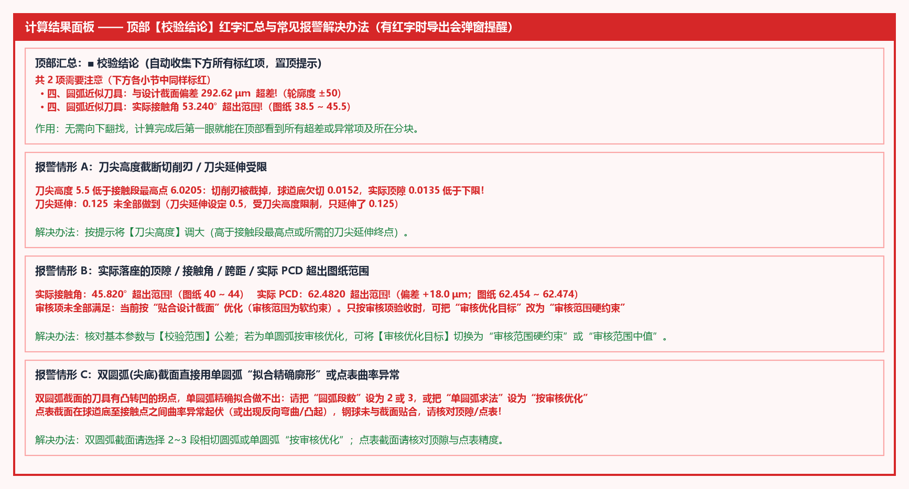

# 4.1 截面设计、精确廓形与仿真落座

本节逐行解读计算结果面板顶部的 **`■ 校验结论`** 以及前三大分块：**`■ 一、球道截面设计【理论值】`**、**`■ 二、精确刀具廓形【理论值】`** 与 **`■ 三、精确刀具切出的球道【实际值·仿真】`**。

---

## 一、顶部汇总：`■ 校验结论`（新增！）

每次计算完成后，软件会自动扫描整份报告（含第 一 ~ 五 分块）中所有带红色报警状态（`bad`）的条目，并在报告最顶部生成 **`■ 校验结论`**：

* **全部合格时**：
  ```text
  ■ 校验结论
    全部校验通过
  ```
* **存在超差或异常项时**：
  ```text
  ■ 校验结论
    共 2 项需要注意（下方各小节中同样标红）
      · 四、圆弧近似刀具：与设计截面偏差 292.62 μm  超差!（轮廓度 ±50）
      · 四、圆弧近似刀具：实际接触角 53.240°  超出范围!（图纸 38.5 ~ 45.5）
  ```

---

## 二、`■ 一、球道截面设计【理论值】` 逐行详解

以默认 `AC3300-G` 椭圆球道为例，第一分块输出如下：

```text
■ 一、球道截面设计【理论值】
  截面：椭圆（给定相似度）
  工件类型：星形套（固定节）
  钢球中心轨迹半径 Rp：31.5225
  椭圆半轴 a(横向)：10.1762   b(径向) = 10.6436
  椭圆中心高 uc：+0.6929（相对钢球中心，朝球道开口为正；距球道底 10.6436）
  接触角 α：42.000°（公差 -2/+2°，实际接触角应在 40.000 ~ 44.000）
  相似度：1.0400
  顶隙：0.0287  OK（图纸 0.019 ~ 0.04）
  接触角跨距：13.2782（未给范围，不校验）
  球道边缘接触角：81.17°
```

| 输出行名称 | 含义与核对方法 |
| :--- | :--- |
| **`截面` 与 `工件类型`** | 分别列出截面类型与定义方式（如 `椭圆（给定相似度）`），以及当前选定的 `工件类型`（如 `星形套（固定节）`；扩展类型在内部版中旁注 `开发中`）。 |
| **`钢球中心轨迹半径 Rp` / `钢球中心轨迹`** | • **圆弧球道（固定节）**：显示 `钢球中心轨迹半径 Rp`（单位 `mm`）；<br>• **直线 / VL 斜球道**：显示 `直线` 或 `斜线 γ = ...°`（旁注 `距轴线 PCD/2`）。 |
| **截面特征描述行** | 按截面类型输出几何尺寸：<br>• **椭圆**：输出 `椭圆半轴 a(横向)`、`b(径向)` 及 `椭圆中心高 uc`；<br>• **双圆弧**：输出 `圆弧半径 R`、交叉 `圆心 (y, u)` 坐标及 `尖点处法线角 θ0`；<br>• **点表(CSV)**：输出点表宽深、`光顺偏差`、钢球最小间隙及点表曲率质量诊断。 |
| **`接触角 α`** | 理论截面接触角，并显示由【校验范围】`接触角下偏差 / 上偏差` 换算出的实际接触角合格区间（如 `公差 -2/+2°，实际接触角应在 40.000 ~ 44.000`）。 |
| **`相似度`** | 球道名义截面（不含余量）在接触点处的曲率半径与钢球半径之比。 |
| **`顶隙`** | 钢球最低点与名义球道底之间的理论径向间隙（单位 `mm`），对照 `[顶隙下限, 顶隙上限]` 自动判定 **`OK`** 或 **`超出范围!`**。 |
| **`接触角跨距`** | 钢球与左右两侧球道接触点之间的水平跨距（$= D_w \sin\alpha$，单位 `mm`），对照 `[接触角跨距下限, 接触角跨距上限]` 判定。 |
| **`球道边缘接触角`** | 球道槽壁与工件工作面（如外球面 / 内球面 / 内孔）相交处（球道开口边缘）的截面法线角。 |

---

## 三、`■ 二、精确刀具廓形【理论值】` 逐行详解

```text
■ 二、精确刀具廓形【理论值】
  接触段 r（到球道边缘）：7.9269 ~ 10.1209
  接触段 z（到球道边缘）：0.0310 ~ 6.0205
  边缘延伸：0.3 mm（在球道边缘 z = 0.0310 之外继续到 z = -0.1747（r 10.1384），为外球面尺寸偏差和定位误差留的余量）
  刀头最大直径：20.2768（含边缘延伸）
  刀尖高度：9.922
  廓形单调（无自交）：是
  过切校验 最小间隙：1.75e-07  OK（< 0 为过切）
```

| 输出行名称 | 工程含义与制造用途 |
| :--- | :--- |
| **`接触段 r / z（到球道边缘）`** | 真正切出球道（从球道底到工作面球道边缘处）的核心接触段刃口在刀具坐标系（原点 = 虚拟钢球中心，朝刀尖为正）下的半径与轴向范围；其中 `z` 最大值（如 `6.0205`）即**接触段最高点**。 |
| **`边缘延伸`** | 在球道边缘之外朝刀柄方向多算的一小段刃口（青色段），为工件尺寸偏差与装夹定位误差留出余量。 |
| **`刀头最大直径 / 刀尖高度`** | 精确刀具接触段（含边缘延伸）的最大回转外径与当前设定的刀尖平端高度。 |
| **`廓形单调（无自交）`** | 检查刀具接触段母线沿轴向是否单调变化、无回折自交。 |
| **`过切校验 最小间隙`** | 将整段三维球道面网格点与摆动/移动中的刀具逐点比对，确保走刀全程无干涉过切。 |

---

## 四、`■ 三、精确刀具切出的球道【实际值·仿真】`（含钢球落座与工件干涉）

软件驱动精确刀具沿球道轨迹运动做反向包络仿真，求出实际切出的球道截面，并**将直径为 $D_w$ 的钢球实际放进切出的球道中（实际落座）**：

```text
■ 三、精确刀具切出的球道【实际值·仿真】
  最大过切：0.00e+00  OK
  侧面（钢球接触区）欠切：2.27e-05  OK
  球道底欠切：0.0000（顶隙区）
  ▸ 钢球放进切出的球道（实际落座）
  实际顶隙：0.0287  OK（图纸 0.019 ~ 0.04）
  实际接触角：41.982°  OK（图纸 40 ~ 44）
  实际接触角跨距：13.2736（未给范围）
  实际 PCD：62.4640  OK（偏差 +0.0 μm；图纸 62.454 ~ 62.474）
  钢球中心相对设计位置移动：+0.0 μm（朝开口为正）
```

### 1. 反向包络仿真与刀尖截断智能判据
* **`最大过切`** 与 **`侧面（钢球接触区）欠切`**：正常时均为 `1e-5 mm` 以下的离散仿真误差量级，显示绿色 **`OK`**。
* **`球道底欠切` 的智能分析**：
  * 当 `刀尖高度` 高于接触段最高点时，球道底完全切出；
  * 当 `刀尖高度` 低于接触段最高点时，软件会自动说明截去范围，并结合下方**钢球实际落座后的 `实际顶隙`**判定：只要 `实际顶隙` 仍在图纸 `顶隙下限` 之上就完全合格；只有当截去过多导致实际顶隙低于下限时，才在报告顶部标红报警 `请提高刀尖高度（最高到 ... 时不截断）`。

### 2. `▸ 钢球放进切出的球道（实际落座）` 五项实测指标
将刚性钢球沿对称轴放入切出球道直到与两侧槽壁贴合接触（**当设置了 `法向余量` 如 `0.15 mm` 时，仿真会先沿法向退回该余量还原精加工成品边界后再放球**），测得 5 项装配指标：
1. **`实际顶隙`**：落座后钢球最低点到成品球道底的真实距离（对照 `[顶隙下限, 顶隙上限]` 校验 **`OK`** / **`超出范围!`**）；
2. **`实际接触角`**：落座后钢球与切出球道侧壁接触点的真实法线角（对照 `[接触角 + 下偏差, 接触角 + 上偏差]` 校验）；
3. **`实际接触角跨距`**：落座后左右两接触点之间的真实水平距离（对照 `[跨距下限, 跨距上限]` 校验）；
4. **`实际 PCD`**：由钢球落座中心移动量换算出的实际节圆直径（圆弧球道按 $2\sqrt{(R_p \pm \Delta)^2 - e^2}$，直线球道按 $\text{PCD} \pm 2\Delta$），对照 PCD 上下偏差校验；
5. **`钢球中心相对设计位置移动`**：落座钢球心相对设计中心 $(0,0)$ 的偏移量（单位 `μm`，朝球道开口方向为正 `+`）。

### 3. `▸ 工件与刀具干涉`（非固定节星形套显示）
当使用除 `星形套（固定节）` 以外的 5 种扩展工件类型（如外圈斜筒形壳 `EVL12508M.0F2-1`）时，第 三 分块会自动附加 **`▸ 工件与刀具干涉`** 子块（同步对应 Tab 4 下方的允许刀颈直径曲线）：
* **`球道范围 Z` / `球道盲端（刀具收尾）`**：列出贯通球道或外圈盲端处刀具收尾轴向位置；
* **`刀颈允许最大直径（最窄处）`**：三维扫描全行程后给出的刀颈安全包络极限直径（若整段碰不到工件则显示 `≥ 50`，否则给出最窄处直径及距球心距离）；
* **`刀头尾端直径`**：检验刀头末端是否触碰工件实体（触发则标红 **`碰工件!`**）；
* **`刀柄端面距开口端面`**：检验行程终点时刀柄端面是否位于工件外部（`< 0` 则标红 **`伸入工件!`**）。

---

## 五、常见红色报警汇总与快速处理



* **情形 A（刀尖高度截断切削刃 / 刀尖延伸受限）**：若导致实际顶隙不足或刀尖延伸未全部做到而标红报警，展开 **`▸ 高级参数`** 将 `刀尖高度` 调大至提示值即可；
* **情形 B（实际落座的顶隙 / 接触角 / 跨距 / 实际 PCD 超出范围）**：
  * 核对基本参数与【高级参数 → 校验范围】中的公差设置；
  * 若出现在第 四 分块且正在使用单圆弧 `按审核优化`，可将 **`审核优化目标`** 切换为 **`审核范围硬约束`** 或 **`审核范围中值`**，或改用多段相切圆弧（`圆弧段数 = 2~3`）；
* **情形 C（双圆弧直接用单圆弧“拟合精确廓形”超差 / 点表曲率异常 / 刀颈碰工件）**：双圆弧请选 `2~3` 段相切圆弧或单圆弧 `按审核优化`；点表请核对 `顶隙 c` 与 `点表精度`；外圈碰工件或伸入工件时请减小切入角 $\beta$、增大 `球心距 L` 或缩小刀颈直径。
