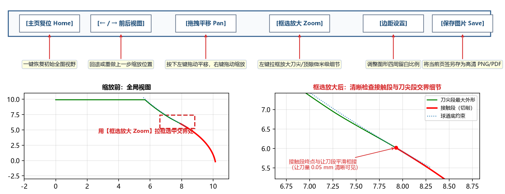

# 第五章：六大可视化图表标签页详解

右侧主工作区共设有 **6 个交互式工程图表标签页（Tab 1 ~ Tab 6）**。每次点击 **`▶ 计算刀具廓形`** 后，全部 6 个标签页会同步刷新，从**刀具自身廓形、球道法向截面、星形套轴向截面、机床子午面摆动姿态、反向切削仿真偏差、单圆弧近似对比**六个维度全方位展示设计结果。

---

## 六大图表标签页速查与快捷键

您可以直接用鼠标点击顶部标签栏切换，也可以使用键盘快捷键 **`Ctrl + 1` ~ `Ctrl + 6`** 瞬间切换：

| 标签序号 | 标签页名称 | 快捷键 | 核心看图目的 | 详细教程链接 |
| :---: | :--- | :---: | :--- | :--- |
| **Tab 1** | **`刀具廓形`** | `Ctrl+1` | 查看精确成型刀具全貌、有效接触段（红）与刀尖避空段（绿）、最大外径与刀尖高度 | [5.1 Tab 1：刀具廓形](tab1_tool.md) |
| **Tab 2** | **`球道截面`** | `Ctrl+2` | 核对球道法向截面形状、钢球两点接触位置（$\alpha$）、顶隙 $c$ 及截面关键尺寸 | [5.2 Tab 2：球道截面](tab2_section.md) |
| **Tab 3** | **`星形套截面`** | `Ctrl+3` | 核对星形套子午面外形尺寸（$W, H, e, S\varnothing, \varnothing\text{内孔}, R_p$）及球道底壁厚 | [5.3 Tab 3：星形套截面](tab3_part.md) |
| **Tab 4** | **`加工姿态(子午面)`** | `Ctrl+4` | 动态检视刀具与刀柄在 $\varphi_{\min}, 0, \varphi_{\max}$ 三个摆角位置的包络关系与防干涉情况 | [5.4 Tab 4：加工姿态(子午面)](tab4_pose.md) |
| **Tab 5** | **`反向仿真偏差`** | `Ctrl+5` | 检验三维反向包络切出的球道与理论球道的微米级误差（严防过切与工作区欠切） | [5.5 Tab 5：反向仿真偏差](tab5_sim.md) |
| **Tab 6** | **`单圆弧近似`** | `Ctrl+6` | 评估单圆弧近似刀具与精确刀具的半径差，以及加工球道偏差是否落在红色公差带内 | [5.6 Tab 6：单圆弧近似](tab6_arc.md) |

---

## 底部图表导航工具栏操作指南

在右侧图表区域的左下角，配备有全功能交互工具栏和实时坐标读数器：

| 工具按钮 | 图标/名称 | 操作方法与实用技巧 |
| :---: | :--- | :--- |
| **① 复位视图** | **`[主页 Home]`** | 当您放大或平移图表后，点击此按钮立即恢复默认的 1:1 全局居中视图。 |
| **② 后退 / 前进** | **`[<-] [->]`** | 在您之前浏览过的多个局部放大视图历史之间前后切换。 |
| **③ 平移视图** | **`[平移 Pan]`** | 点击激活后：<ul><li>按住**鼠标左键拖拽**：任意方向平移画布；</li><li>按住**鼠标右键拖拽**：沿水平或竖直方向动态缩放坐标轴。</li></ul>再次点击可取消激活。 |
| **④ 框选放大** | **`[框选放大 Zoom]`** | **最常用功能**：点击激活后，在图表任意局部（如球道底部顶隙区或刀尖交界处）**按住鼠标左键拉出一个矩形框**，即可将该微米级细节放大至全屏查看！用鼠标右键拉框则是缩小。 |
| **⑤ 边距设置** | **`[边距]`** | 弹出滑块微调图表四周留白边距与子图间距。 |
| **⑥ 保存图片** | **`[保存图片 Save]`** | 将当前正在查看的标签页图表直接导出保存为高清 **`.png` / `.pdf` / `.svg`** 图像文件，可直接插入技术报告或 PPT。 |
| **⑦ 实时坐标** | 右侧 `x=... y=...` | 鼠标在图表画布内移动时，状态栏右侧实时显示当前光标所在位置的精确工程坐标值（单位：`mm` 或 `μm`）。 |

