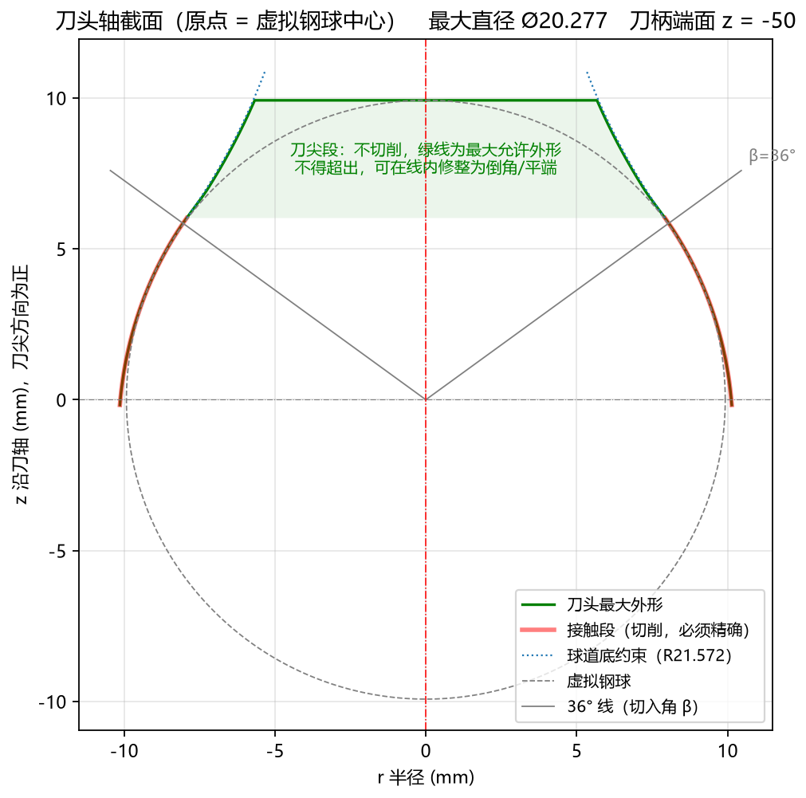

# 5.1 Tab 1：刀具廓形 (`Ctrl+1`)

**`刀具廓形`** 是软件启动后的默认首屏标签页，以 **1:1 等比例坐标系** 直观展示所设计的球道成型刀具（成型铣刀或成型磨轮）的轴向回转截面全貌。

---

## 一、标题栏关键读数与坐标系定义

### 1. 顶部标题栏三项核心读数
图表顶部标题栏实时汇总当前刀头的三项基准参数（以默认参数为例）：
* **`刀头轴截面 (原点 = 虚拟钢球中心)`**：标明当前视图为包含刀具旋转轴线的轴向剖面，且坐标原点 $(0, 0)$ 位于虚拟钢球中心；
* **`最大直径 Ø20.277`**：接触段刀刃下端最大半径（$r_{\max} = 10.1384\text{ mm}$）对应的回转外径，直接用于选定刀具棒料或毛坯直径；
* **`刀柄端面 z = -50`**：标明刀柄定位端面在当前刀具坐标系中的轴向位置（由高级参数中的 `球心距 L` 与 `刀柄方向` 共同决定）。

### 2. 坐标轴定义
* **横轴 `r 半径 (mm)`**：垂直于刀具旋转轴线的径向坐标。中央红色竖直点划线 `r = 0` 即为**刀具旋转中心轴线**，左右两侧刀刃关于 `r = 0` 完全对称。
* **纵轴 `z 沿刀轴 (mm)，刀尖方向为正`**：沿着刀具旋转轴线的高度坐标。
  * **原点 `z = 0`**：虚拟钢球球心所在的基准水平面（灰色水平点划线）；
  * **向上（$+z$ 方向）**：朝向刀具前端**刀尖顶面**（切入球道底部深处）；
  * **向下（$-z$ 方向）**：朝向刀头根部及刀柄端面（对应球道外球面开口边缘）。

---

## 二、图例与各色曲线工程含义

在阅读 `刀具廓形` 图时，请对照右下角图例重点区分以下 5 组几何元素：

| 图例名称 | 线型与颜色 | 工程含义与设计作用 |
| :--- | :--- | :--- |
| **`刀头最大外形`** | **绿色粗实线 + 浅绿填充区** | 勾勒出整个成型刀头的完整回转外轮廓。其中接触段上端分界线以上的浅绿色阴影区域标有文字说明：**“刀尖段：不切削，绿线为最大允许外形，不得超出，可在线内修整为倒角/平端”**。 |
| **`接触段 (切削，必须精确)`** | **珊瑚红粗实线** | **核心工作刀刃**（叠加在左右两侧下段的绿线上）！该段刀刃直接包络切削出星形套球道的有效工作接触面，制造与检测时必须严格保证其轮廓度精度。 |
| **`球道底约束 (R21.572)`** | **蓝色点线** | 球道底部最低点（半径 `R21.572`）在刀具坐标系下形成的极限包络边界。刀尖段绿色实线向内偏置了 `让刀量`（默认 `0.05 mm`），始终保持在蓝色点线内侧，确保刀尖绝不刮伤球道底面。 |
| **`虚拟钢球`** | **灰色细虚线圆** | 以原点 $(0,0)$ 为圆心、直径等于钢球直径 $D_w$（默认 `19.844 mm`）的虚拟参考钢球，用于直观对比成型刀刃曲率与钢球曲率的差异。 |
| **`36° 线 (切入角 β)`** | **灰色细实线** | 从原点 $(0,0)$ 引出、与水平面呈切入角 $\beta$（图中标有 `β=36°`）的参考线，直观标示球道底部方向对应的刀具轴向位置（即接触段与刀尖段的分界高度附近）。 |

---

## 三、工程师看图检查要点

1. **检查接触段（红线）与刀尖段（绿线）衔接是否自然**：
   * 正常情况下，两侧珊瑚红粗实线（接触段）在接近 `36° 线` 处平滑过渡为上方的绿色刀尖避空线；
   * 若浅绿色刀尖区域完全消失，或者红线顶部被平顶直接截断，说明高级参数中的 **`刀尖高度` 设得太小**（低于接触段上端 $z_{\max}$），必须立即调大 `刀尖高度`。
2. **根据加工工艺优化刀尖段外形**：
   * 正如图中绿色文字提示所示，浅绿色填充区域内的刀尖段**不参与有效球道面切削**。若觉得默认刀尖高度（`9.922 mm`）较高，可在高级参数中将 **`刀尖高度`** 调小至略大于接触段上限（例如对默认参数设为 `6.2 ~ 6.5 mm`），或在绿色最大允许外形线以内将其修整为平端/大圆角，以提高刀头刚性与散热能力。
