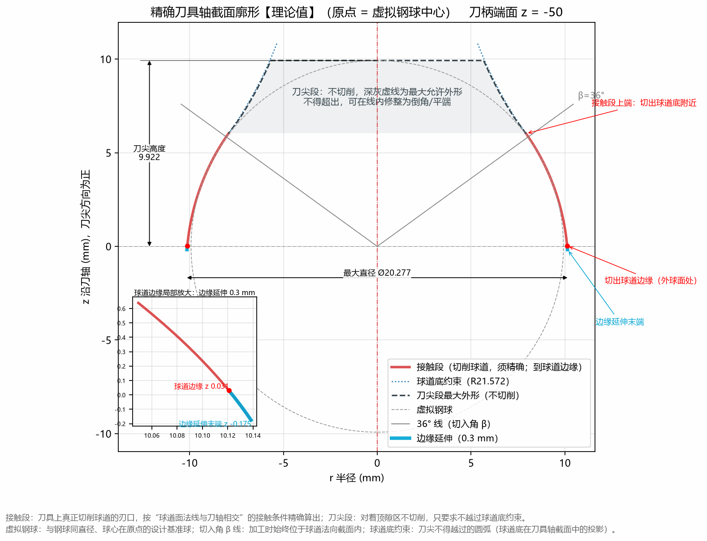

# 5.1 Tab 1：精确刀具廓形 (`Ctrl+1`)

**`精确刀具廓形`** 是软件启动后的默认首屏标签页，以 **1:1 等比例坐标系** 直观展示按包络条件算出的精确球道成型刀具轴截面全貌，并在图上直接标出**关键尺寸箭头**、**切削边界说明**以及**球道边缘延伸段的局部放大窗**。

---

## 一、标题栏关键读数、坐标系与图面尺寸标注

### 1. 顶部标题栏与图面直接尺寸标注
* **顶部标题栏**：`精确刀具轴截面廓形【理论值】（原点 = 虚拟钢球中心）  刀柄端面 z = -50`；
* **左侧竖向尺寸箭头 `刀尖高度 9.922`**：直接标出从原点 $z = 0$（虚拟钢球中心）到刀尖平端面的轴向高度；
* **下部横向尺寸箭头 `最大直径 Ø20.277`**：直接标出刀头接触段（含边缘延伸）最宽处的最大回转外径，用于选定刀具棒料直径。

### 2. 坐标轴定义
* **横轴 `r 半径 (mm)`**：垂直于刀具旋转轴线的径向坐标。中央红色竖直点划线 `r = 0` 即为**刀具旋转中心轴线**，左右两侧刀刃关于 `r = 0` 完全对称。
* **纵轴 `z 沿刀轴 (mm)，刀尖方向为正`**：沿着刀具旋转轴线的高度坐标。
  * **原点 `z = 0`**：虚拟钢球球心所在的基准水平面（灰色水平点划线）；
  * **向上（$+z$ 方向）**：朝向刀具前端**刀尖顶面**（切入球道底部深处）；
  * **向下（$-z$ 方向）**：朝向刀头根部及刀柄端面（对应球道外球面开口边缘）。

---

## 二、图例、各色曲线与左下角“球道边缘局部放大”窗

在阅读 `精确刀具廓形` 图时，请对照右下角图例与图面引线重点区分以下 6 组几何元素：

| 图例 / 标注名称 | 线型与颜色 | 工程含义与设计作用 |
| :--- | :--- | :--- |
| **`接触段（切削，须精确；到球道边缘）`** | **红色粗实线** | **核心工作刀刃**！上端带红色引线标注 **`接触段上端：切出球道底附近`**，下端红点标注 **`切出球道边缘（外球面/工作面处）`**（若点表未覆盖到工作面则注明 `切出点表末端（未到工作面）`）。制造与检测时必须严格保证该段精度。 |
| **`边缘延伸 (0.3 mm)` + 左下角局部放大窗** | **青色粗实线 + 左下角放大图** | 在红点（球道边缘）之外继续朝刀柄侧延伸的一小段刃口（引线标注 **`边缘延伸末端`**），为工件外球面/工作面尺寸偏差与装夹误差留余量。**左下角内嵌放大窗 `球道边缘局部放大：边缘延伸 0.3 mm`** 将该处自动放大，标出 `球道边缘 z 0.031` 红点与 `边缘延伸末端 z -0.175` 青色段。 |
| **`刀尖段最大外形（不切削）`** | **深灰虚线 + 极浅灰阴影区** | 从接触段上端延至刀尖平端面的允许外形边界。浅灰区注明：**“刀尖段：不切削，深灰虚线为最大允许外形，不得超出，可在线内修整为倒角/平端”**。 |
| **`球道底约束 (R21.572)`** | **蓝色点线** | 球道底部最低点（固定节圆弧半径 `R21.572`；直线球道则为斜直线）在刀具轴截面中的投影边界。刀尖段深灰虚线向内缩进了 `让刀量`（默认 `0.05 mm`），始终保持在蓝色点线内侧，确保刀尖绝不擦伤球道底。 |
| **`虚拟钢球`** | **灰色细虚线圆** | 以原点 $(0,0)$ 为圆心、直径等于钢球直径 $D_w$（默认 `19.844 mm`）的设计基准球。 |
| **`36° 线 (切入角 β)`** | **灰色细实线** | 从原点 $(0,0)$ 引出、与水平面呈切入角 $\beta$（图中标有 `β=36°`）的参考线，加工时始终位于球道法向截面内。 |

---

## 三、工程师看图检查要点

1. **检查接触段（红线）、边缘延伸段（青线）与刀尖段（深灰虚线）的过渡**：
   * 正常情况下，上端红线平滑过渡为深灰虚线刀尖让刀段，下端红点处继续顺延出青色边缘延伸段（可在左下角放大窗核对 `0.031 ~ -0.175` 起止坐标）；
   * 若在 `点表(CSV)` 模式下设置了 `边缘延伸 > 0` 但点表本身只给到球道边缘，图面右下角会给出提示 `边缘延伸 X mm 未生效（点表只到球道边缘...）`。
2. **根据加工工艺优化刀尖段外形**：
   * 若觉得默认刀尖高度（`9.922 mm`）较高，可在高级参数中将 **`刀尖高度`** 调小至略大于接触段上端高度（例如对默认参数设为 `6.2 ~ 6.5 mm`），或在深灰虚线最大允许外形线以内将其修整为平端/大圆角，以提高刀头刚性。
