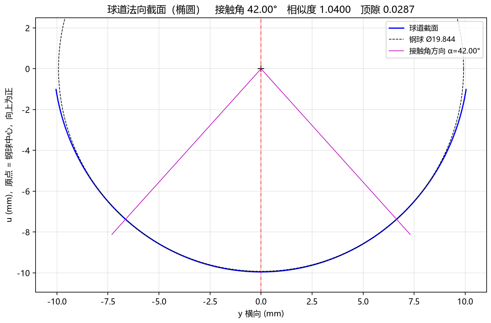
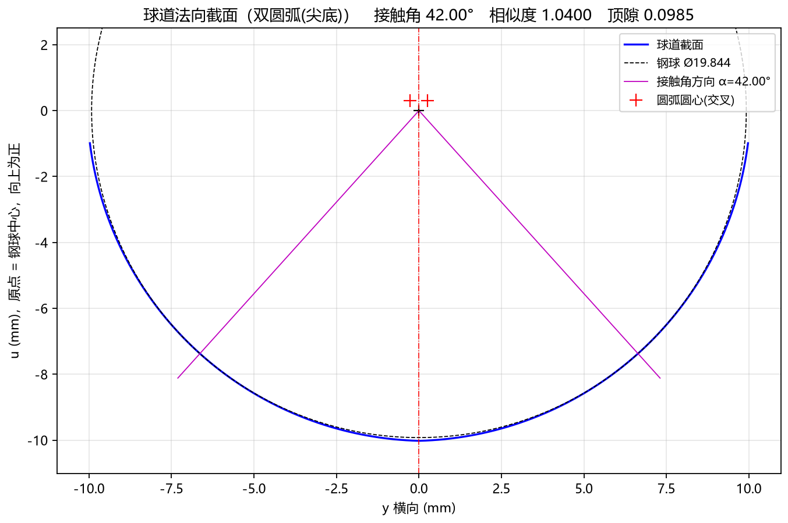

# 5.2 Tab 2：球道截面 (`Ctrl+2`)

**`球道截面`** 标签页展示垂直于球道中心轨迹切开的**球道法向截面（Normal Cross-Section）**。该视图与星形套产品图纸上的“球道法向截面放大图”完全对应，用于直观核对球道截面几何形状、接触角 $\alpha$、相似度 $k$ 以及底部顶隙 $c$。

---

## 一、椭圆截面与点表截面视图解读

当 `截面类型` 选择 `椭圆` 或 `点表(CSV)` 时，图表显示如下：

### 1. 标题栏摘要与坐标系定义
* **顶部标题栏**：直接汇总当前截面类型及三项核心指标，例如：
  `球道法向截面 (椭圆)  接触角 42.00°  相似度 1.0400  顶隙 0.0287`
* **横轴 `y 横向 (mm)`**：球道法向截面的水平宽度方向。中央红色竖直点划线 `y = 0` 为球道对称中心线，左右槽壁对称分布。
* **纵轴 `u (mm)，原点 = 钢球中心，向上为正`**：球道法向截面的深度方向。
  * **原点 $(0, 0)$**：钢球落入球道并与左右槽壁形成接触角 $\alpha$ 时的**理论钢球球心位置**（图中标有黑色小十字 `+`）。

### 2. 图例与几何元素含义
* **蓝色粗实线（`球道截面`）**：球道法向截面的设计轮廓（已包含高级参数中的 `法向余量` 偏置）；
* **黑色细虚线圆（`钢球 Ø19.844`）**：处于名义装配接触位置、直径为 $D_w$ 的理论钢球轮廓；
* **洋红色细实线（`接触角方向 α=42.00°`）**：从钢球球心 $(0,0)$ 引向左右两侧球道接触点的法线。该法线与水平轴的夹角即为**接触角 $\alpha$**，直观展示钢球与球道槽壁的“两点角接触”位置；
* **底部顶隙区（`y = 0, u ≈ -9.95 mm`）**：在球道正底部中央，蓝色球道底位于黑色虚线钢球底面下方微小距离处，两者之间的竖直间隙即为**顶隙 $c$**（默认参数下为 `0.0287 mm`）。

> **交互看图技巧**：由于顶隙 $c$ 通常仅有 `0.01 ~ 0.04 mm`，在全局视图下底部蓝线与黑虚线看似重合。您可以点击底部工具栏的 **`[框选放大 Zoom]`**，在底部 $(0, -9.95)$ 附近拉框放大，即可清晰观察到球道底与钢球底之间的微米级顶隙裕量！

---

## 二、双圆弧（尖底/哥德式）截面视图解读

当 `截面类型` 选择 `双圆弧(尖底)` 时，图表除了展示上述元素外，还会额外标出左右两段偏心圆弧的圆心位置：

### 双圆弧截面的独有特征
1. **红色十字标记 `+`（`圆弧圆心(交叉)`）**：
   * 在钢球球心 $(0, 0)$ 上方两侧，标有两个红色 `+` 号，分别代表左、右两段圆弧槽壁的曲率中心；
   * 左侧球道圆弧的圆心位于中心线**右侧**（$+y$ 侧），右侧球道圆弧的圆心位于中心线**左侧**（$-y$ 侧），形成典型的“交叉偏心圆心”，且圆心连线严格落在洋红色接触角法线延长线上。
2. **哥德式尖底与更大顶隙**：
   * 左右两段圆弧在底部中央 `y = 0` 处相交，形成明显的哥德式拱形尖底，顶部标题栏同步显示出增大后的实际顶隙（如 `顶隙 0.0985`）。
