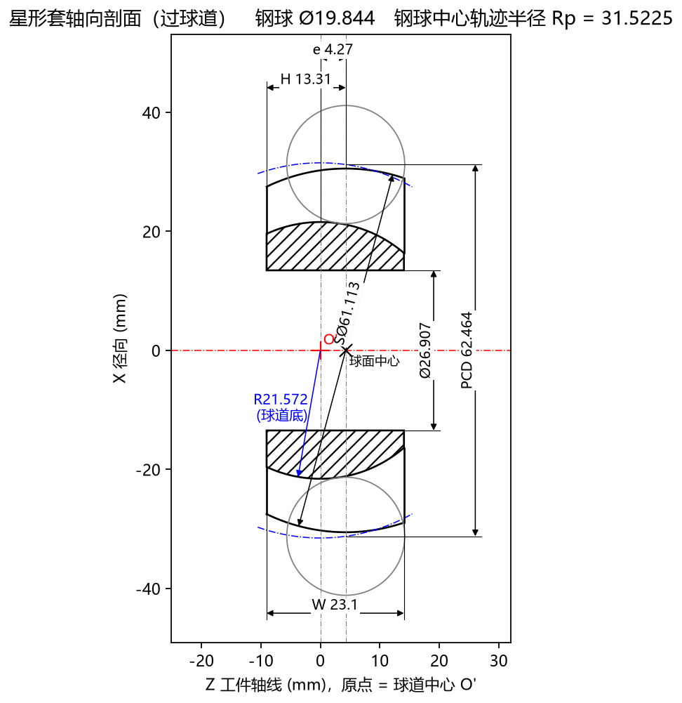

# 5.3 Tab 3：星形套截面 (`Ctrl+3`)

**`星形套截面`** 标签页展示沿着星形套零件回转中心轴线切开的**轴向剖面图（过球道子午面）**，并自动在图面上引出全部核心车削毛坯与球道特征尺寸。它相当于一张实时生成的**星形套工序核对工程图**。

---

## 一、标题栏与坐标系基准定义

* **顶部标题栏**：显示 `星形套轴向剖面 (过球道)  钢球 Ø19.844  钢球中心轨迹半径 Rp = 31.5225`。
* **横轴 `Z 工件轴线 (mm)，原点 = 球道中心 O'`**：
  * 水平红色点划线 `X = 0` 为**星形套回转中心轴线**；
  * **坐标原点 `Z = 0`（红色十字 `+ O'`）**：固定在**球道中心 $O'$**（即钢球中心轨迹圆弧的曲率中心）；
  * **外球面球心（黑色叉号 `× 球面中心`）**：位于 $Z = +e$ 处（当偏心距 $e = 4.27\text{ mm}$ 时，位于原点右侧 $+4.27\text{ mm}$ 处）。
* **纵轴 `X 径向 (mm)`**：垂直于星形套回转轴线的径向半径坐标（上下对称绘制）。

---

## 二、图面几何元素与 8 项自动标注尺寸核对清单

在每次开始计算刀具前，强烈建议切换到 **`Tab 3：星形套截面`**，对照手中的客户星形套零件图纸逐一核对图上标出的尺寸与轮廓：

| 序号 | 图面标注 / 符号 | 对应参数或计算结果 | 工程核对要点 |
| :---: | :--- | :--- | :--- |
| **1** | **`W 23.1`** | 高级参数 `工件宽度` | 核对零件左右两端面之间的总轴向厚度 $W$。 |
| **2** | **`H 13.31`** | 高级参数 `球心至端面` | 核对从左侧端面到**外球面球心（`× 球面中心`）**的轴向距离 $H$。 |
| **3** | **`e 4.27`** | 基本参数 `球道偏心 e` | 核对**球道中心（红十字 `O'`）**与**外球面球心（黑叉号 `球面中心`）**之间的轴向偏心距 $e$。 |
| **4** | **`SØ61.113`** | 高级参数 `外球面直径` | 核对以 `× 球面中心` 为圆心的星形套外球面直径。 |
| **5** | **`Ø26.907`** | 高级参数 `内孔直径` | 核对中心内孔直径，并目视检查剖面线区域（**球道底部与内孔壁之间的最小实体壁厚**）是否充足。 |
| **6** | **`PCD 62.464`** | 基本参数 `节圆直径 PCD` | 核对在 `球面中心` 基准平面（$Z = e$）处上下两颗灰色钢球中心的跨距。 |
| **7** | **`R21.572 (球道底)`** | 自动计算结果 | 蓝色箭头标示从球道中心 `O'` 到球道最深处底面轮廓的圆弧半径（可用于车间圆弧样板或三坐标抽检球道底径）。 |
| **8** | **蓝色点划线圆弧** | `Rp = 31.5225` | 标示钢球中心沿着子午面运动的圆弧轨迹（以 `O'` 为圆心、半径为 $R_p$）。 |
