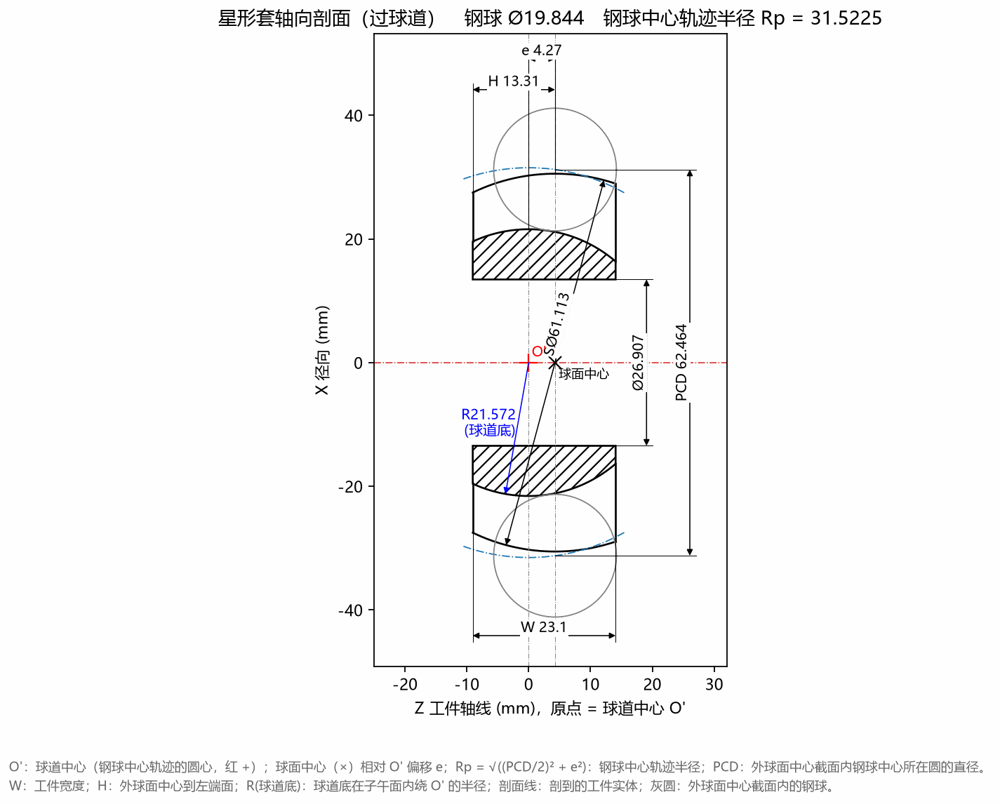
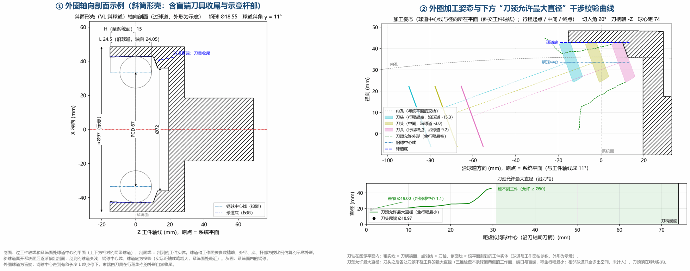

# 5.3 Tab 3：工件轴向剖面 (`Ctrl+3`)

**`工件轴向剖面`** 标签页展示沿着零件回转中心轴线切开的**过球道轴向剖面图**，自动引出核心毛坯与球道特征尺寸，底部配有各项符号的灰字释义。

---

## 一、固定节星形套视图解读（完整工序核对图）

### 1. 标题栏与坐标系基准
* **顶部标题栏**：`星形套（固定节） 轴向剖面 (过球道)  钢球 Ø19.844  钢球中心轨迹半径 Rp = 31.5225`；
* **横轴 `Z 工件轴线 (mm)，原点 = 球道中心 O'`**：红色十字 `+ O'` 为球道中心，黑色叉号 `× 球面中心` 位于 $Z = +e$ 处；
* **纵轴 `X 径向 (mm)`**：水平红色点划线 `X = 0` 为零件回转中心轴线（上下对称绘制）。

### 2. 八项自动标注尺寸核对清单

| 序号 | 图面标注 / 符号 | 对应参数或计算结果 | 工程核对要点 |
| :---: | :--- | :--- | :--- |
| **1** | **`W 23.1`** | 基本参数 `工件宽度 W` | 核对零件左右两端面之间的总轴向厚度 $W$。 |
| **2** | **`H 13.31`** | 基本参数 `球心至端面 H` | 核对从左侧端面到**外球面球心（`× 球面中心`）**的轴向距离 $H$。 |
| **3** | **`e 4.27`** | 基本参数 `球道偏移 e` | 核对**球道中心（红十字 `O'`）**与**外球面球心（黑叉号 `球面中心`）**之间的轴向偏移距 $e$。 |
| **4** | **`SØ61.113`** | 基本参数 `外球面直径` | 核对以 `× 球面中心` 为圆心的星形套外球面直径。 |
| **5** | **`Ø26.907`** | 高级参数 `内孔直径` | 核对中心内孔直径，并目视检查剖面线区域（**球道底部与内孔壁之间的最小实体壁厚**）是否充足。 |
| **6** | **`PCD 62.464`** | 基本参数 `节圆直径 PCD` | 核对在基准横截面处上下两颗灰色钢球中心的跨距。 |
| **7** | **`R21.572 (球道底)`** | 自动计算结果 | 蓝色箭头标示从球道中心 `O'` 到球道最深处底面轮廓的圆弧半径（直线/斜球道标注为 `直线`）。 |
| **8** | **蓝色点划线圆弧** | `Rp = 31.5225` | 标示钢球中心沿着子午面运动的轨迹（圆弧球道为圆弧，DO/VL 伸缩节为平行轴线直线）。 |

---

## 二、扩展工件类型（外圈 / 直线 / 斜球道）示意外形剖面

当（在内部版中）切换为 **`钟形壳（固定节）`、`星形套（DO 直球道）`、`筒形壳（DO 直球道）`、`星形套（VL 斜球道）` 或 `斜筒形壳（VL 斜球道）`** 时，Tab 3 会自动切换为对应几何表达方式（下图 ① 为 VL 斜筒形壳 `EVL12508M.0F2-1` 示例）：

* **球道与工作面严格按参数精确绘制**：内球面 / 圆柱内孔、盲端有效长度 `L` 及**末端刀具自然收尾圆角**按实际刀具外形精确绘出；
* **外径 / 底壁 / 杆部按经验比例示意**：用剖面线补齐外圈杯体与杆部轮廓，辅助核对开口深度与整体比例；
* **VL 斜球道投影说明**：斜球道离开系统平面后逐渐偏出基准剖面，图中以虚线标示钢球中心线及球道底投影，并在底部浅灰注释中注明。
