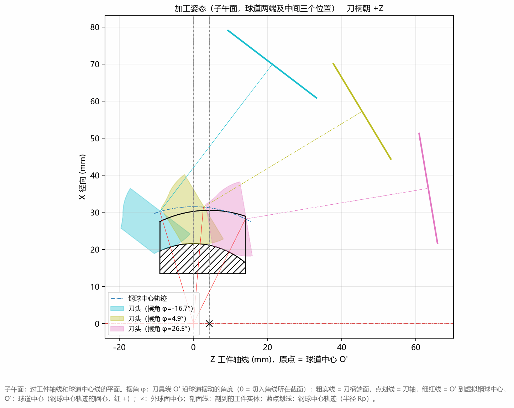

# 5.4 Tab 4：加工姿态 (`Ctrl+4`)

**`加工姿态`** 标签页将设计好的成型刀头与刀柄放入球道对称平面中，同步展示刀具在**球道起点、中间位置、终点**三个典型位置处的空间切削姿态与防干涉包络范围。

---

## 一、运动包络姿态直观图解

* **顶部标题栏**：显示当前位置平面类型、切入角 $\beta$、刀柄方向及球心距 $L$（例如 `加工姿态 (球道两端及中间三个位置)  粗实线 = 刀柄端面，点划线 = 刀轴，刀柄朝 +Z`；VL 斜球道则注明斜交平面倾角）；
* **回转基准 / 运动轨迹**：
  * 固定节（圆弧球道）：三条红色细实线从球道中心 $O'$ 呈扇形发散，指向左/中/右三个位置的虚拟钢球中心；
  * 钢球中心轨迹与球道底：分别用**蓝色点划线**与**蓝色虚线**标出，直观反映进刀轨迹与摆角/行程区间。
* **三个关键位置的刀头与刀柄**：
  * **青色填充**：刀具位于球道起点位置（如摆角 $\varphi = -16.7^\circ$）的姿态；
  * **橄榄黄填充**：刀具位于球道中间位置（如 $\varphi = 4.9^\circ$）的姿态；
  * **粉洋红填充**：刀具位于球道终点位置（如 $\varphi = 26.5^\circ$）的姿态；
  * 每组姿态均包含**半透明刀头截面** + **点划线（刀具旋转轴线）** + **末端粗实线（刀柄定位端面，距虚拟球心为 `球心距 L`）**。

---

## 二、工程师如何利用此图做机床防干涉校核？

1. **核对球道行程 / 摆角范围**：从左下角图例直接读取当前球道加工所需的总摆角行程（如 `-16.7° ~ +26.5°`）或直线球道行程位置（单位 `mm`），确认机床摆台或直线轴行程完全覆盖；
2. **检查刀柄端面与工件空间间隙**：观察末端粗实线（刀柄/主轴端面）与工件表面之间的距离，确保在极限位置时不发生主轴撞击工件或夹具；
3. **切换 `刀柄方向` 对比装夹布局**：内圈贯通球道可将 **`刀柄方向`** 从 `朝 +Z` 改为 `朝 -Z`，重新计算后在本图查看镜像伸出姿态（外圈内腔工件必须使用 **`朝 -Z`**）；
4. **查看下方“刀颈允许最大直径”曲线（扩展工件类型适用）**：
   * 对于非固定节星形套的 5 种扩展工件（如外圈斜筒形壳 `EVL12508M.0F2-1`，见 [Tab 3 附图 ②](tab3_part.md#二、扩展工件类型（外圈--直线--斜球道）示意外形剖面)），软件会在加工姿态图正下方自动追加**`刀颈允许最大直径（沿刀轴）`**曲线；
   * 绿色实线给出刀具从虚拟钢球中心沿刀轴向刀柄方向移动过程中，三维扫描本条球道槽壁、端口与盲端后不碰撞工件的**最大允许刀颈直径**（全行程最窄包络），并在图中直接标出最窄点直径与安全绿区（与结果面板 `▸ 工件与刀具干涉` 数据完全对应）。
