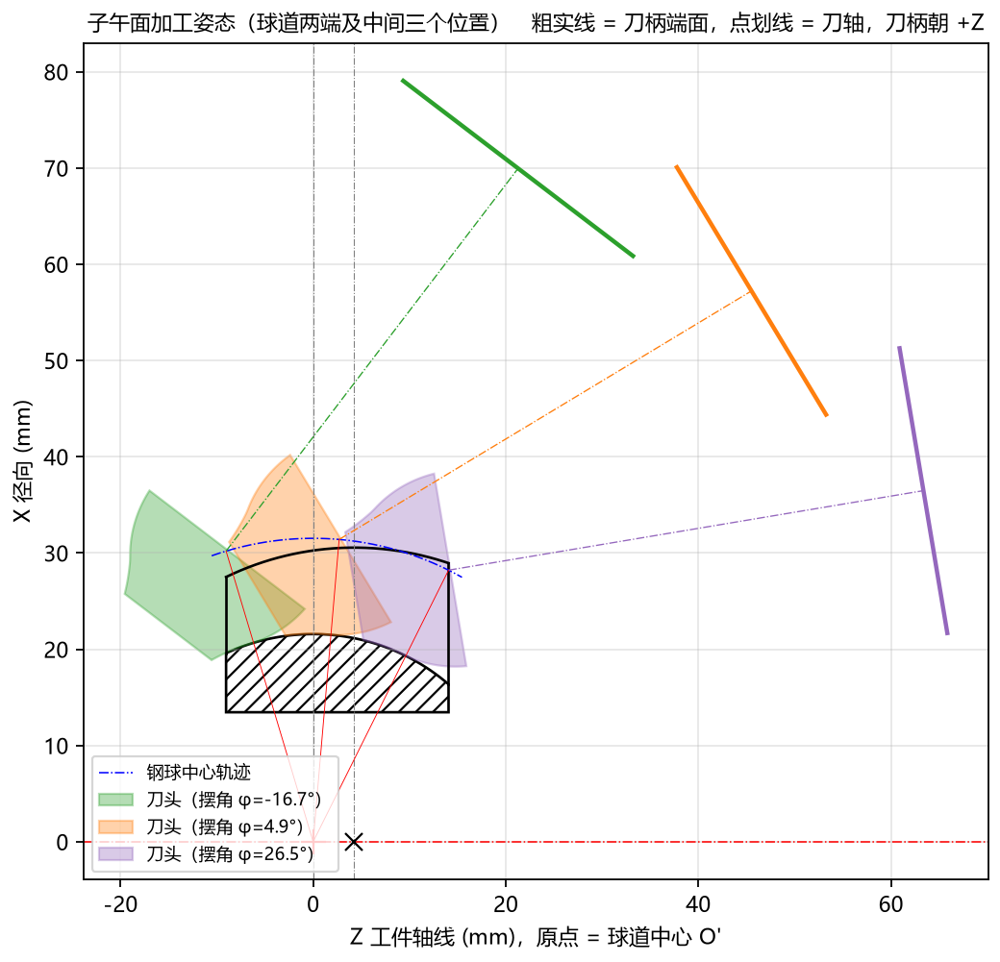

# 5.4 Tab 4：加工姿态(子午面) (`Ctrl+4`)

**`加工姿态(子午面)`** 标签页将设计好的成型刀头与刀柄放入星形套子午面坐标系中，同步展示刀具在**球道左端切入极限位置、中间位置、右端切出极限位置**三个典型摆角下的空间切削姿态。

---

## 一、运动包络姿态直观图解

如顶部标题栏所示（`子午面加工姿态 (球道两端及中间三个位置)  粗实线 = 刀柄端面，点划线 = 刀轴，刀柄朝 +Z`），图面由以下核心元素构成：

1. **回转摆动基准点（原点 `Z = 0, X = 0`）**：
   * 位于底部中央的球道中心 $O'$，三条红色细实线从 $O'$ 呈扇形发散，分别指向刀具在左、中、右三个位置时的虚拟钢球中心。
2. **钢球中心轨迹（蓝色点划线圆弧）**：
   * 刀具球心基准点沿着以 $O'$ 为圆心、半径为 $R_p$ 的蓝色点划线圆弧轨迹摆动进给。
3. **三个关键摆角位置的刀头与刀柄**：
   * **绿色（`刀头 (摆角 φ=-16.7°)`）**：刀具运动到星形套左侧端面球道口部时的极限摆角姿态；
   * **橙色（`刀头 (摆角 φ=4.9°)`）**：刀具运动到球道中部位置时的姿态；
   * **紫色（`刀头 (摆角 φ=26.5°)`）**：刀具运动到星形套右侧端面球道口部时的极限摆角姿态；
   * 每组颜色均包含三部分：**半透明刀头实体截面** + **延伸向右上方的点划线（刀具旋转轴线）** + **末端的粗实线（刀柄端面，距离球心 `L = 50 mm`）**。

---

## 二、工程师如何利用此图做机床防干涉校核？

在将刀具图纸下发制造或上机调试前，请通过本图重点检查以下 3 项工程安全性：

1. **核对球道两端加工摆角行程范围**：
   * 直接从左下角图例读取当前零件球道加工所需的机床 B 轴/摆台角度范围（例如从 `-16.7°` 摆动至 `+26.5°`，总摆角行程约 `43.2°`），确认机床摆台行程完全覆盖该角度区间。
2. **检查刀头与刀柄端面的安全间隙**：
   * 观察绿、橙、紫三条粗实线（代表直径为 `刀柄直径`、距离球心为 `球心距 L` 的刀柄/主轴端面位置）与星形套外球面及右端面之间的空间距离，确保在极限摆角 `+26.5°` 时主轴端面不会与工件或夹具发生干涉。
3. **切换 `刀柄方向` 对比正反装夹布局**：
   * 如果您的机床主轴位于左侧（$-Z$ 方向），可在左侧高级参数中将 **`刀柄方向`** 从 `朝 +Z` 切换为 `朝 -Z`，重新点击计算，即可在本图中看到刀轴点划线与刀柄粗实线朝向左侧（$-Z$ 方向）伸出的镜像加工姿态。
