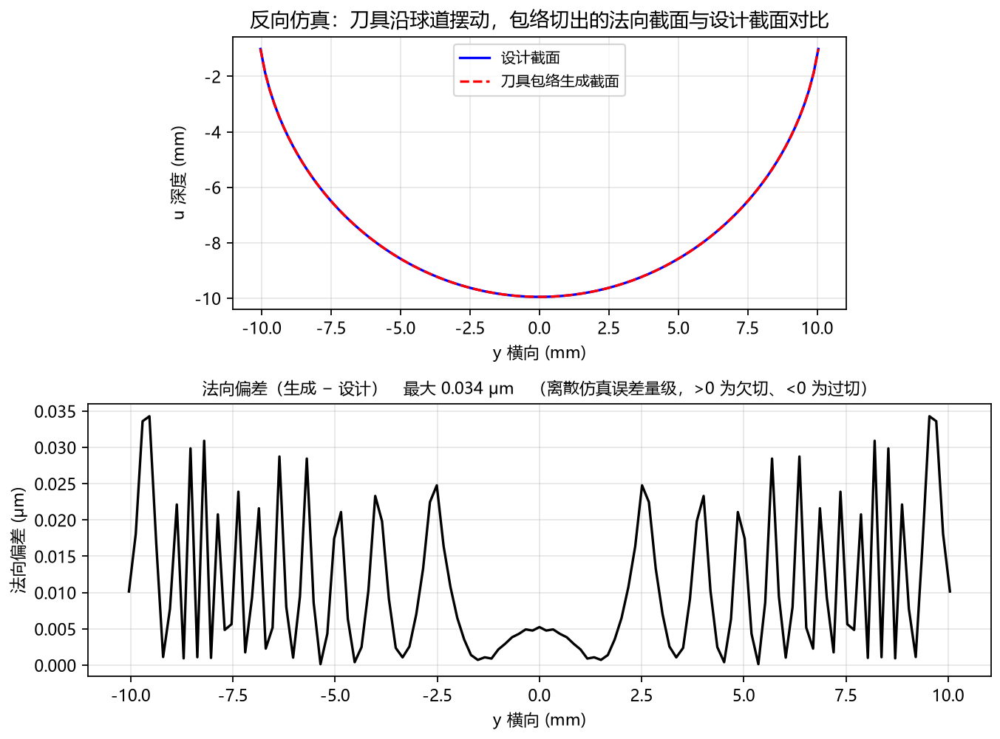

# 5.5 Tab 5：反向仿真偏差 (`Ctrl+5`)

**`反向仿真偏差`** 标签页是验证成型刀具设计正确性的**核心检验工具**。

软件在计算出刀具廓形后，会在后台驱动设计出的刀具沿着圆弧轨迹 $R_p$ 摆动走刀，求出刀具包络扫掠切出的实际球道法向截面（即“生成截面”），并与理论设计球道截面进行微米级对比。

---

## 一、上下双子图结构详解

该标签页由上下两个对齐的子图组成（横轴均为球道截面横向坐标 `y 横向 (mm)`）：

### 1. 上图：`反向仿真：刀具沿球道摆动，包络切出的法向截面与设计截面对比`
* **纵轴 `u 深度 (mm)`**：球道法向截面深度坐标；
* **蓝色粗实线（`设计截面`）**：您要求加工的理论球道法向截面；
* **红色粗虚线（`刀具包络生成截面`）**：用当前设计的刀具在三维空间摆动包络切出的实际球道截面。正常状态下，红色虚线与蓝色实线在整个球道范围内完全重合。

### 2. 下图：`法向偏差 (生成 − 设计)`（微米级误差放大镜）
下图将红线与蓝线之间的法向偏差放大了数万倍，以**微米（`μm`，$1\ \mu\text{m} = 0.001\text{ mm}$）**为单位显示：
* **顶部标题读数**：例如 `法向偏差 (生成 − 设计)  最大 0.034 μm  (离散仿真误差量级，>0 为欠切、<0 为过切)`；
* **纵轴 `法向偏差 (μm)` 符号定义**：
  * **`> 0`（正值 = 欠切）**：刀具包络生成截面位于设计截面内侧（少切了材料）；
  * **`< 0`（负值 = 过切）**：刀具包络生成截面侵入了设计截面外侧（多切了材料）。

---

## 二、如何判断反向仿真图是否合格？

观察下图的偏差曲线与标题栏读数，您可以一眼判定当前刀具设计是否完美：

1. **正常合格状态（如上图所示）**：
   * 下图显示为**黑色实线**，全幅最大偏差仅为 **`0.034 μm`**（不到 $0.04$ 微米，属于计算机网格离散仿真的数值精度极限，物理上完全等同于 **零误差**）。
   * 这证明当前设计的精确刀具廓形在三维空间包络切削中没有任何过切或工作面欠切，100% 忠实还原了目标球道截面。
2. **异常报警状态（例如 `刀尖高度` 过小截断了接触段）**：
   * 如果您在高级参数中不小心把 `刀尖高度` 设得低于接触段上限（例如设为 `5.0 mm`），刀具前端被削平，无法切到靠近球道底部的有效接触区；
   * 此时下图曲线会自动变为醒目的**红色警告曲线**，标题栏显示高达数百微米的正偏差（欠切），直观标示出哪些横向位置 `y` 因为刀尖过短而没有被切到位。
