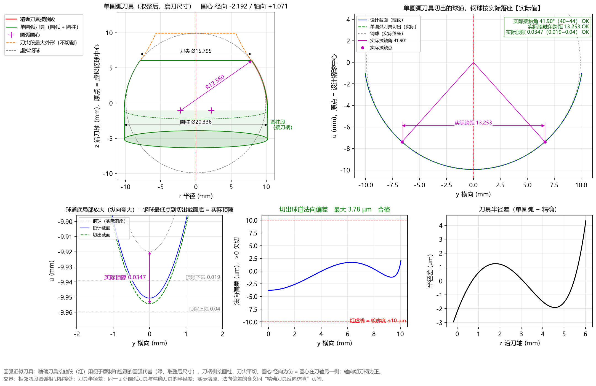

# 5.6 Tab 6：圆弧近似刀具 (`Ctrl+6`)

在实际生产中，制造和检测一把“自由曲线成型刀”成本较高，而在数控工具磨床或砂轮修整器上加工**单圆弧**或**多段相切圆弧**则非常简便。

**`圆弧近似刀具`** 标签页通过**上二、下三共 5 个子图**，全方位展示圆弧近似刀具（支持 **`1` 段单圆弧**与 **`2~5` 段相切圆弧**，以及 **`拟合精确廓形`** 与 **`按审核优化`** 两种单圆弧求法）的磨刀尺寸、切出球道的钢球实际落座状态、球道底局部放大、球道法向偏差及刀具半径差。

---

## 一、五子图布局（上二 + 下三）与各自含义

### 1. 左上图：`...刀具（取整后，磨刀尺寸）`（含立体圆柱段示意与图面尺寸标注！）
* **图面直接尺寸标注**：
  * **单圆弧时**：直接用洋红色半径箭头标出 **`R12.360`**、洋红色十字 `+` 标出圆心位置，并用水平双向箭头标出 **`刀尖 Ø15.795`** 与 **`圆柱 Ø20.336`**；
  * **多段相切圆弧时**：在右侧刃口逐段引出 **`R11.121（凸）`**、**`R18.972（凸）`**、**`R23.482（凹）`**，并在左侧刃口用黑色圆点 `●` 标出各段圆弧相切交界的轴向高度（如 `z 4.787`、`z 6.301`）。
* **刀柄侧立体圆柱段示意**：在圆弧下端接刀柄处，以**浅绿色立体圆柱（带上下椭圆端面，旁注 `圆柱段（接刀柄）`）**直观绘出圆柱段，让您一眼看懂 `圆柱 Ø...` 指的是刀头哪一部分！

### 2. 右上图：`...刀具切出的球道，钢球按实际落座【实际值】`
* 将取整后的圆弧近似刀具沿球道摆动包络切出实际球道（**绿色虚线**），与理论设计截面（**蓝色实线**）叠加对比；
* **钢球实际落座检验**：把直径为 $D_w$ 的钢球实际放入圆弧刀切出的球道中，标出 **`实际接触角`**、**`实际接触点`**、**`实际跨距`**，并在**右上角核对框**中给出三项实测值是否全部符合图纸范围的 `OK` / `超出!` 判定！
* *注：当启用 `单圆弧求法 = 按审核优化` 时，球道底部中央区域会以浅橙色背景标出 **`球道底：允许适应`**。*

### 3. 左下图：`球道底局部放大（纵向夸大）：钢球最低点到切出截面底 = 实际顶隙`（独立子图！）
* 将圆弧刀具切出的球道底部（绿色虚线）、理论设计截面底部（蓝色实线）与实际落座后的钢球底部（灰色点线）纵向夸大显示；
* 用洋红色双向箭头直接标出 **`实际顶隙`**（如 `0.0347`），并对照 **`顶隙下限`** 与 **`顶隙上限`** 水平点线直观核验顶隙余量。

### 4. 中下图：`切出球道法向偏差  最大/侧面偏差 ... μm  合格/超差`
* **横轴 `y 横向 (mm)`**，**纵轴 `法向偏差 (μm)，>0 欠切`**；
* **蓝色粗实线**：圆弧刀具实际切出的球道与设计截面之间的法向偏差曲线；
* **上下两条红色水平虚线**：由高级参数 **`轮廓度公差`** 决定的合格公差带（如默认 `±10 μm` 或 `AC10000` 的 `±50 μm`）。当蓝色曲线在考核区内完全处于两条红虚线之间时，标题显示为**绿色 `合格`**；超出则变为**红色 `超差`**！

### 5. 右下图：`刀具半径差（... − 精确）`
* **横轴 `z 沿刀轴 (mm)`**，**纵轴 `半径差 (μm)`**；
* 展示同一轴向位置 $z$ 处，圆弧近似刀具与精确刀具之间的半径差（多段圆弧时还用灰色竖直点线标出各段圆弧相切交界位置）。

---

## 二、三种典型圆弧近似场景对比

1. **椭圆 / 点表截面 + 单圆弧（`圆弧段数 = 1, 拟合精确廓形`）**：
   * 如本页顶部大图所示，1 段圆弧即可使球道最大偏差低至 `3.78 μm`，右上角实际落座三项全部绿色 `OK`，右中图显示绿色 `合格`。
2. **双圆弧（尖底）截面 + 多段相切圆弧（`圆弧段数 = 3`）**：
   * 针对双圆弧截面，将 `圆弧段数` 设为 `3` 段后，2 段外凸圆弧 + 1 段内凹圆弧完美贴合拐点，全截面偏差仅 `7.02 μm`，实际落座三项全部绿色 `OK`（详见 **[8.3 案例三](../8_workflows_cases/case3_gothic.md)**）。
3. **双圆弧（尖底）截面 + 单圆弧按审核优化（`圆弧段数 = 1, 按审核优化`）**：
   * 当现场必须使用 1 段单圆弧加工双圆弧图纸且允许球道底从尖底适应为圆底时，选用 `按审核优化`，球道底以浅橙色标示 `允许适应`，侧面工作区偏差仅 `5.31 μm`，且右上角实际接触角、实际跨距、实际顶隙全部绿色 `OK`！
