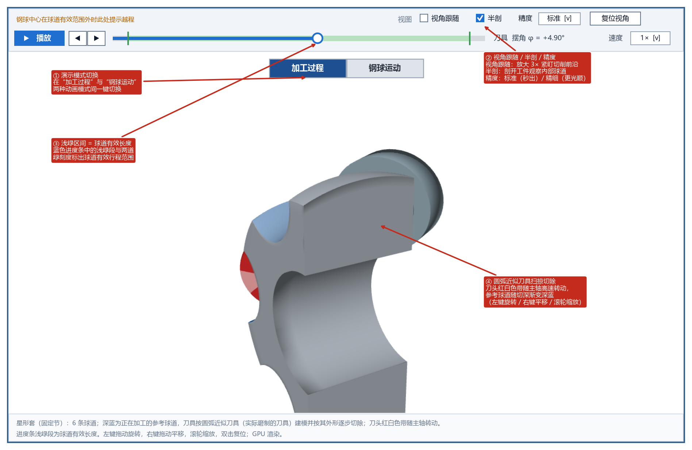
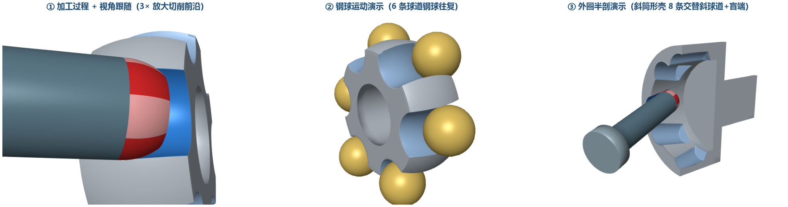

# 5.7 Tab 7：三维演示 (`Ctrl+7`)

**`三维演示`** 标签页利用 **OpenGL 3.3 GPU 硬件加速（4× MSAA 多重采样抗锯齿 + 平滑法向着色）**，实时呈现整件工件（含全部球道）、成型刀具或钢球的三维空间相对运动与逐步切削效果。

---

## 一、两种三维演示模式（顶部浮空切换条）

在三维绘图区顶部正中央浮有切换条，可在以下两种演示模式间一键切换：

| 演示模式 | 核心展示内容 | 颜色编码与物理意义 |
| :--- | :--- | :--- |
| **`加工过程`**（默认） | 按 **[Tab 6 圆弧近似刀具](tab6_arc.md)** 的实际磨制刀具模型，沿参考球道（深蓝色）从行程起点扫掠至终点，**实时按刀具外形逐步切除工件材料** | • **刀头红白色带**：随主轴高速旋转，直观分辨切削前沿与刃口旋转扫掠； • **参考球道**：已切出区段渐变深蓝（`#2f7fd8`），其余球道显示浅蓝已成品状态。 |
| **`钢球运动`** | 所有球道全部处于已加工成品状态，各球道内的金色钢球同步沿球道轨迹做往复运动演示 | 用于检查全周向 6 条 / 8 条球道的空间排布（如 VL 斜球道的左右旋交替斜交排布与钢球防碰，非万向节整套运动学）。 |

> 上图依次展示：**① `加工过程 + 视角跟随`（3× 放大切削前沿细节）**、**② `钢球运动`（6 条球道钢球往复）** 与 **③ 扩展工件外圈半剖（`斜筒形壳` 8 条左右旋交替斜球道及盲端自然收尾）**。

---

## 二、顶部控制栏与进度条功能详解

### 1. 上行：视图控制与网格精度
* **`视角跟随`**：勾选后将视野中心自动锁定在正在切削的刀具虚拟钢球中心（或参考球道钢球中心），并自动放大 **3 倍** 紧盯切削前沿与刀背间隙；
* **`半剖`**：仅显示 $X \ge 0$ 一侧半边工件，沿着过参考球道的剖切面直接观察内腔深处的球道形状与伸入刀具（外圈件尤为实用，如斜筒形壳默认开启半剖）；
* **`精度`（`标准` / `精细`）**：
  * **`标准`**（默认）：随主计算瞬间秒出，转动与播放可达 **60 FPS**；
  * **`精细`**：在后台线程静默生成超高密度加密网格后无感切换，适合高清特写截图与细致检查曲率过渡；
* **`复位视角`**：一键恢复默认三维观察方位、缩放比例与平移偏移（或直接**左键双击**三维画面）。

### 2. 下行：动画播放与行程进度条
* **`▶ 播放` / `⏸ 暂停` 与单步按钮（`◀` / `▶`）**：控制连续播放，或在暂停后逐帧微调进度（整个循环等分为 `300` 步）；
* **`进度条`（浅绿区间 = 球道有效长度）**：
  * 进度条总行程完整覆盖从切入端之外到切出端之外的进出口预备段，而中间的**浅绿色区段与两道绿刻度**专门标出**球道在零件上的有效工作长度**；
  * 当将滑块拖到浅绿区段之外（切入端前或盲端后）时，左上角自动弹出橙色提示：**`钢球中心在球道有效范围外`**；
* **右侧实时读数与 `速度`**：实时显示当前处于圆弧摆角 `φ`（如 `+4.90°`）或直线沿球道距离 `s (mm)`；支持 **`0.25×` / `0.5×` / `1×` / `2×`** 四挡倍速。

---

## 三、鼠标操作与硬件兼容说明

* **三维鼠标交互**：
  * **鼠标左键拖动**：自由旋转三维观察视角；
  * **鼠标右键 / 中键拖动**：在屏幕平面内平移场景中心；
  * **鼠标滚轮**：无级放大与缩小视野；
  * **鼠标左键双击**：立即复位至初始默认视角。
* **图形渲染引擎**：
  * Windows 独立显卡或主流核显默认启用 **OpenGL 3.3 GPU 渲染**，底栏注明 **`GPU 渲染`**，拖拽与动画极其流畅；
  * 若在无 OpenGL 3.3 支持的老旧电脑或精简远程桌面环境中运行，软件会自动安全回退至 `matplotlib` 软件渲染模式（bottom 栏显示 `matplotlib 渲染`），同样保留全部视图、半剖与单步功能；也可通过系统环境变量 `TRACKFORM_3D=mpl` 强制指定软件渲染。
