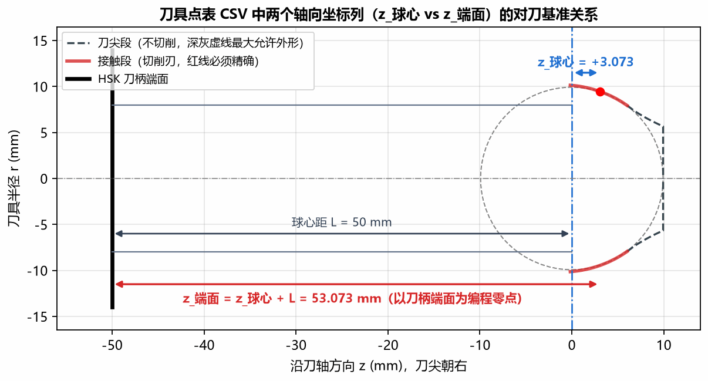

# 6.2 导出 CSV 数据表详解与坐标基准说明

TrackForm 导出的全部 3 类 `.csv` 文件均采用 **UTF-8 with BOM** 编码格式：
* **用 Microsoft Excel / WPS 表格双击打开**：中文表头与注释直接完美显示，绝不乱码；
* **用记事本 / VS Code / 数控系统读取**：以 `#` 开头的行为元数据注释行，数据列之间以标准英文逗号 `,` 分隔。

---

## 一、`刀具点表 CSV` (`tool_profile_points.csv`)

点击左下角的 **`刀具点表 CSV`** 按钮，可导出精确成型刀具单侧刃口（**按从刀柄侧外缘下端 $\to$ 刀尖顶端的顺序排列**）的全部离散坐标点。

### 1. 极其重要：理解双轴向坐标基准（`z_球心` vs `z_端面`）

为了同时满足**理论包络分析**与**数控工具磨床/加工中心以刀柄端面为编程零点**的现场习惯，导出的 `tool_profile_points.csv` 同时提供了两列轴向坐标：



| 数据列名称 | 工程含义与坐标基准定义 | 数值特征与适用场景 |
| :--- | :--- | :--- |
| **`序号`** | 点位行号（从 `1` 开始连续编号） | 按**刀柄侧（外径最大处） $\to$ 刀尖顶面**的顺序排列。 |
| **`段`** | 标识该点所属的刀头功能区段 | • `接触`：球道有效工作接触区与边缘延伸的切削刃（对应 Tab 1 红/青实线，须精确制造）；<br>• `刀尖`：球道底部避空区最大允许外形（对应 Tab 1 深灰虚线刀尖段，不参与切削）。 |
| **`r`** | 刀具半径（单位：`mm`） | 各点到刀具旋转中心轴线的径向半径（例如从 `10.13841` 递减至 `7.92686`）。 |
| **`D`** | 刀具直径（单位：`mm`） | 即 $D = 2r$，方便直接核对各轴向高度处的回转外径。 |
| **`z_球心`** | **以虚拟钢球中心为原点 `z = 0`**（向刀尖方向为正，单位：`mm`） | 与软件界面 **[Tab 1：精确刀具廓形](../5_tabs_charts/tab1_tool.md)** 及结果面板 `接触段 z` 一致（从 `-0.17467` 递增至 `+9.92200`）。 |
| **`z_端面`** | **以刀柄定位端面为原点 `z = 0`**（距刀柄端面距离，单位：`mm`） | 换算公式恒为：$$\text{z\_端面} = \text{z\_球心} + \text{球心距 } L$$。<br>**现场最常用**：数控磨床装夹 HSK 刀柄时直接以**刀柄定位端面为 Z 向编程零点**，即可直接读取 `z_端面` 列坐标编程与检测，免去手工加减换算！ |

* *说明：客户发行版输出上述 `6` 列纯粹几何坐标；内部版额外附带 `截面y, 截面Y, 法线角θ(deg)` 以及 `摆角φ(deg)`（圆弧球道）或 `沿球道s(mm)`（DO/VL 直线球道）四列校核数据。*

### 2. 真实导出文件内容示例

```text
# TrackForm 刀具廓形点表（刀具轴截面半廓形，单位 mm）。行顺序：刀柄侧 -> 刀尖。
# 段：接触 = 切削段（必须精确）；刀尖 = 最大允许外形（不切削，可在线内修整）。
# r：该点到刀轴的距离（半径）；D = 2r 为该处刀具直径。
# z_球心：沿刀轴的位置，原点 = 虚拟钢球中心，刀尖方向为正。
# z_端面：该点到刀柄（HSK）端面的距离 = z_球心 + 球心距 L，以端面为基准编程时使用。
# 设计值（理论）：接触角 42.000°（图纸 40~44）   接触角跨距 13.2782   顶隙 0.0287（图纸 0.019~0.04）
# 实际切出的球道（钢球落座）：
#   接触角 41.982°（图纸 40~44）   接触角跨距 13.2736   顶隙 0.0287（图纸 0.019~0.04）
#   钢球中心相对设计位置移动 +0.0 μm（朝开口为正）   实际 PCD 62.4640（+0.0 μm）（图纸 62.454~62.474）
序号,段,r,D,z_球心,z_端面
1,接触,10.13841,20.27682,-0.17467,49.82533
2,接触,10.13774,20.27549,-0.16609,49.83391
...
667,接触,7.92686,15.85372,6.02054,56.02054
668,刀尖,7.89191,15.78382,6.06931,56.06931
...
748,刀尖,0.00000,0.00000,9.92200,59.92200
```

---

## 二、`方程常数（Table 1）` (`table1_constants.csv`)

点击左下角的 **`方程常数（Table 1）`** 按钮，可将计算结果中的 **轮廓方程常数（Table 1：$C_1 \sim C_{10}$）** 导出为标准 CSV 表格，格式直接对标主机厂球道工程图纸的 Table 1。

### 真实导出文件内容示例

```text
# TrackForm 球道基本轮廓参数方程常数（同客户图纸 Table 1）
# Z(X) = ±[(P − C1)² − (C2(X − C3)P / (C4·P − C1(X − C5)) + C2)²]^(1/2)        (1)
# Y(X) = C6 + (X − C3)·[1 + C7·P² / (C4·P − C1(X − C5))²]^(1/2)                (2)
# P = [C10 − (X − C5)²]^(1/2)，C8 ≤ X ≤ C9；X 为刀轴上的位置（原点 = 钢球中心，刀尖方向为负）
# 钢球 D=19.844  切入角 36.0°
常数,数值
C1,2.19160
C2,-25.50227
C3,-18.52849
C4,-19.59946
C5,1.07098
C6,-21.56794
C7,650.36593
C8,-6.06824
C9,1.07098
C10,152.76417
```

> **提示**：如果需要按取整后的圆弧尺寸生成常数表，可在高级参数中将 **`常数依据`** 切换为 `取整值` 后再点击导出。

---

## 三、`基本轮廓（Table 2）` (`table2_basic_profile.csv`)

点击左下角的 **`基本轮廓（Table 2）`** 按钮，软件会从球道底部到终点沿半边球道截面等弧长均匀生成离散点（默认 `117` 点），导出与客户球道图纸 **Table 2 (BASIC PROFILE)** 格式一致的基准轮廓坐标表。

### 1. 各列坐标含义与图纸点表对标说明
* **`No`**：点序号，从 `1`（球道底部最低点）递增至 `117`（球道上边缘终点）；
* **`Z(±)`**：该高度处球道法向截面的**水平横向半宽坐标**（单位：`mm`，左右对称取 `±`）；
* **`Y`**：从球道底部最低点向上量取的**截面高度坐标**（单位：`mm`，第 `1` 点球道底处固定为 `Z(±) = 0.00000, Y = 0.00000`）。

### 2. 闭环复核技巧：导出的 Table 2 可直接作为点表截面重新导入！
* `table2_basic_profile.csv` 采用标准的 `No, Z(±), Y` 格式；
* 您可以随时在左侧基本参数中将 `截面类型` 切换为 **`点表(CSV)`**，直接选择导出的 `table2_basic_profile.csv` 进行闭环验证（详见 **[8.2 案例二](../8_workflows_cases/case2_points.md)**）。

### 3. 真实导出文件内容示例

```text
# TrackForm 球道基本轮廓  星形套（固定节）（同客户图纸 Table 2；单圆弧刀具 R12.35978 圆心 径向 -2.19160 / 轴向 +1.07098 生成，依据：拟合值）
# 轮廓方程常数（Table 1）：C1=2.19160  C2=-25.50227  C3=-18.52849  C4=-19.59946  C5=1.07098  C6=-21.56794  C7=650.36593  C8=-6.06824  C9=1.07098  C10=152.76417
# 终点：球道边缘
# 实际切出的球道（钢球落座）：
#   接触角 41.877°（图纸 40~44）   接触角跨距 13.2464   顶隙 0.0346（图纸 0.019~0.04）
#   钢球中心相对设计位置移动 +2.0 μm（朝开口为正）   实际 PCD 62.4681（+4.1 μm）（图纸 62.454~62.474）
# 钢球 D=19.844  钢球中心距球道底 9.95461  切入角 36.0  钢球中心轨迹半径 Rp 31.5225
No,Z(±),Y
1,0.00000,0.00000
2,0.12621,0.00090
3,0.25241,0.00334
...
116,10.02295,8.81646
117,10.04271,8.94112
```
