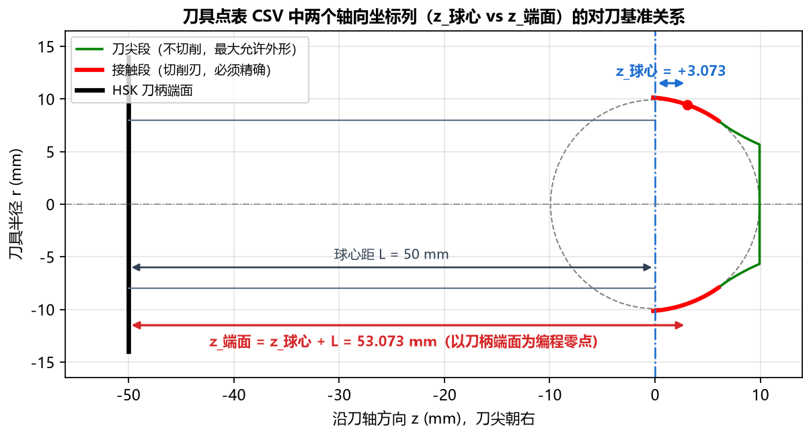

# 6.2 导出 CSV 数据表详解与坐标基准说明

TrackForm 导出的全部 3 类 `.csv` 文件均采用 **UTF-8 with BOM** 编码格式：
* **用 Microsoft Excel / WPS 表格双击打开**：中文表头与注释直接完美显示，绝不乱码；
* **用记事本 / VS Code / 数控系统读取**：以 `#` 开头的行为元数据注释行，数据列之间以标准英文逗号 `,` 分隔。

---

## 一、`刀具点表 CSV` (`tool_profile_points.csv`)

点击左下角的 **`刀具点表 CSV`** 按钮，可导出精确成型刀具单侧刃口（**按从刀柄侧外缘下端 $\to$ 刀尖顶端的顺序排列**）的全部离散坐标点。

### 1. 极其重要：理解双轴向坐标基准（`z_球心` vs `z_端面`）

为了同时满足**理论包络分析**与**数控工具磨床/加工中心以刀柄端面为编程零点**的现场习惯，导出的 `tool_profile_points.csv` 同时提供了两列轴向坐标：



| 数据列名称 | 工程含义与坐标基准定义 | 数值特征与适用场景 |
| :--- | :--- | :--- |
| **`序号`** | 点位行号（从 `1` 开始连续编号） | 按**刀柄侧（外径最大处） $\to$ 刀尖顶面**的顺序排列。 |
| **`段`** | 标识该点所属的刀头功能区段 | <ul><li>`接触`：球道有效工作接触区的核心切削刃（对应 Tab 1 中的红色实线，必须精确制造）；</li><li>`刀尖`：球道底部避空区的最大允许外形（对应 Tab 1 中的绿色刀尖段，不参与切削）。</li></ul> |
| **`r`** | 刀具半径（单位：`mm`） | 各点到刀具旋转中心轴线的径向半径（例如接触段从 `10.13842` 递减至 `7.92685`）。 |
| **`D`** | 刀具直径（单位：`mm`） | 即 $D = 2r$，方便直接核对各轴向高度处的回转外径。 |
| **`z_球心`** | **以虚拟钢球中心为原点 `z = 0`**（向刀尖方向为正，单位：`mm`） | 与软件界面 **[Tab 1：刀具廓形](../5_tabs_charts/tab1_tool.md)** 及计算结果面板中的 `接触段 z` 完全一致（例如从 `-0.17469` 递增至 `+9.92200`）。 |
| **`z_端面`** | **以刀柄定位端面为原点 `z = 0`**（距刀柄端面距离，单位：`mm`） | 换算关系：$$\text{z\_端面} = \text{z\_球心} + \text{球心距 } L$$（当 `刀柄方向 = 朝 +Z` 时为 `L - z_球心`）。<br>**现场最常用**：数控磨床或加工中心装夹 HSK 刀柄时，直接以**刀柄定位端面（HSK 法兰端面）作为 Z 向编程零点**，即可直接读取 `z_端面` 列坐标进行编程与三坐标检测，免去一切手工加减换算！ |

### 2. 真实导出文件内容示例

```text
# TrackForm 球道成型刀具廓形点表
# 钢球直径=19.844  PCD=62.464  偏移e=4.270  Rp=31.5225
# 截面=椭圆  接触角=42.00°  切入角=36.00°  球心距=50.000  余量=0.000
# 椭圆 a(横向)=10.1762  b(径向)=10.6436  uc=0.6929  相似度=1.0400  顶隙=0.0287
# 顺序: 刀柄侧 -> 刀尖；段=接触 为切削刃(必须精确)，段=刀尖 为最大允许外形(不切削)
# r=半径(mm)  D=直径(mm)  z_球心=沿刀轴距虚拟钢球中心(刀尖为正)  z_端面=距刀柄端面
序号,段,r,D,z_球心,z_端面
1,接触,10.13842,20.27684,-0.17469,49.82531
2,接触,10.13819,20.27637,-0.16469,49.83531
...
644,接触,7.92685,15.85371,6.02050,56.02050
645,刀尖,7.91944,15.83889,6.02849,56.02849
...
1038,刀尖,0.00000,0.00000,9.92200,59.92200
```

---

## 二、`方程常数（Table 1）` (`table1_constants.csv`)

点击左下角的 **`方程常数（Table 1）`** 按钮，可将计算结果中的 **轮廓方程常数（Table 1：$C_1 \sim C_{10}$）** 导出为标准 CSV 表格，格式直接对标主机厂球道工程图纸的 Table 1。

### 真实导出文件内容示例

```text
# TrackForm 球道基本轮廓方程常数 (图纸 Table 1)
# 单圆弧刀具 (取整 3 位): R=12.3600  rc=-2.1920  zc=-1.0710(刀尖向)
# 切入角 β=36.00°  轨迹半径 Rp=31.5225  常数依据=拟合值
常数,数值
C1,2.19160
C2,-25.50227
C3,-18.52849
C4,-19.59946
C5,1.07098
C6,-21.56794
C7,650.36593
C8,-6.06824
C9,1.07098
C10,152.76417
```

> **提示**：如果需要按取整后的圆弧尺寸生成常数表，可在高级参数中将 **`常数依据`** 切换为 `取整值` 后再点击导出。

---

## 三、`基本轮廓（Table 2）` (`table2_basic_profile.csv`)

点击左下角的 **`基本轮廓（Table 2）`** 按钮，软件会在球道底部到终止高度之间均匀生成离散点（默认 `117` 个点，由高级参数 `基本轮廓点数` 控制），导出与客户球道图纸 **Table 2 (BASIC PROFILE)** 格式完全一致的基准轮廓坐标表。

### 1. 各列坐标含义与图纸点表对标说明
* **`No`**：点序号，从 `1`（球道底部最低点）递增至 `117`（球道上边缘终点）；
* **`Z(±)`**：该高度处球道法向截面的**水平横向半宽坐标**（单位：`mm`，左右对称取 `±`）；
* **`Y`**：从球道底部最低点向上量取的**截面高度坐标**（单位：`mm`，第 `1` 点球道底处固定为 `Z(±) = 0.00000, Y = 0.00000`）。

### 2. 闭环复核技巧：导出的 Table 2 可直接作为点表截面重新导入！
由于 `table2_basic_profile.csv` 采用标准的 `No, Z(±), Y` 格式，您可以随时在左侧基本参数中将 `截面类型` 切换为 **`点表(CSV)`**，然后直接选择刚才导出的 `table2_basic_profile.csv` 文件进行闭环验证（详见 **[8.2 案例二：导入客户点表 CSV 与 Table 1/2 对标](../8_workflows_cases/case2_points.md)**）。

### 3. 真实导出文件内容示例

```text
# TrackForm 球道基本轮廓点表 (图纸 Table 2)
# 常数依据=拟合值  轮廓终点=球道边缘  点数=117
# Z(±): 截面水平坐标 (mm)，对称取 ±
# Y:    截面高度坐标 (mm)，球道底处 Y = 0
No,Z(±),Y
1,0.00000,0.00000
2,1.27688,0.07720
3,1.80379,0.15441
...
116,10.02521,8.87833
117,10.04426,8.95553
```
