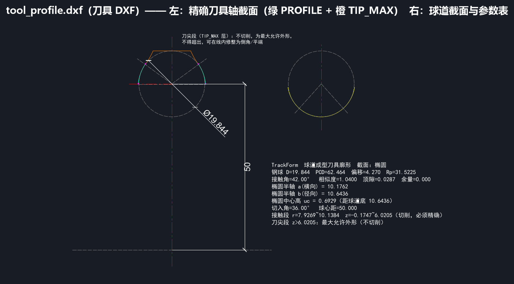
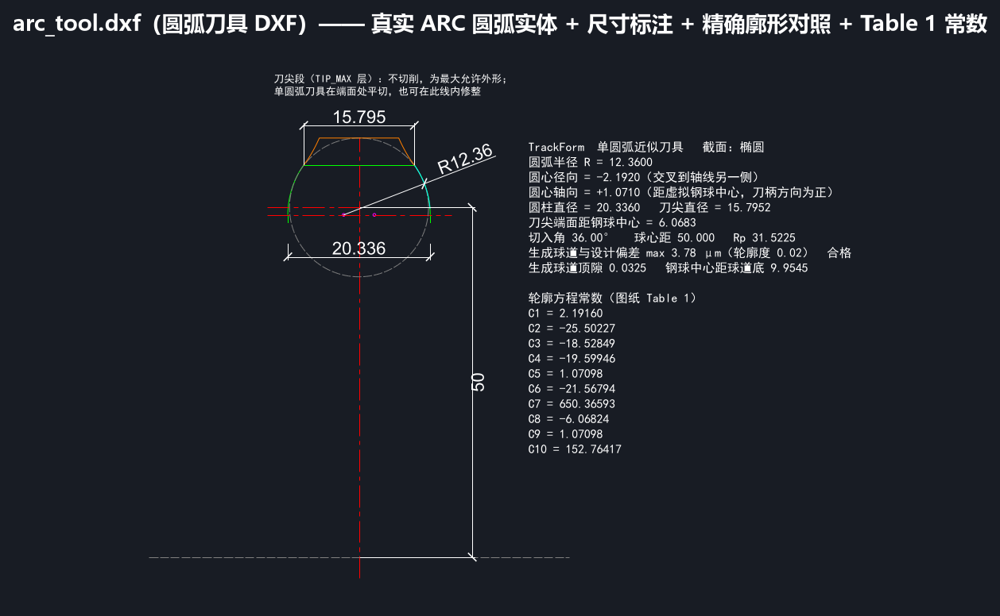
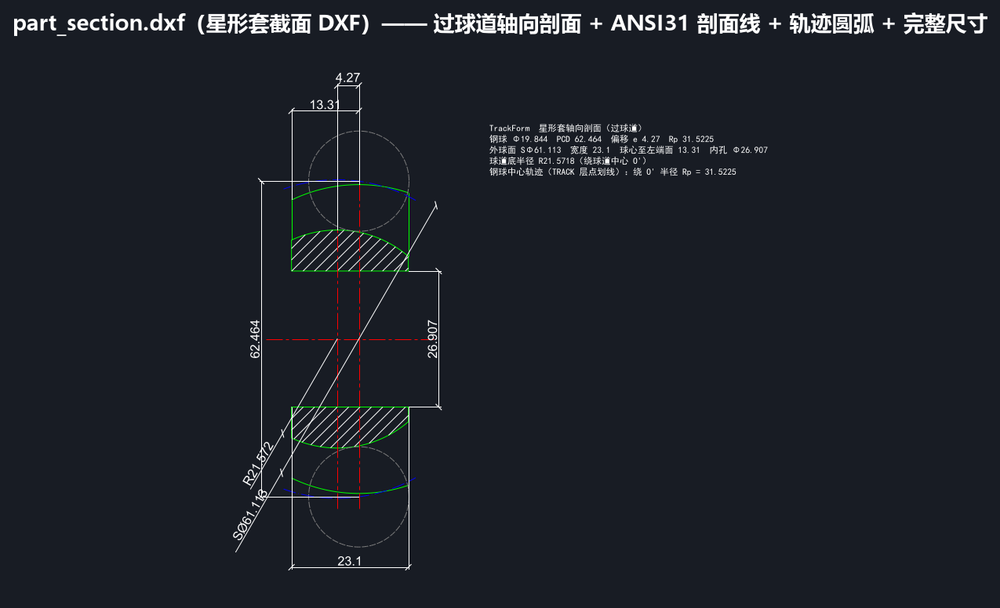

# 6.1 导出 DXF 工程图详解与 CAD 应用指南

TrackForm 导出的全部 3 类 `.dxf` 文件均遵循 **AutoCAD 2010 (AC1024)** 工业标准，采用严格的 **1:1 毫米（mm）比例**绘制，预置了规范的分层（Layers）、颜色、线型（中心线 `CENTER`、虚线 `DASHED`、点划线 `DASHDOT`）以及中文字体样式（`CN`，自动绑定 `simhei.ttf` 黑体，在 AutoCAD、CAXA、浩辰 CAD、SolidWorks、UG/NX 中打开绝无乱码或问号）。

---

## 一、DXF 图层（Layers）标准规范表

在 AutoCAD 中打开任意导出的 DXF 文件后，您可以通过图层管理器单独开关或提取特定几何图元：

| 图层名称 (Layer) | CAD 颜色号 (ACI) | 线型 (Linetype) | 图层承载内容与 CAM 提取说明 |
| :--- | :---: | :---: | :--- |
| **`PROFILE`** | `3` (绿色 Green) | `CONTINUOUS` | **核心轮廓层**：在 `tool_profile.dxf` 中为精确接触段折线；在 `arc_tool.dxf` 中为原生 `ARC` 圆弧图元 + 相切圆柱段直线；在 `part_section.dxf` 中为星形套外球面、内孔及两端面实线。 |
| **`PROFILE_SPLINE`** | `4` (青色 Cyan) | `CONTINUOUS` | **光滑样条 / 精确对照层**：在 `tool_profile.dxf` 中为 3 阶光滑样条曲线（`SPLINE`），供五轴工具磨床/慢走丝 CAM 直接拾取光滑刀刃；在 `arc_tool.dxf` 中为精确刀具廓形对照线。 |
| **`TIP_MAX`** | `30` (橙色 Orange) | `CONTINUOUS` | **刀尖段最大允许外形层**：刀尖避空段（不切削区）的让刀包络线与顶部平端线。 |
| **`SECTION`** | `2` (黄色 Yellow) | `CONTINUOUS` | **球道法向截面层**（仅在 `tool_profile.dxf` 右侧）：1:1 绘制球道法向截面曲线。 |
| **`CENTER`** | `1` (红色 Red) | `CENTER` | **基准中心线层**：刀具旋转轴线、虚拟钢球中心十字线、星形套回转轴线及球道中心/球面中心竖直基准线。 |
| **`REF`** | `8` (灰色 Gray) | `DASHED` | **参考辅助线层**：虚拟钢球参考圆、切入角 $\beta$ 参考线、接触角 $\alpha$ 方向线、刀柄定位端面线。 |
| **`MARK`** | `6` (洋红 Magenta) | `CONTINUOUS` | **特征点标记层**：球道底/球道边缘接触点小圆圈、单圆弧圆心小圆圈标记。 |
| **`TEXT`** | `7` (白/黑) | `CONTINUOUS` | **尺寸标注与文字表层**：全部直径/半径/线性尺寸标注（`DIMENSION`）及右侧技术参数与常数汇总表（`MTEXT`）。 |
| **`HATCH`** | `8` (灰色 Gray) | `CONTINUOUS` | **剖面线层**（`ANSI31` 斜线）：`part_section.dxf` 中星形套实体剖面区域的工程剖面填充。 |
| **`TRACK`** | `5` (蓝色 Blue) | `DASHDOT` | **钢球中心轨迹层**：`part_section.dxf` 中以球道中心 $O'$ 为圆心、半径为 $R_p$ 的钢球中心轨迹圆弧。 |

---

## 二、三种 DXF 文件内容详解

### 1. 精确成型刀具图：`刀具 DXF` (`tool_profile.dxf`)

* **适用场景**：制造非圆弧复杂廓形刀具（如双圆弧哥德式尖底球道刀具、高精度椭圆/点表球道成型铣刀或磨轮）。
* **图元结构亮点**：
  1. **左侧主视图（刀头轴截面）**：左右对称绘制完整刀头，同时提供 **`PROFILE`（绿色密集折线）** 与 **`PROFILE_SPLINE`（青色光滑样条）** 两个刀刃图层，顶部橙色 `TIP_MAX` 层标示刀尖最大允许外形，并自动标注虚拟钢球直径（如 `Ø19.844`）及球心至刀柄端面距离（如 `50`）；
  2. **右侧辅视图（球道法向截面 + 参数表）**：上方以黄色 `SECTION` 层绘制 1:1 球道法向截面与接触角参考线，下方完整列出球道参数、椭圆半轴、切入角、接触段坐标范围等技术说明文字块。

---

### 2. 单圆弧近似刀具图：`圆弧刀具 DXF` (`arc_tool.dxf`)

* **适用场景**：**车间现场使用频率最高**！当单圆弧近似偏差合格时，直接导出此图用于制造单圆弧成型刀具或编写砂轮金刚轮圆弧修整程序。
* **图元结构亮点**：
  1. **原生 `ARC` 圆弧与相切 `LINE` 直线**：`PROFILE` 图层（绿色）由纯正的 CAD 原生 `ARC` 圆弧图元、下端相切圆柱竖直线及顶部平切端面线组成，同时在 `PROFILE_SPLINE` 层（青色）保留精确廓形供对比；
  2. **完备的工程尺寸标注**：自动生成原生 CAD 尺寸标注——包括**单圆弧半径标注（如 `R12.36`）**、**圆柱段外径标注（如 `20.336`）**、**刀尖平端直径标注（如 `15.795`）** 以及 **球心至刀柄端面距离标注（如 `50`）**；
  3. **圆心标记与 Table 1 常数表**：以洋红色十字+小圆圈标出左右圆弧圆心位置，并在右侧文字块中完整列出单圆弧刀具几何参数与 **轮廓方程常数（图纸 Table 1：$C_1 \sim C_{10}$）**。

---

### 3. 星形套子午面工序图：`星形套截面 DXF` (`part_section.dxf`)

* **适用场景**：工艺部门编制星形套车削与球道铣削/磨削工序卡、设计球道加工专用夹具、在 CAD 中直观量取球道底部与内孔之间的最小壁厚。
* **图元结构亮点**：
  1. 完整绘制星形套上下对称轴向全剖视图（绿色 `PROFILE` 外轮廓 + 灰色 `ANSI31` 剖面线填充）；
  2. 原生 `ARC` 绘制外球面圆弧、球道底部圆弧及蓝色点划线钢球中心轨迹（`TRACK` 层）；
  3. 自动标注全部 7 项核心工程尺寸：`4.27`（偏移 $e$）、`13.31`（球心至左端面 $H$）、`23.1`（工件宽度 $W$）、`62.464`（节圆直径 $\text{PCD}$）、`26.907`（内孔直径）、`R21.572`（球道底半径）及 `SØ61.113`（外球面直径）。
