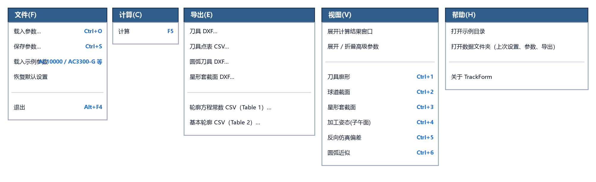

# 7.1 顶部菜单栏功能与全局快捷键

主窗口顶部设有一条标准 Windows 菜单栏，包含 **`文件(F)`**、**`计算(C)`**、**`导出(E)`**、**`视图(V)`**、**`帮助(H)`** 五个下拉菜单（可按 `Alt + 对应字母` 快速呼出）。

---

## 一、五大下拉菜单命令逐项详解

### 1. `文件(F)` 菜单
负责参数方案档案（`.json`）的载入与保存、内置典型示例参数的一键载入以及恢复出厂默认设置：

| 菜单命令 | 快捷键 | 功能说明 |
| :--- | :---: | :--- |
| **`载入参数…`** | `Ctrl+O` | 从磁盘读取之前保存的 `.json` 参数档案文件，自动回填全部参数并立即重新计算刷新图表。 |
| **`保存参数…`** | `Ctrl+S` | 将当前界面上的全部基本参数、高级参数及界面展开状态保存为一个 `.json` 参数档案文件。 |
| **`载入示例参数`** | 子菜单 | 直接从内置 `examples/` 目录一键载入 4 套典型产品示例（`AC3300-G_参数`、`AC10000_参数`、`Nexteer_34205673_参数`、`AC0706-E_参数`），非常适合新手学习或对标验证。 |
| **`恢复默认设置`** | — | 弹出确认框，确认后将全部参数、高级参数面板展开状态及当前图表标签页一键重置为出厂默认（`AC3300-G`）状态。 |
| **`退出`** | `Alt+F4` | 自动将当前界面参数与窗口状态保存到 `last_session.json` 并安全关闭软件。 |

---

### 2. `计算(C)` 菜单
| 菜单命令 | 快捷键 | 功能说明 |
| :--- | :---: | :--- |
| **`计算`** | `F5` | 等同于点击左侧绿色的 **`▶ 计算 (F5)`** 按钮，立即执行全部求解、反向仿真落座校验与六大图表刷新。 |

---

### 3. `导出(E)` 菜单
汇总全部 6 项工程图纸与数据表导出命令（功能与左下角导出按钮区完全一致）：

| 菜单命令 | 默认文件名 | 功能说明 |
| :--- | :--- | :--- |
| **`刀具 DXF…`** | `tool_profile.dxf` | 导出精确成型刀具 CAD 工程图（含 `PROFILE` 折线、`PROFILE_SPLINE` 样条线及右侧球道截面图）。 |
| **`刀具点表 CSV…`** | `tool_profile_points.csv` | 导出精确成型刀具廓形坐标点表（含 `z_球心` 与 `z_端面` 双轴向基准列）。 |
| **`圆弧刀具 DXF…`** | `arc_tool.dxf` | 导出单圆弧或多段相切圆弧近似刀具 CAD 工程图（原生 `ARC` 圆弧 + 尺寸标注 + 落座审核与 Table 1 常数表）。 |
| **`星形套截面 DXF…`** | `part_section.dxf` | 导出星形套过球道轴向剖面 CAD 工程图（含 `ANSI31` 剖面线与完整尺寸标注）。 |
| **`轮廓方程常数 CSV（Table 1）…`** | `table1_constants.csv` | 导出单圆弧刀具对应的球道基本轮廓方程常数表（Table 1：$C_1 \sim C_{10}$）。 |
| **`基本轮廓 CSV（Table 2）…`** | `table2_basic_profile.csv` | 导出球道基本轮廓坐标点表（Table 2：`No, Z(±), Y`）。 |

---

### 4. `视图(V)` 菜单
负责界面面板折叠/展开控制，以及右侧 6 个可视化图表标签页的快速跳转：

| 菜单命令 | 快捷键 | 功能说明 |
| :--- | :---: | :--- |
| **`展开计算结果窗口`** | — | 弹出独立可缩放的 **`计算结果 - TrackForm`** 大窗口，并提供一键 `复制全部` 按钮。 |
| **`展开 / 折叠高级参数`** | — | 切换左侧面板中 `▸ 高级参数` 抽屉的展开或折叠状态。 |
| **`刀具廓形`** | `Ctrl+1` | 切换到 Tab 1：精确刀具廓形视图。 |
| **`球道截面`** | `Ctrl+2` | 切换到 Tab 2：球道法向截面视图（含球道底放大窗与跨距标注）。 |
| **`星形套截面`** | `Ctrl+3` | 切换到 Tab 3：星形套轴向剖面视图。 |
| **`加工姿态(子午面)`** | `Ctrl+4` | 切换到 Tab 4：子午面三摆角包络姿态视图。 |
| **`反向仿真偏差`** | `Ctrl+5` | 切换到 Tab 5：精确刀具反向切削仿真与钢球实际落座视图。 |
| **`圆弧近似`** | `Ctrl+6` | 切换到 Tab 6：单圆弧/多段圆弧近似刀具四子图对比视图。 |

---

### 5. `帮助(H)` 菜单
| 菜单命令 | 快捷键 | 功能说明 |
| :--- | :---: | :--- |
| **`打开示例目录`** | — | 在 Windows 资源管理器中直接打开软件内置的 `examples/` 示例文件夹（内含示例 `.json` 参数与示例点表 `.csv`）。 |
| **`打开数据文件夹（上次设置、参数、导出）`** | — | 在 Windows 资源管理器中直接打开用户数据目录，方便查找保存的参数档案（`params/`）与导出的工程图纸（`exports/`）。 |
| **`关于 TrackForm`** | — | 弹出软件版本信息、功能简介与当前数据存储路径说明对话框。 |

---

## 二、全局键盘快捷键汇总表

熟练使用以下键盘快捷键，可以让您的参数调试与看图效率翻倍：

| 快捷键 | 对应操作 | 高频使用场景 |
| :---: | :--- | :--- |
| **`F5`** | **执行计算** | 在输入框修改完某个参数后，左手直接按一下 `F5` 即可立即刷新计算结果与图表，无需移动鼠标去点按钮！ |
| **`Ctrl + 1` ~ `Ctrl + 6`** | **快速切换第 1 ~ 6 个图表标签页** | 修改完参数按 `F5` 后，连续按 `Ctrl+1`、`Ctrl+5`、`Ctrl+6` 快速巡检刀具廓形、仿真偏差与圆弧近似误差。 |
| **`Ctrl + O`** | **载入参数档案 (`.json`)** | 快速打开历史产品型号参数方案。 |
| **`Ctrl + S`** | **保存参数档案 (`.json`)** | 将当前调试通过的参数方案归档保存。 |
| **`Alt + F4`** | **退出软件** | 完成工作后自动保存当前会话并关闭窗口。 |
