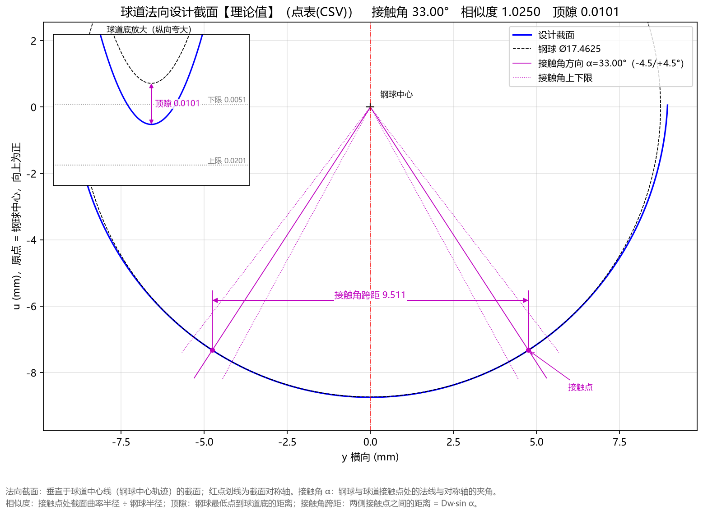
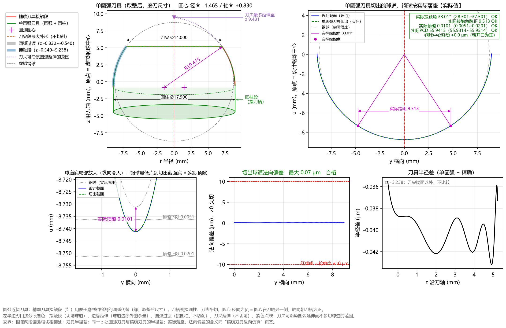

# 8.2 案例二：导入客户点表 CSV 逆向设计刀具与 Table 1/2 对标 (`Nexteer 34205673`)

## 一、任务背景与客户图纸特征

在实际外贸或主机厂配套项目中（以软件内置示例 **`Nexteer_34205673_参数`** 为例），客户图纸上**没有直接给出椭圆长短半轴**，而是在图纸中给出了标准表格：
* **TABLE 1 — BASIC PROFILE EQUATION CONSTANTS**（轮廓方程常数 $C_1 \sim C_{10}$）
* **TABLE 2 — BASIC PROFILE**（117 个点的球道基本轮廓坐标表 `No, Z(±), Y`）

图纸上的已知参数如下：
1. **钢球直径 $D_w$**：$11/16^{\prime\prime} = 17.4625\text{ mm}$；
2. **节圆直径 $\text{PCD}$**：$55.9414\text{ mm}$；
3. **球道中心偏心距 $e$**：$0.0\text{ mm}$（直球道或等效球道中心半径 $R_p = 27.9707\text{ mm}$）；
4. **球道顶隙 $c$**：$0.0101\text{ mm}$（允许范围 `0.0051 ~ 0.0201 mm`）；
5. **切入角 $\beta$**：$36.0^\circ$；
6. **图纸 Table 1 给出的基准单圆弧刀具参数与常数**：
   * 单圆弧半径 $R = 10.415\text{ mm}$，圆心径向偏置 $-1.465\text{ mm}$，圆心轴向偏置 $+0.830\text{ mm}$；
   * $C_1 = 1.46500$，$C_2 = -22.62877$，$C_3 = -16.44077$，$C_4 = -17.27077$，$C_5 = 0.83000$，$C_6 = -19.22915$，$C_7 = 483.73939$，$C_8 = -5.23775$，$C_9 = 0.83000$，$C_{10} = 108.47223$。

**工程目标**：
将客户图纸上的 Table 2 点表（`Nexteer_34205673_截面点表.csv`）导入 TrackForm，自动反求球道接触角、相似度与成型刀具廓形，并验证软件求出的单圆弧刀具及 Table 1 常数与客户原图纸常数是否完全吻合！

---

## 二、第一步：一键载入内置示例或手动导入点表 CSV

您可以直接点击顶部菜单 **`文件(F) → 载入示例参数 → Nexteer_34205673_参数`** 一键载入本案例，或者按以下步骤手动操作体验完整流程：

1. **查看点表 CSV 文件格式**：
   打开 `examples/Nexteer_34205673_截面点表.csv`（可通过 **`帮助(H) → 打开示例目录`** 找到），文件内容为客户图纸 Table 2 的三列数据（`No, Z(±), Y`，共 117 点）：
   ```text
   # Nexteer drawing 34205673 — Table 2 BASIC PROFILE (117 points)
   No,Z(±),Y
   1,0.00000,0.00000
   2,1.18695,0.07587
   3,1.67665,0.15174
   ...
   116,8.93897,8.72503
   117,8.94000,8.80090
   ```
2. **在左侧面板录入参数**：
   * **基本参数**：
     * `钢球直径` = **`17.4625`**，`节圆直径 PCD` = **`55.9414`**，`球道偏心 e` = **`0.0`**
     * `截面类型` 选择 **`点表(CSV)`**
     * 点击 `点表文件` 右侧的 **`浏览…`**，选中 `Nexteer_34205673_截面点表.csv`
     * `点表精度` = **`1e-5`**，`顶隙 c` = **`0.0101`**，`切入角 β` = **`36.0`**
   * **高级参数**：
     * `刀尖高度` = **`5.23775`**，`边缘延伸` = **`0.0`**
     * `顶隙下限` = **`0.0051`**，`顶隙上限` = **`0.0201`**，`接触角下偏差` = **`-4.5`**，`接触角上偏差` = **`4.5`**
     * `PCD 下偏差` = **`-0.01`**，`PCD 上偏差` = **`0.01`**
3. 按 **`F5`** 执行计算！

---

## 三、第二步：检验点表自动拟合与接触角反推结果

切换到 **`Tab 2：球道设计截面`** 并观察左侧 **`计算结果`** 面板：



1. **自动反推出接触角与相似度**：
   * 在 `点表(CSV)` 模式下，无需人工输入接触角，软件自动分析点表与 $\varnothing 17.4625\text{ mm}$ 钢球的相切几何关系，精确反推出：
     * **`接触角 33.001°`**（即名义接触角 $\alpha = 33.00^\circ$）
     * **`相似度 = 1.0250`**
     * **`钢球最小间隙 +0.0000`**（钢球与点表槽壁完美相切，无任何干涉）
2. **精确刀具接触段范围**：
   * `接触段 r: 7.0000 ~ 8.9460 mm`
   * `接触段 z: -0.5398 ~ 5.2377 mm`
   * `刀头最大直径 = 17.8920 mm`

---

## 四、第三步：查看 Tab 6 圆弧近似刀具并与客户原图纸 Table 1 对标

切换到 **`Tab 6：圆弧近似刀具`**（如下图）并查看计算结果面板底部的 `■ 四、圆弧近似刀具` 与 `■ 五、轮廓方程常数 Table 1`：



将 TrackForm 逆向求解出的数值与客户原图纸 Table 1 印刷值进行逐项对比：

| 对比项目 | 客户原图纸印刷值 | TrackForm 逆向求解值 | 对标结论 |
| :--- | :---: | :---: | :--- |
| **单圆弧半径 $R$** | `10.415 mm` | **`10.4150 mm`** (拟合 `10.4150`) | **100% 完全一致** |
| **圆心径向偏置 ($C_1$)** | `-1.465 mm` (`C1 = 1.46500`) | **`-1.4650 mm`** (`C1 = 1.46502`) | **完全一致（差 `0.02 μm`）** |
| **圆心轴向偏置 ($C_5, C_9$)** | `+0.830 mm` (`0.83000`) | **`+0.8300 mm`** (`0.83002`) | **完全一致（差 `0.02 μm`）** |
| **圆柱段外径 $\varnothing$** | `17.900 mm` | **`17.9000 mm`** | **100% 完全一致** |
| **常数 $C_2 \sim C_4$** | `-22.62877 / -16.44077 / -17.27077` | **`-22.62877 / -16.44077 / -17.27079`** | **小数点后第 5 位吻合** |
| **生成球道最大偏差** | — | **拟合 `0.07 μm` / 取整 `0.14 μm` (合格)** | **亚微米级完美重合！** |

> **实战总结**：只需直接将客户图纸上的 Table 2 坐标表保存为 `No, Z(±), Y` 格式的 CSV 导入 TrackForm，软件不仅能自动算出接触角与相似度，更能以 **`0.07 ~ 0.14 μm`** 的超高精度 100% 复现主机厂原版单圆弧成型刀具参数与 Table 1 常数！
