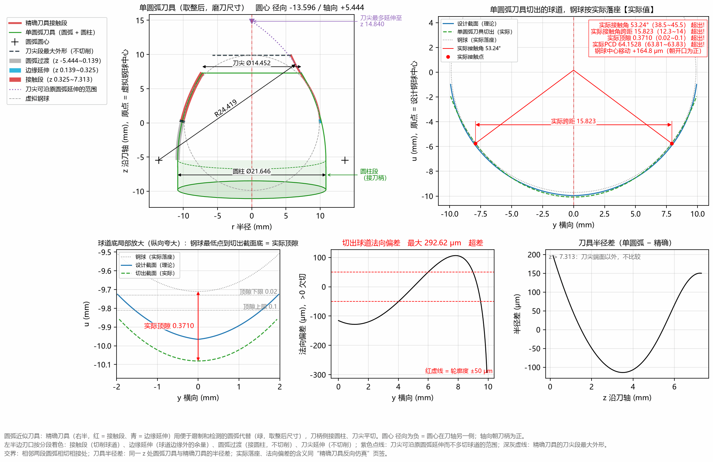
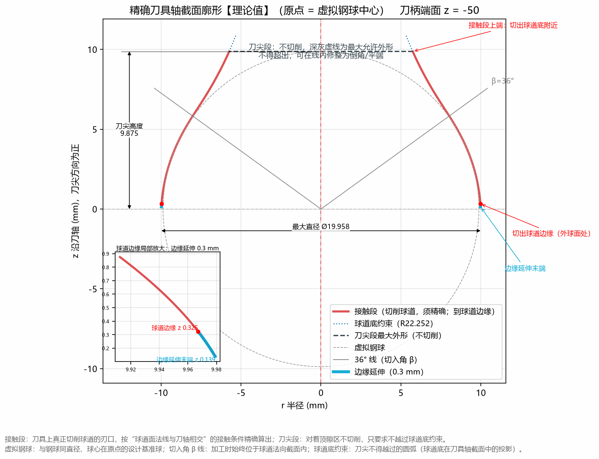
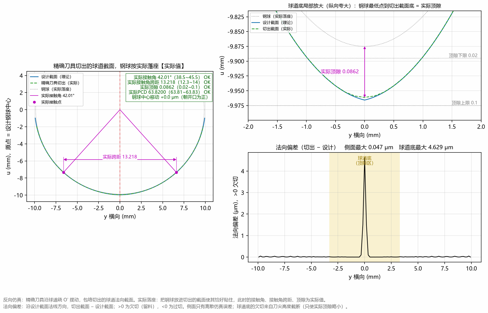
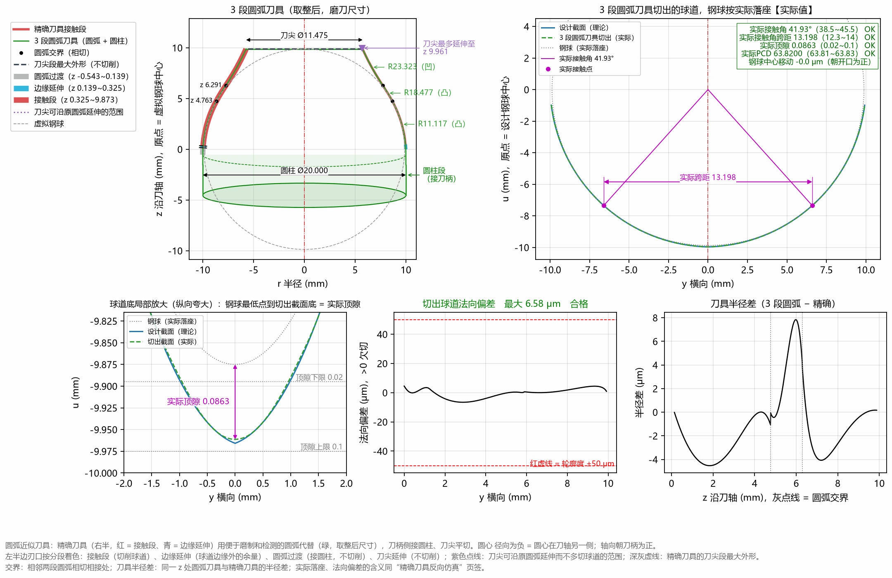
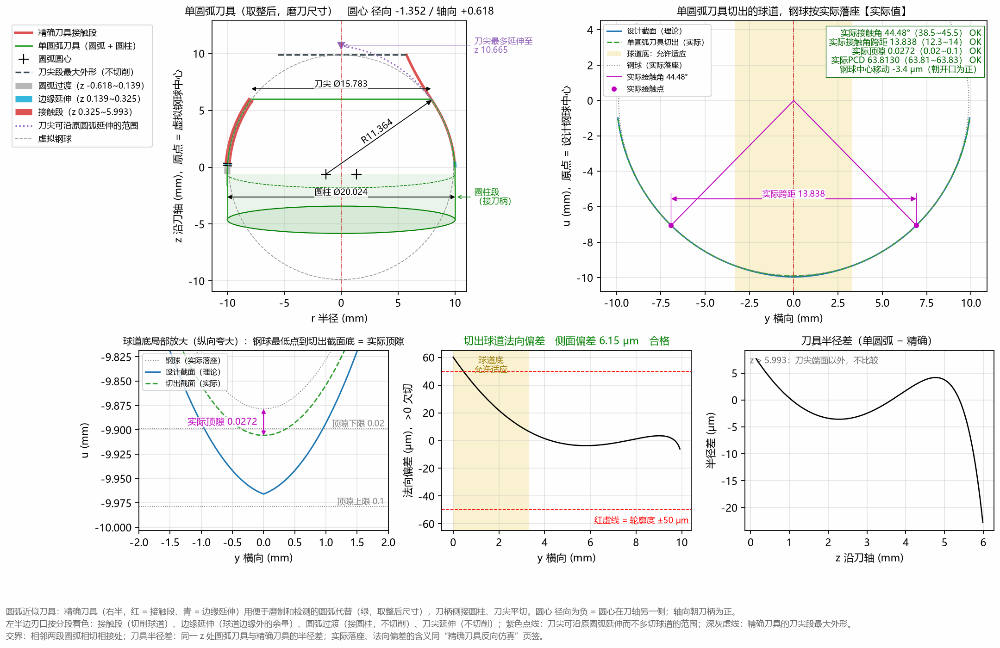

# 8.3 案例三：双圆弧球道（给定半径 R）与三种刀具制造方案对比 (`AC10000`)

## 一、任务背景与零件图纸参数

在高刚度、大扭矩球笼式等速万向节星形套中（以软件内置示例 **`AC10000_星形套_参数`** 为例），球道法向截面采用**双圆弧（哥特式尖底，Gothic Arch）截面**。

该零件图纸直接标出**两段圆弧半径 $R = 10.24\text{ mm}$** 与名义**接触角 $\alpha = 42^\circ$**，并规定了接触角、跨距、顶隙、PCD 与轮廓度的审核公差：

| 图纸标注项目 | 图纸数值 | 填入 TrackForm 的参数位置与数值 |
| :--- | :--- | :--- |
| **工件结构与钢球直径 ($D_w$)** | 固定节星形套，$\varnothing 19.75\text{ mm}$（半径 $9.875\text{ mm}$） | `工件类型` = **`星形套（固定节）`**，`钢球直径 Dw` = **`19.75`** mm |
| **节圆直径 (PCD)** | $\varnothing 63.82\text{ mm}$ | 基本参数 `节圆直径 PCD` = **`63.82`** mm |
| **球道中心偏移 ($e$)** | $4.44\text{ mm}$ | 基本参数 `球道偏移 e` = **`4.44`** mm |
| **球道截面类型与定义方式** | 双圆弧截面，直接给定圆弧半径 $R$ | `截面类型` = **`双圆弧`**，`定义方式` = **`给定半径 R`** |
| **名义接触角 ($\alpha$)** | $42.0^\circ$ | 基本参数 `接触角 α` = **`42.0`** ° |
| **双圆弧半径 ($R$)** | $R 10.24\text{ mm}$ | 基本参数 `圆弧半径 R` = **`10.24`** mm |
| **刀具安装切入角 ($\beta$)** | $36.0^\circ$ | 基本参数 `切入角 β` = **`36.0`** ° |
| **工件外形尺寸** | 外球面 $S\varnothing 62.35$，宽 $W=25.4$，$H=15.72$，内孔 $\varnothing 29.0$ | 基本参数 `④ 工件外形` 与高级参数 `内孔直径` 对应填入 |
| **图纸审核公差范围** | 顶隙 `0.02 ~ 0.10 mm`<br>接触角跨距 `12.3 ~ 14.0 mm`<br>接触角 `42° ± 3.5°`（即 `38.5° ~ 45.5°`）<br>PCD 公差 `±0.01 mm`<br>截面轮廓度 `0.10 mm`（即 `±50 μm`） | 高级参数 **`校验范围`**：<br>`顶隙下限/上限` = **`0.02` / `0.1`**<br>`接触角跨距下限/上限` = **`12.3` / `14.0`**<br>`接触角下偏差/上偏差` = **`-3.5` / `3.5`**<br>`PCD 下偏差/上偏差` = **`-0.01` / `0.01`**<br>`轮廓度公差` = **`0.1`** |

---

## 二、第一步：载入 `AC10000_星形套_参数` 并核对双圆弧理论截面

1. 点击顶部菜单 **`文件(F) → 载入示例参数 → AC10000_星形套_参数`**，然后按 **`F5`** 计算。
2. 查看左侧 **`计算结果`** 面板第 一 分块与右侧 **`Tab 2：球道设计截面`**：
   ```text
   ■ 一、球道截面设计【理论值】
     截面：双圆弧（给定半径 R）
     工件类型：星形套（固定节）
     钢球中心轨迹半径 Rp：32.2174
     圆弧半径 R：10.2400
     圆心 (y, u)：(±0.2442, 0.2712)（交叉）
     尖点处法线角 θ0：1.367°
     接触角 α：42.000°（公差 -3.5/+3.5°，实际接触角应在 38.500 ~ 45.500）
     相似度：1.0370
     顶隙：0.0908  OK（图纸 0.02 ~ 0.1）
     接触角跨距：13.2153  OK（图纸 12.3 ~ 14）
     球道边缘接触角：82.94°
   ```
   * 软件根据输入的 `接触角 α = 42.0°` 和 `圆弧半径 R = 10.24 mm`，自动算出 **`相似度 = 1.0370`**、尖底处 **`顶隙 = 0.0908 mm`**、**`接触角跨距 = 13.2153 mm`**，全部绿色 **`OK`**！

---

## 三、痛点剖析：为什么双圆弧直接用“单圆弧拟合精确廓形”会严重超差？

在双圆弧（尖底）截面中，左右圆弧在球道底部交汇成尖点（$\theta_0 = 1.367^\circ$），导致精确成型刀的接触段廓形存在明显的**“外凸转内凹”拐点**（刀柄侧外凸切球道侧面，刀尖侧内凹切出尖底）。

若将【高级参数 → 圆弧近似】的 `圆弧段数` 设为 `1`、`单圆弧求法` 设为默认的 `拟合精确廓形`，切换到 **`Tab 6：圆弧近似刀具`** 会看到如下红字超差报警：



* **失败原因**：一段单圆弧只能单向弯曲，强行拟合带凹凸拐点的接触段会得到半径高达 `R = 24.4190 mm` 的圆弧，切出球道最大偏差达 **`292.62 μm（超差!）`**，实际落座完全失真（`实际接触角 = 53.240°`、`实际跨距 = 15.8228`、`实际顶隙 = 0.3710`、`实际 PCD = 64.1528` 全红）。

以下对比 TrackForm 提供的 **三种合格刀具制造方案**：

---

## 四、双圆弧球道的三种合格刀具方案详解

### 方案 A：精确自由曲线成型刀（`刀具 DXF` + `刀具点表 CSV`）

使用五轴数控工具磨床（支持样条线或密集点表插补磨削）时，可直接使用精确成型刀廓形：





* 查看计算结果第 二、三 分块与上图 **`Tab 5：精确刀具反向仿真`**：
  * **刀尖高度适度平切（避免过度尖锐崩刃）**：双圆弧尖底接触段沿刀轴延伸至 `z = 16.3870 mm`，本例 `刀尖高度 = 9.875 mm` 适度截去尖端，球道底欠切仅 **`0.0046 mm`（`4.6 μm`）**；
  * **侧面零误差、落座指标全合格**：钢球实际落座后的 **`实际顶隙 = 0.0862 mm OK`**、**`实际接触角 = 41.990° OK`**、**`实际接触角跨距 = 13.2127 mm OK`**、**`实际 PCD = 63.8200 mm OK（偏差 +0.0 μm）`**！
* **导出文件**：点击 **`刀具 DXF`**（提取 `PROFILE` 折线或开启 `PROFILE_SPLINE` 红色样条层）或 **`刀具点表 CSV`**。

---

### 方案 B：多段相切圆弧刀具（推荐！`圆弧段数 = 3`）

若磨床或砂轮修整程序只支持标准圆弧指令（`G02/G03`），只需展开 **`▸ 高级参数 → 圆弧近似`**，将 **`圆弧段数`** 设为 **`3`**：



* **拟合结果与实际落座表现**：
  ```text
  ■ 四、圆弧近似刀具：3 段相切圆弧（取整到 3 位，磨刀尺寸）
    第 1 段（外凸）R：11.1170   圆心 径向 -1.1170 / 轴向 +0.5430；z 0.139 ~ 4.763
    第 2 段（外凸）R：18.4770   圆心 径向 -7.5840 / 轴向 +4.0550；z 4.763 ~ 6.291
    第 3 段（内凹）R：23.3230   圆心 径向 +27.0480 / 轴向 -19.3510；z 6.291 ~ 9.873
    圆柱直径：Ø20.0000   刀尖直径：Ø11.4754   交界错位：1.03 μm
    ▸ 该刀具切出的球道【实际值·仿真】
    与设计截面偏差：6.58 μm  合格（轮廓度 ±50）
    实际顶隙：0.0863  OK（图纸 0.02 ~ 0.1）
    实际接触角：41.932°  OK（图纸 38.5 ~ 45.5）
    实际接触角跨距：13.1978  OK（图纸 12.3 ~ 14）
    实际 PCD：63.8200  OK（偏差 -0.0 μm；图纸 63.81 ~ 63.83）
  ```
  * 用 **2 段外凸圆弧（`R11.117`、`R18.477`）+ 1 段内凹圆弧（`R23.323`）** 首尾相切衔接，精准还原“外凸转内凹”拐点；
  * 全截面最大法向偏差仅 **`6.58 μm`**（远小于 `±50 μm` 公差），钢球实际落座四项指标全部精准合格（**`OK`**）！
* **导出文件**：点击 **`圆弧刀具 DXF`**（包含 3 段严格 $G^1$ 相切的原生 `ARC` 圆弧实体及交界标注）与 **`基本轮廓（Table 2）`**。

---

### 方案 C：按审核优化的单圆弧刀具（`圆弧段数 = 1, 单圆弧求法 = 按审核优化` + 三种 `审核优化目标`）

若工艺规定**只能使用 1 段单圆弧刀具**（或客户必须提供单圆弧专属 **Table 1 常数 $C_1 \sim C_{10}$**），且球道底部非工作区允许从“尖底”自然适应为圆底：

1. 在 **`▸ 高级参数 → 圆弧近似`** 中，将 **`圆弧段数`** 设为 **`1`**，**`单圆弧求法`** 设为 **`按审核优化`**（内置示例 `AC10000_星形套_参数` 默认即为此设置）；
2. 根据图纸验收重点选择 **`审核优化目标`**：
   * **`贴合设计截面`（默认）**：优先保证球道工作侧面与理论双圆弧最贴近，审核范围为软约束；
   * **`审核范围硬约束`**：若产品公差更紧、默认模式出现顶隙/PCD/接触角超限，切换此项可将所有审核项硬性约束进公差带；
   * **`审核范围中值`**：将实际顶隙、接触角、跨距、实际 PCD 推向各自公差带正中（留出最大安全余量）。
3. 点击 **`▶ 计算 (F5)`**（优化过程约需 20~60 秒）：



* **优化结果与实际落座表现（`AC10000_星形套_参数` 默认 `贴合设计截面`）**：
  * 磨刀尺寸：**`R = 11.3640 mm`、`圆心 径向 -1.3520 / 轴向 +0.6180`、`圆柱 Ø20.0240 mm`、`刀尖 Ø15.7827 mm`（端面 `z = 5.9927 mm`）**；
  * 截面与落座审核：**`侧面偏差（|y| ≥ 3.30）= 6.15 μm  合格`**、**`实际顶隙 = 0.0272 OK`**、**`实际接触角 = 44.479° OK`**、**`实际接触角跨距 = 13.8378 OK`**、**`实际 PCD = 63.8130 OK（偏差 -7.0 μm）`**，全项一次性通过！
  * 同时完整输出 **Table 1 常数 ($C_1 \sim C_{10}$)**，`常数自检 = 0.08 μm OK`！
* **导出文件**：点击 **`圆弧刀具 DXF`**、**`方程常数（Table 1）`** 与 **`基本轮廓（Table 2）`**。

---

## 五、三种方案总结对照表

| 对比维度 | 方案 A：精确样条成型刀 | 方案 B：多段相切圆弧刀（`圆弧段数 = 3`） | 方案 C：单圆弧按审核优化（`按审核优化`） |
| :--- | :--- | :--- | :--- |
| **刀刃几何形态** | 自由样条曲线（`SPLINE` / 密集点表） | 3 段首尾相切标准圆弧（2 凸 + 1 凹）+ 圆柱 | 1 段标准单圆弧 + 圆柱 |
| **与双圆弧设计截面偏差** | **零误差**（侧面 `< 0.1 μm`，底部留料 `4.6 μm`） | 全截面 **`6.58 μm`**（连尖底一并还原） | 侧面工作区 **`6.15 μm`**（球道底适应为圆底） |
| **四项落座审核（顶隙/接触角/跨距/PCD）** | 全部绿色 **`OK`** | 全部绿色 **`OK`** | 全部绿色 **`OK`**（公差更紧时可切 `硬约束/中值`） |
| **是否提供 Table 1 常数** | — | 不适用（仅单圆弧有 Table 1） | **支持输出完整 Table 1 ($C_1 \sim C_{10}$)** |
| **推荐导出文件** | `刀具 DXF` + `刀具点表 CSV` | `圆弧刀具 DXF` + `基本轮廓（Table 2）` | `圆弧刀具 DXF` + `Table 1` + `Table 2` |
