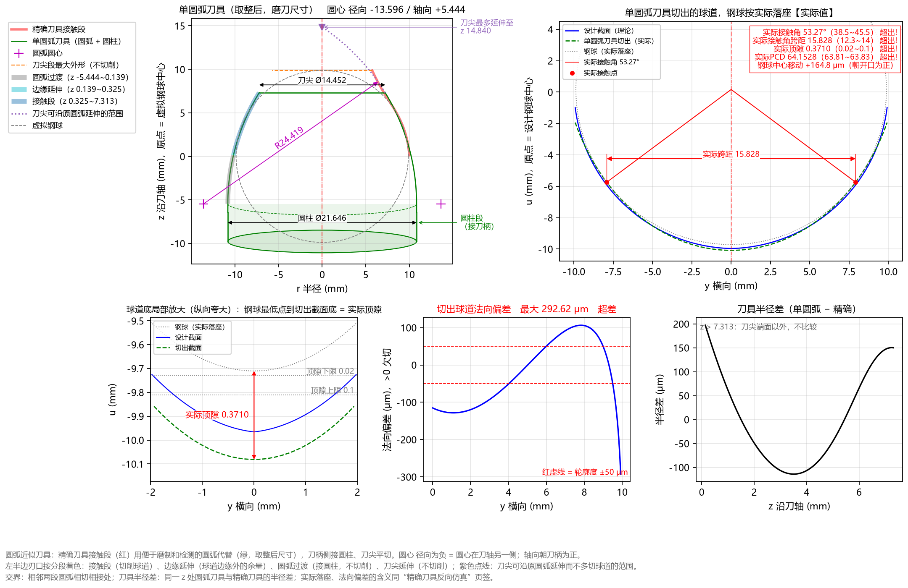
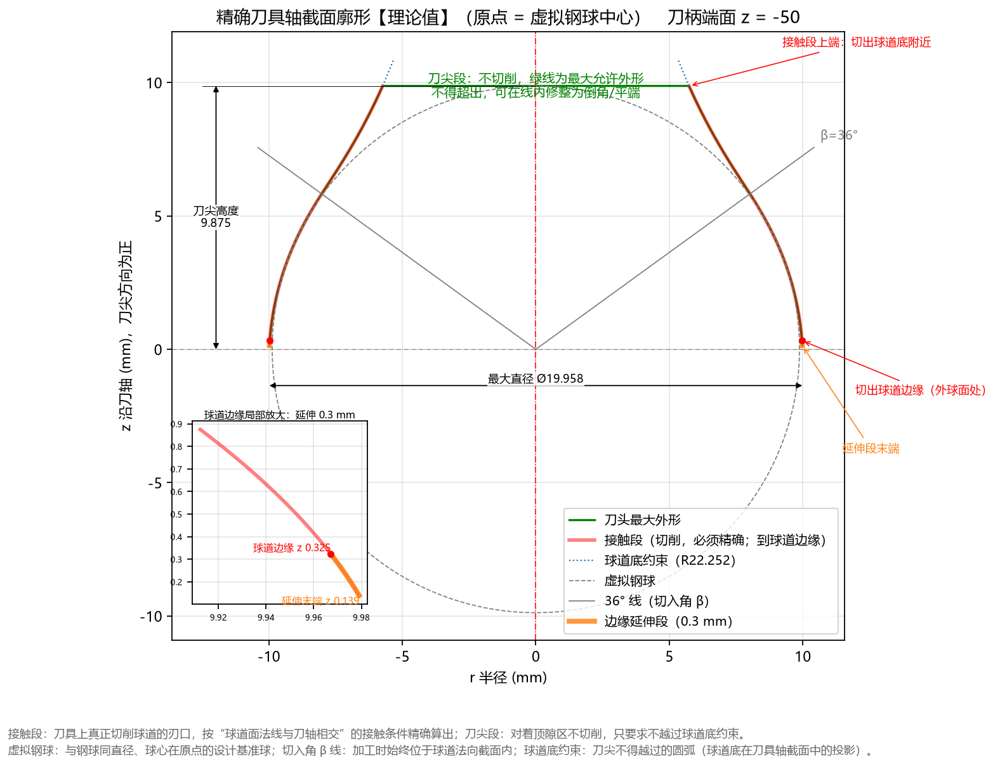
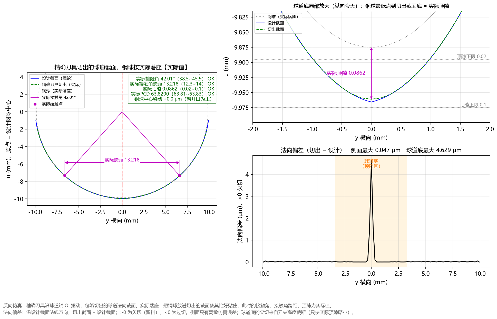
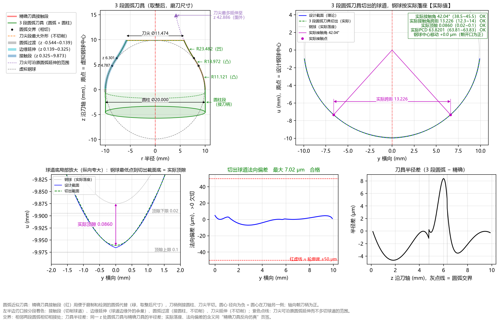
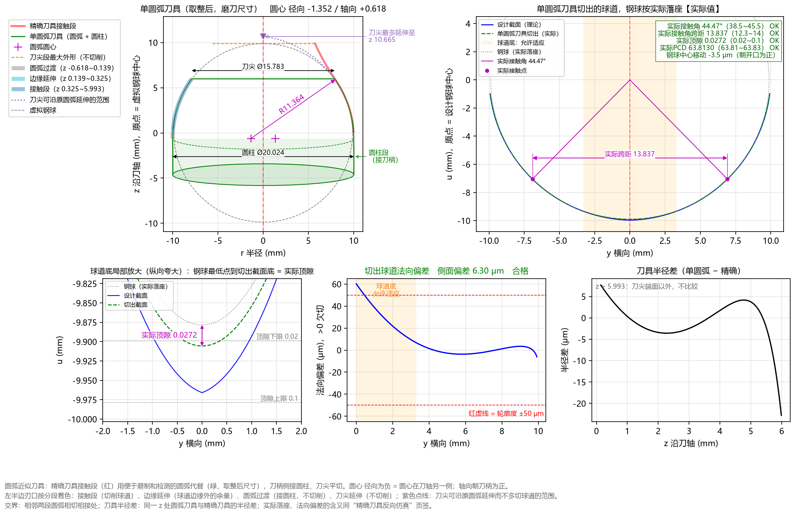

# 8.3 案例三：双圆弧球道（给定半径 R）与三种刀具制造方案对比 (`AC10000`)

## 一、任务背景与零件图纸参数

在许多高刚度、大扭矩球笼式等速万向节星形套中（以软件内置示例 **`AC10000_参数`** 为例），球道法向截面采用**双圆弧（哥特式尖底，Gothic Arch）截面**。

与传统给出“相似度”的图纸不同，该零件图纸直接在截面图上标出了**两段圆弧半径 $R = 10.24\text{ mm}$** 与名义**接触角 $\alpha = 42^\circ$**，并规定了接触角、跨距、顶隙、PCD 与轮廓度的审核公差：

| 图纸标注项目 | 图纸数值 | 填入 TrackForm 的参数位置与数值 |
| :--- | :--- | :--- |
| **钢球直径 ($D_w$)** | $\varnothing 19.75\text{ mm}$（半径 $9.875\text{ mm}$） | 基本参数 `钢球直径 Dw` = **`19.75`** mm |
| **节圆直径 (PCD)** | $\varnothing 70.0\text{ mm}$ | 基本参数 `节圆直径 PCD` = **`70.0`** mm |
| **球道中心偏移 ($e$)** | $5.2\text{ mm}$ | 基本参数 `球道偏移 e` = **`5.2`** mm |
| **球道截面类型与定义方式** | 双圆弧截面，直接给定圆弧半径 $R$ | `截面类型` = **`双圆弧`**，`定义方式` = **`给定半径 R`** |
| **名义接触角 ($\alpha$)** | $42.0^\circ$ | 基本参数 `接触角 α` = **`42.0`** ° |
| **双圆弧半径 ($R$)** | $R 10.24\text{ mm}$ | 基本参数 `圆弧半径 R` = **`10.24`** mm |
| **刀具安装切入角 ($\beta$)** | $36.0^\circ$ | 基本参数 `切入角 β` = **`36.0`** ° |
| **工件外形尺寸** | 外球面 $S\varnothing 68.5$，宽 $W=29.0$，$H=13.0$，内孔 $\varnothing 30.0$ | 基本参数 `④ 工件外形` 与高级参数 `内孔直径` 对应填入 |
| **图纸审核公差范围** | 顶隙 `0.02 ~ 0.10 mm`<br>接触角跨距 `12.3 ~ 14.0 mm`<br>接触角 `42° ± 3.5°`（即 `38.5° ~ 45.5°`）<br>PCD 公差 `±0.01 mm`<br>截面轮廓度 `0.10 mm`（即 `±50 μm`） | 高级参数 **`校验范围`**：<br>`顶隙下限/上限` = **`0.02` / `0.1`**<br>`接触角跨距下限/上限` = **`12.3` / `14.0`**<br>`接触角下偏差/上偏差` = **`-3.5` / `3.5`**<br>`PCD 下偏差/上偏差` = **`-0.01` / `0.01`**<br>`轮廓度公差` = **`0.1`** |

---

## 二、第一步：一键载入 `AC10000_参数` 并核对双圆弧理论截面

1. 点击顶部菜单 **`文件(F) → 载入示例参数 → AC10000_参数`**，然后按 **`F5`** 计算。
2. 查看左侧 **`计算结果`** 面板第 一 分块与右侧 **`Tab 2：球道设计截面`**：
   ```text
   ■ 一、球道截面设计【理论值】
     截面：双圆弧（给定半径 R）
     钢球中心轨迹半径 Rp：35.3842
     圆弧半径 R：10.2400
     圆心 (y, u)：(±0.2442, +0.2711)（两侧圆弧圆心交叉到对称轴另一侧）
     球道底尖点法线角 θ0：1.366°
     接触角 α：42.000°（公差 -3.5/+3.5°，实际接触角应在 38.500 ~ 45.500）
     相似度：1.0370
     顶隙：0.0908  OK（图纸 0.02 ~ 0.1）
     接触角跨距：13.2153  OK（图纸 12.3 ~ 14）
     球道边缘接触角：67.07°
   ```
   * 软件根据输入的 `接触角 α = 42.0°` 和 `圆弧半径 R = 10.24 mm`，自动算出对应的**相似度为 `1.0370`**、尖底处的**理论顶隙为 `0.0908 mm`**、**理论接触角跨距为 `13.2153 mm`**，全部落在图纸公差带内（绿色 **`OK`**）！

---

## 三、痛点剖析：为什么双圆弧球道直接用“单圆弧拟合”会严重超差？

在双圆弧（尖底）截面中，左右两段圆弧在球道底部交汇成尖点（尖点处法线角 $\theta_0 = 1.366^\circ$），这导致精确成型刀的接触段廓形存在一个明显的**“由外凸转内凹”的拐点**（刀柄侧外凸切球道侧面，刀尖侧内凹切出尖底）。

如果您在【高级参数 → 圆弧近似】中将 `圆弧段数` 设为 `1`、且 `单圆弧求法` 选默认的 `拟合精确廓形`，切换到 **`Tab 6：圆弧近似刀具`** 会看到如下红字超差报警：



* **失败原因**：一段单圆弧只能朝一个方向弯曲，强行去拟合带凹凸拐点的整条接触段，得到的单圆弧半径高达 `R 24.419 mm`，切出的球道与设计截面最大偏差高达 **`292.62 μm`（超差！）**，且钢球放进去后的**实际接触角变成了 `53.27°`（超出 `38.5°~45.5°`！）**、**实际跨距 `15.828 mm`（超出！）**、**实际顶隙 `0.3710 mm`（超出！）**。

那么，车间加工双圆弧球道究竟有哪些合格方案？TrackForm 为您提供了以下 **三种完美解决方案**，可根据车间的磨刀与检测设备自由选用：

---

## 四、双圆弧球道的三种合格刀具方案详解

### 方案 A：精确自由曲线成型刀（`刀具 DXF` + `刀具点表 CSV`）

如果您使用五轴数控工具磨床（支持导入 DXF 样条线或高密度点表插补磨削），可直接使用软件算出的**精确成型刀廓形**：





* 查看计算结果第 二、三 分块与上图 **`Tab 5：精确刀具反向仿真`**：
  * **侧面零误差**：精确刀具在侧面接触区的欠切仅为 `6.8e-5 mm`（`0.068 μm` 离散误差量级）；
  * **刀尖高度适度平切**：本例中 `刀尖高度` 保持在钢球半径 `9.875 mm`（低于尖底接触段最高点 `10.2269 mm`），刀尖平端将最尖端的 `0.35 mm` 刀刃截平，使球道底尖点略微变浅 `0.048 mm`；
  * **落座指标全合格**：软件通过钢球实际落座仿真证实——落座后的 **`实际顶隙 = 0.0384 mm`** 仍稳高于图纸下限 `0.02 mm`（绿色 `OK`），且 **`实际接触角 = 42.02° OK`**、**`实际接触角跨距 = 13.221 mm OK`**、**`实际 PCD = 69.9999 mm OK`**！既避免了刀尖过尖崩刃，又 100% 满足全部图纸指标。
* **导出文件**：直接点击 **`刀具 DXF`**（提取 `PROFILE_SPLINE` 青色样条层）或 **`刀具点表 CSV`**。

---

### 方案 B：多段相切圆弧刀具（推荐！`圆弧段数 = 3`）

如果工具磨床或砂轮修整程序只支持标准圆弧指令（`G02/G03`），只需展开 **`▸ 高级参数 → 圆弧近似`**，将 **`圆弧段数`** 设为 **`3`**（这也是内置示例 `AC10000_参数` 的默认设置）：



* **拟合结果与实际落座表现**：
  ```text
  ■ 四、圆弧近似刀具：3 段相切圆弧（取整到 3 位，磨刀尺寸）
    1. 外凸 R=11.1210  圆心 -1.1210 / +0.0250  z 0.097~4.819
    2. 外凸 R=18.9720  圆心 -7.9030 / +4.0340  z 4.819~6.329
    3. 内凹 R=23.4820  圆心 +27.3260 / -16.2990  z 6.329~9.875
    圆柱 Ø20.0000  刀尖 Ø11.5718  交界错位 0.42 μm
    该刀具切出的球道【实际值·仿真】：
      与设计截面偏差 = 7.02 μm（轮廓度 ±50）  合格
      实际顶隙 = 0.0860（图纸 0.02 ~ 0.1）  OK
      实际接触角 = 42.036°（图纸 38.5 ~ 45.5）  OK
      实际接触角跨距 = 13.2256（图纸 12.3 ~ 14）  OK
  ```
  * 用 **2 段外凸圆弧（`R11.121`、`R18.972`）+ 1 段内凹圆弧（`R23.482`）** 首尾相切衔接，完美贴合了双圆弧刀具的凹凸拐点！
  * 全截面最大法向偏差仅为 **`7.02 μm`**（远小于 `±50 μm` 公差），钢球实际落座后的**实际接触角 `42.04°`、实际跨距 `13.226 mm`、实际顶隙 `0.0860 mm`** 全部精准命中图纸名义值并显示绿色 **`OK`**！
* **导出文件**：直接点击 **`圆弧刀具 DXF`**（导出包含 3 段原生 `ARC` 圆弧实体、圆心与相切交界点标注的完整加工图）与 **`基本轮廓（Table 2）`**。

---

### 方案 C：按审核优化的单圆弧刀具（`圆弧段数 = 1, 单圆弧求法 = 按审核优化` + 三种 `审核优化目标`）

如果现场工艺规定**只能使用 1 段单圆弧刀具**（或者客户必须要求提供单圆弧专用的 **Table 1 常数 $C_1 \sim C_{10}$**），且球道底部非工作储油区允许从“尖底”自然适应为单圆弧刀切出的“圆底”：

1. 在 **`▸ 高级参数 → 圆弧近似`** 中，将 **`圆弧段数`** 设为 **`1`**，并将 **`单圆弧求法`** 切换为 **`按审核优化`**（内置示例 `AC10000_参数` 默认即为此设置）；
2. 根据客户验收重点，选择 **`审核优化目标`**：
   * **`贴合设计截面`（默认）**：优先使球道工作侧面与理论双圆弧最贴近（侧面偏差仅 **`3.00 μm`**），审核范围作为软约束；
   * **`审核范围硬约束`**：优先保证**实际顶隙、实际接触角、实际跨距、实际 PCD** 四项审核指标 100% 落在公差带内，在此前提下尽量贴合侧面；
   * **`审核范围中值`**：将实际顶隙、接触角、跨距、实际 PCD 都推向各自公差带正中间（留出最大安全余量）。
3. 点击 **`▶ 计算 (F5)`**（优化过程约需 20~60 秒，右侧图形区显示旋转进度环与试算次数）：



* **优化结果与实际落座表现**：
  * **选 `贴合设计截面` 时**：求得单圆弧 `R = 10.5060 mm，圆心 -0.5580 / -0.0250，圆柱 Ø19.8960 mm`，球道侧面工作区（$|y| \ge 3.31\text{ mm}$）与双圆弧设计截面的偏差低至 **`3.00 μm`（合格）**！由于紧贴双圆弧侧面，圆底顶隙略小（`0.0029 mm`），结果栏会自动提示：
    `审核项未全部满足：当前按“贴合设计截面”优化（审核范围为软约束）。只按审核项验收时，可把“审核优化目标”改为“审核范围硬约束”或“审核范围中值”`。
  * **选 `审核范围硬约束` 或 `审核范围中值` 时**：软件自动将**实际顶隙、实际接触角、实际跨距、实际 PCD** 全部拉回图纸公差带内（全部显示绿色 **`OK`**），并同时在第五分块完整输出对应的 **Table 1（$C_1 \sim C_{10}$）**！
* **导出文件**：点击 **`圆弧刀具 DXF`**、**`方程常数（Table 1）`** 与 **`基本轮廓（Table 2）`**。

---

## 五、三种方案总结对照表

| 对比维度 | 方案 A：精确样条成型刀 | 方案 B：多段相切圆弧刀（`圆弧段数 = 3`） | 方案 C：单圆弧按审核优化（`按审核优化`） |
| :--- | :--- | :--- | :--- |
| **刀刃几何形态** | 自由样条曲线（`SPLINE` / 密集点表） | 3 段首尾相切标准圆弧（2 凸 + 1 凹）+ 圆柱 | 1 段标准单圆弧 + 圆柱 |
| **与双圆弧设计截面偏差** | **零误差**（侧面 `< 0.1 μm`） | 全截面 **`7.02 μm`**（连尖底一并还原） | 侧面工作区 **`3.00 μm`**（`贴合设计截面` 模式） |
| **四项落座审核（顶隙/接触角/跨距/PCD）** | 全部绿色 **`OK`** | 全部绿色 **`OK`** | 选 `审核范围硬约束` 或 `中值` 时全部绿色 **`OK`** |
| **是否提供 Table 1 常数** | — | 不适用（仅单圆弧有 Table 1） | **支持输出完整 Table 1 ($C_1 \sim C_{10}$)** |
| **推荐导出文件** | `刀具 DXF` + `刀具点表 CSV` | `圆弧刀具 DXF` + `基本轮廓（Table 2）` | `圆弧刀具 DXF` + `Table 1` + `Table 2` |
