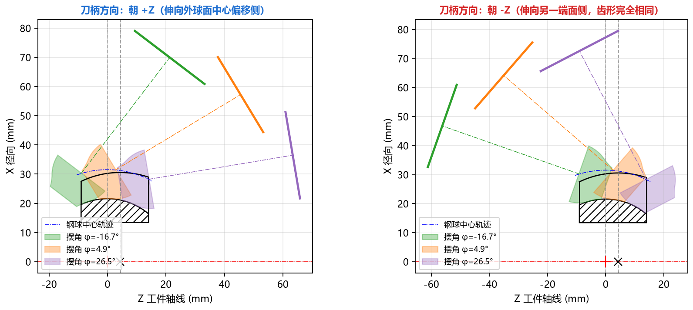

# 8.4 案例四：粗磨/半精铣余量刀具设计与刀柄方向防干涉调整

## 一、任务背景

在星形套的实际量产工艺路线中，通常分为**热处理前球道半精铣（或粗磨）**与**热处理后球道精密成型磨削**两道工序：
1. **半精铣工序**：需要在球道槽壁单侧表面留出 **`0.15 mm`** 的均匀法向磨削余量，供热处理后的精磨工序切除热处理变形层；
2. **机床装夹防干涉**：车间某台专用机床在零件右侧（$+Z$ 侧）安装了尾座顶尖或压紧机构，若刀柄朝 $+Z$ 侧倾斜伸出容易发生干涉，需要改为朝左侧（$-Z$ 侧）倾斜装夹进刀。

---

## 二、分步操作流程

### 第一步：设置 `法向余量 = 0.15 mm` 求解半精铣刀具
1. 载入或恢复成品精磨基准参数（以 `AC3300-G` 为例）；
2. 在左侧基本参数底部找到 **`法向余量`** 输入框，将其从 `0.0` 修改为 **`0.15`**（单位：`mm`）；
3. 按 **`F5`** 重新计算。

---

### 第二步：对比带余量半精加工刀具与成品精磨刀具的尺寸变化

观察 **`计算结果`** 面板：
1. **顶部余量状态提示**：计算结果面板第一行末尾自动增加提示 **`余量 δ = +0.150 mm`**，导出的 DXF 图纸与 CSV 表头也会同步注明 `余量=0.150`，防止工艺员将粗刀与精刀图纸混用；
2. **刀具直径与圆弧半径变化对比**：

| 刀具参数项目 | 成品精磨刀具（`法向余量 = 0.0 mm`） | 半精铣刀具（`法向余量 = 0.15 mm`） | 物理变化规律 |
| :--- | :---: | :---: | :--- |
| **刀头最大直径 $\varnothing_{\max}$** | `20.2768 mm` | **`19.9810 mm`** | 减小约 `0.296 mm`（两侧槽壁各留 `0.15 mm` 法向余量） |
| **接触段径向范围 $r$** | `7.9269 ~ 10.1384 mm` | **`7.8046 ~ 9.9905 mm`** | 刀刃整体向内收缩约 `0.15 mm` |
| **接触段轴向范围 $z$** | `-0.1747 ~ 6.0205 mm` | **`-0.2079 ~ 5.9336 mm`** | 随截面内缩自动微调接触边界 |
| **单圆弧近似半径 $R$** | `12.3600 mm` | **`12.2120 mm`** | 圆弧半径正好减小约 `0.148 mm`（接近 `0.15 mm` 余量值） |
| **单圆弧圆柱段直径 $\varnothing$** | `20.3360 mm` | **`20.0380 mm`** | 圆柱外径减小约 `0.298 mm` |
| **单圆弧生成球道偏差** | `3.78 μm 合格` | **`3.78 μm 合格`** | 依然远小于 $\pm 10\ \mu\text{m}$，半精铣刀同样可直接采用单圆弧！ |

---

### 第三步：切换 `刀柄方向` 为 `朝 -Z` 并校核机床空间姿态

1. 点击左侧 **`▶ 高级参数`** 展开高级参数面板，在 **`── 刀柄与工件 ──`** 分组中：
   * 根据机床主轴夹头悬伸长度核对 **`球心距 L`**（默认 **`50.0`** mm）；
   * 将 **`刀柄方向`** 下拉框从默认的 `朝 +Z` 切换为 **`朝 -Z`**；
2. 按 **`F5`** 重新计算，并按 **`Ctrl + 4`** 切换到 **[Tab 4：加工姿态(子午面)](../5_tabs_charts/tab4_pose.md)** 标签页：

3. **姿态校核结论**：
   * 切换为 `朝 -Z` 后，刀轴点划线与刀柄端面粗实线完全朝向左侧（$-Z$ 方向）伸出，$+Z$ 侧空间完全敞开，彻底避开了右侧尾座顶尖；
   * 注意观察 **`刀具点表 CSV`** 中的 `z_端面` 列：当 `刀柄方向` 从 `朝 +Z` 切换为 `朝 -Z` 时，软件会自动适配刀柄端面所在侧，确保 `z_端面` 始终代表各刀刃点到刀柄定位端面的真实距离！

---

### 第四步：导出半精铣刀具图纸并归档
1. 点击 **`圆弧刀具 DXF`**，命名为 `AC3300G_Rough_0.15mm_arc_tool.dxf`；
2. 按 **`Ctrl + S`**（或点击 **`文件(F) → 保存参数…`**），保存为 `AC3300G_Rough_0.15mm.json`。
3. **重要好习惯**：导出完毕后，若后续继续设计成品精磨刀，请记得将 **`法向余量`** 改回 **`0.0`**！
