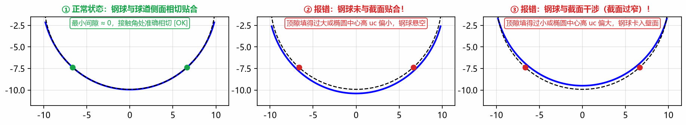

# 第九章：常见报警排查与故障处理速查

在使用 TrackForm 进行球道成型刀具设计的过程中，如果输入的参数存在几何矛盾、数值越界或干涉超差风险，软件会通过**弹窗报错**或**计算结果面板红字警告**第一时间提醒您。

本章汇总了全部常见报错信息、触发原因及一步到位的解决办法，供您随时查阅排障。

---

## 一、点击“计算”时的弹窗报错排查表（输入合法性拦截）

当您点击 **`▶ 计算 (F5)`** 时，若直接弹出错误提示对话框，请对照下表修改左侧对应的输入框：

| 弹窗报错提示内容 | 触发原因 | 解决办法 |
| :--- | :--- | :--- |
| **`“<工件类型>”尚在开发中，当前版本只支持“星形套（固定节）”。`** | 在客户发行版中切换了扩展工件类型并点击计算或导出零件 DXF/Table 1。 | 客户发行版完整开放 **`星形套（固定节）`**；请切换回 `星形套（固定节）`。 |
| **`钢球直径 Dw 必须大于 0`** | `钢球直径 Dw` 输入了 $\le 0$ 的数值或非法字符。 | 输入正数（常见万向节钢球直径为 `12.7 ~ 30.0 mm`）。 |
| **`节圆直径 PCD 必须大于钢球直径`** | `节圆直径 PCD` $\le$ `钢球直径 Dw`，在几何上无法排布球道。 | 核对图纸节圆直径 PCD（通常为钢球直径的 $2.8 \sim 3.5$ 倍）。 |
| **`球道斜角 γ 应在 0°~45° 之间`** | VL 斜球道下 `球道斜角 γ` 设为 `0` 或 $\ge 45^\circ$。 | 输入图纸规定的斜角（VL 常见 `8° ~ 16°`，如 `11°`）。 |
| **`外球面直径必须大于 0`** / **`内孔直径必须大于 0 且小于外球面直径`** | 外球面直径 $\le 0$，或星形套 `内孔直径` $\le 0$ / $\ge$ `外球面直径`。 | 填入真实外形直径（外球面如 `61.113`，内孔如 `26.907`）。 |
| **`外圈工作面（内球面 / 内孔）直径必须小于 PCD + 钢球直径`** / **`刀柄方向须为“朝 -Z”`** | 外圈零件工作面直径过大导致球道露不出，或误选了 `朝 +Z`。 | 核对内球面/内孔直径，并将 `刀柄方向` 设为 **`朝 -Z`**。 |
| **`工件宽度 W 必须大于 0`** / **`两端面位置超出钢球中心轨迹半径 Rp`** | `工件宽度 W` $\le 0$，或两端面相对 $O'$ 超出轨迹圆弧半径 $R_p$。 | 核对图纸总宽 $W$ 与 `球心至端面 H`（对称件 $H = W/2$）。 |
| **`接触角 α 必须在 0°~90° 之间`** | `接触角 α` 超出了合理范围。 | 填入正确的球道接触角（通常为 `30° ~ 48°`）。 |
| **`双圆弧半径 R 必须大于钢球半径`** | 在 `双圆弧 + 给定半径 R` 模式下，`圆弧半径 R` $\le D_w/2$。 | 确保 $R > D_w / 2$（如 `AC10000` 钢球半径 `9.875`，填 `10.24`）。 |
| **`双圆弧截面的相似度必须大于 1`** | `双圆弧 + 给定相似度` 时，$k \le 1.0$。 | 将 `相似度 k` 设为 $> 1.0$ 的数值（常用 `1.02 ~ 1.08`）。 |
| **`椭圆半轴必须为正`** / **`切入角 β 应在 15°~75° 之间`** | 椭圆半轴 $\le 0$，或切入角 $\beta$ 超出 `15° ~ 75°`。 | 核对半轴尺寸；`切入角 β` 内圈常用 `36°`、外圈常用 `20°`。 |
| **`顶隙下限不能大于顶隙上限`** / **`接触角跨距下限不能大于上限`** / **`接触角下偏差不能大于上偏差`** / **`PCD 下偏差不能大于上偏差`** | 在【高级参数 → 校验范围】中，下限（或下偏差）填得大于上限（或上偏差）。 | 确保下限 $\le$ 上限；不需要校验跨距/接触角/PCD 时将对应两项都填 **`0`**。 |
| **`刀尖延伸不能为负`** | 在【圆弧近似】中 `刀尖延伸` 填了负数。 | 填入 $\ge 0$ 的数值（默认 `0` = 不延伸）。 |

---

## 二、点表 (CSV) / 给定半轴模式下“钢球与截面不匹配”或“点表曲率波动”详解

当 `截面类型` 选择 **`点表(CSV)`** 或 `定义方式` 选择 **`给定半轴`** 时，软件会自动检验直径为 $D_w$ 的钢球放入球道后是否能与两侧槽壁准确相切贴合，并检测点表自身的曲率质量：

### 1. 红字报警一：`钢球未与截面贴合，请核对顶隙/椭圆中心！`（上图 ②）
* **物理原因**：您输入的 **`顶隙 c` 偏大**（或 `椭圆中心高 uc` 偏小），导致钢球中心位置偏高，钢球两侧悬空，无法与槽壁接触（`钢球最小间隙` 为较大的正值）。
* **一步解决方法**：在 `点表(CSV)` 模式下，核对图纸上规定的名义顶隙（或用“钢球中心距球道底距离”减去钢球半径 $D_w/2$），填入 **`顶隙 c`**（`给定半轴` 模式则核对 `中心高 uc`），按 `F5` 重新计算。

### 2. 红字报警二：`钢球与截面干涉（截面过窄）！`（上图 ③）
* **物理原因**：您输入的 **`顶隙 c` 偏小**（或 `椭圆中心高 uc` 偏大），导致钢球卡入两侧槽壁内部发生干涉（`钢球最小间隙` 为负值）。
* **一步解决方法**：同样核对并调大 **`顶隙 c`**（或调小 `中心高 uc`）即可消除干涉。

### 3. 红字提示三：`点表截面在 y ≈ ... 处出现反向弯曲（凸起）` / `曲率异常起伏`
* **物理原因**：部分图纸点表（如 `AC0706-E`）在球道底到接触点之间被线性插值或存在录入误差，导致原始点表本身存在曲率反向或突变。
* **处理方法**：
  1. 如果采用**圆弧近似刀具**加工，光滑圆弧不受局部折线波动影响；
  2. 若点表小数位较少（如 4 位小数），按提示把 **`点表精度`** 改为 `1e-4` 以增强光顺；若仍严重变形请向客户提供方核实原始轮廓方程。

---

## 三、计算结果面板红字报警全面排查表

当计算完成但左侧 **`计算结果`** 面板出现红字报警时（此时点击导出按钮也会弹窗拦截确认），请按以下指南快速消除：

| 计算结果红字报警内容 | 所在分块 | 根本原因与一键消除方法 |
| :--- | :---: | :--- |
| **`接触角 α / 顶隙 / 接触角跨距 ... 超出范围!`** | **■ 一（理论值）** | 基本参数算出的理论截面指标超出了【校验范围】设定的区间。 **消除方法**：核对基本参数是否填错，或调整 `▸ 高级参数 → 校验范围`（不校验跨距时两项均填 `0`）。 |
| **`廓形单调（无自交）  否!`** **`过切校验 最小间隙 = ... 过切!`** | **■ 二（精确刀具）** | 切入角过大或点表曲率异常导致刀刃回折或空间包络过切。 **消除方法**：减小基本参数 **`切入角 β`**（例如从 `45°` 降至 `36°`）。 |
| **`请提高刀尖高度（最高到 X.XXXX 时不截断）`** | **■ 三（精确刀仿真）** | `刀尖高度` 低于接触段最高点，且截去过多导致钢球落座后 **`实际顶隙`** 低于 `顶隙下限`（未低于下限时只提示留料而不报错）。 **消除方法**：展开 `▸ 高级参数 → 刀尖与廓形`，将 **`刀尖高度`** 调大。 |
| **`刀头尾端直径 ... 碰工件!`** / **`刀柄端面距开口端面 ... 伸入工件!`** | **■ 三（工件干涉）** | 扩展工件下全行程扫描发现刀头尾端或刀柄端面触碰工件边界。 **消除方法**：查看 **Tab 4 加工姿态** 下方绿色允许曲线，增大 `球心距 L`、减小切入角 $\beta$ 或缩小刀颈外径。 |
| **`与设计截面偏差 = ... 超差!`** （含双圆弧提示 `单圆弧精确拟合做不出...`） | **■ 四（圆弧近似）** | 单圆弧 `拟合精确廓形` 无法贴合双圆弧凹凸拐点，或 `取整位数` 过小。 **消除方法**： • **双圆弧截面**：设为 **`2` 或 `3` 段**相切圆弧，或将 **`单圆弧求法` 设为 `按审核优化`**； • **椭圆/点表**：确认 `取整位数` 为默认值 **`3` 位**。 |
| **第 三 / 四 分块中 `实际顶隙 / 实际接触角 / 实际接触角跨距 / 实际 PCD ... 超出范围!`** | **■ 三 / ■ 四（实际落座）** | 刀具切出球道在钢球实际落座（含余量退回后成品截面）时偏离图纸公差。 **消除方法**：单圆弧 `按审核优化` 时可将 **`审核优化目标`** 切为 **`审核范围硬约束`** 或 **`审核范围中值`**，或增加圆弧段数；不需校验时对应偏差填 `0`。 |
| **`刀尖延伸 ... 未全部做到`** | **■ 四（圆弧近似）** | 设定的 `刀尖延伸` 超过 `刀尖高度` 或超过不切深球道底的几何极限。 **消除方法**：调大 **`刀尖高度`**，或按结果栏提示的 `最多可沿原圆弧延伸到 z = ...` 减小 **`刀尖延伸`**。 |

---

## 四、加密狗授权、三维演示与下游使用常见问题 (FAQ)

### Q1：加密狗未插好或工作过程中意外拔出怎么办？
* **启动提示**：若提示 `未找到加密狗`、`未安装加密狗驱动（Sentinel LDK Runtime）` 或 `加密狗中没有本软件的授权（功能 400）`，请确认 USB 加密狗已插紧并安装配套驱动后重新打开软件。
* **运行期掉线/拔出保护**：工作期间软件在后台每 2 秒自动检测一次加密狗状态；若中途被拔出，软件会**立即隐藏窗口、将当前全部参数自动保存至 `last_session.json`、弹窗提示并安全退出**。插回加密狗后重启软件即可无缝恢复刚刚编辑的参数。

### Q2：导出的 CSV 文件用 Excel 打开没乱码，但导入某些老旧数控系统报错？
* **答**：导出的 CSV 默认带 UTF-8 BOM 头与 `#` 说明行以便 Excel 打开。若老旧磨床数控系统只接受纯数字行，在 Excel 中删掉顶部 `#` 说明行和中文表头后另存为普通 CSV 即可。

### Q3：`刀具点表 CSV` (`tool_profile_points.csv`) 中的 `z_球心` 和 `z_端面` 两列有什么区别？
* **答**：
  * 第 5 列 **`z_球心`**：以**虚拟钢球球心**为原点 `z = 0`（朝刀尖为正），与 `Tab 1` 纵轴一致；
  * 第 6 列 **`z_端面`**：以**刀柄定位端面（HSK 法兰端面）**为原点 `z = 0` 计算的轴向距离（$\text{z\_端面} = \text{z\_球心} + \text{球心距 } L$），数控磨床直接按刀柄端面对刀编程时直接使用本列。

### Q4：切换到 `Tab 7：三维演示` 时提示“matplotlib 渲染较慢”，或切换“精细”精度时有等待，怎么处理？
* **答**：
  * **`标准` vs `精细` 精度**：`标准` 精度随计算秒出、帧率可达 60 FPS；在控制栏切换为 `精细` 时会在后台静默加密网格并在几秒内自动无感更新；
  * **硬件加速与兼容性**：软件默认优先调用 **OpenGL 3.3 GPU 硬件渲染**（底栏显示 `GPU 渲染`）；在无 OpenGL 支持的老旧核显或精简远程桌面环境下会自动降级为 `matplotlib` 软件渲染（也可设置环境变量 `TRACKFORM_3D=mpl` 强制使用软件渲染），此时仍可通过 **`◀ / ▶` 单步**与 **`半剖`** 清晰检视每一帧。

### Q5：为什么 `圆弧段数` 设为 `2 ~ 5` 段或选用非固定节星形套时，`方程常数（Table 1）` 提示不适用？
* **答**：客户图纸的 **Table 1（$C_1 \sim C_{10}$）** 在数学定义上专门描述**固定节星形套的单段圆弧刀具**轮廓；选用 2~5 段相切圆弧时，可导出 **`圆弧刀具 DXF`**（严格相切圆弧链）磨刀，并导出 **`基本轮廓（Table 2）`** 进行三坐标测量机检测。
