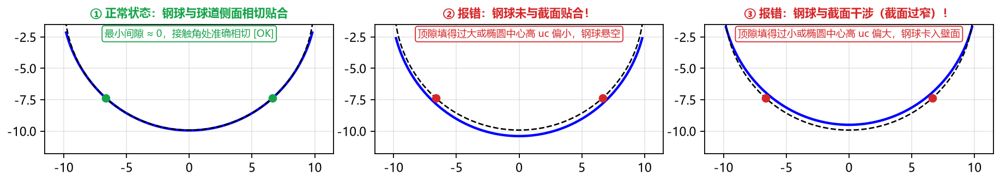

# 第九章：常见报警排查与故障处理速查

在使用 TrackForm 进行球道成型刀具设计的过程中，如果输入的参数存在几何矛盾、数值越界或干涉超差风险，软件会通过**弹窗报错**或**计算结果面板红字警告**第一时间提醒您。

本章汇总了全部常见报错信息、触发原因及一步到位的解决办法，供您随时查阅排障。

---

## 一、点击“计算”时的弹窗报错排查表（输入合法性拦截）

当您点击 **`▶ 计算 (F5)`** 时，若直接弹出错误提示对话框，请对照下表修改左侧对应的输入框：

| 弹窗报错提示内容 | 触发原因 | 解决办法 |
| :--- | :--- | :--- |
| **`钢球直径必须大于 0`** | `钢球直径 Dw` 输入了 $\le 0$ 的数值或非法字符。 | 输入正数（常见万向节钢球直径为 `12.7 ~ 30.0 mm`）。 |
| **`节圆直径 PCD 必须大于钢球直径`** | `节圆直径 PCD` $\le$ `钢球直径 Dw`，在几何上无法排布球道。 | 核对图纸节圆直径 PCD（通常约为钢球直径的 $2.8 \sim 3.5$ 倍）。 |
| **`外球面直径必须大于 0`** | 基本参数 `外球面直径` 输入了 $\le 0$ 的值。 | 填入星形套外球面直径（如 `61.113 mm`）。 |
| **`内孔直径必须小于外球面直径`** | 高级参数 `内孔直径` $< 0$ 或 $\ge$ `外球面直径`。 | 填入真实中心内孔直径（如 `26.907 mm`），不关心时可填 `0`。 |
| **`工件宽度必须大于 0`** / **`球心至端面距离必须在 (0, 工件宽度) 范围内`** | `工件宽度 W` $\le 0$，或 `球心至端面 H` $\le 0$ / $\ge W$，导致外球面球心跑到了星形套两端面之外。 | 核对图纸上工件总宽 $W$ 与外球面球心到基准端面的距离 $H$（对称零件 $H = W/2$）。 |
| **`接触角必须在 10° ~ 75° 之间`** | `接触角 α` 超出了合理范围 `10° ~ 75°`。 | 填入正确的球道接触角（通常为 `30° ~ 48°`）。 |
| **`双圆弧半径 R 必须大于钢球半径 (X.XXXX)`** | 在 `双圆弧 + 给定半径 R` 模式下，输入的 `圆弧半径 R` $\le D_w/2$（圆弧比钢球还小，钢球放不进去）。 | 核对图纸上的双圆弧半径 $R$，确保 $R > D_w / 2$（如 `AC10000` 钢球半径 `9.875`，圆弧半径 `10.24`）。 |
| **`相似度 k 必须大于 0.9` / `双圆弧截面要求相似度 k > 1.0`** | 在 `给定相似度` 模式下，`相似度 k` 过小。 | 将 `相似度 k` 设为 $> 1.0$ 的值（典型范围 `1.02 ~ 1.08`，常用 `1.04`）。 |
| **`顶隙必须大于 0`** | 在 `给定顶隙` 或 `点表(CSV)` 模式下，`顶隙 c` $\le 0$。 | 填入正数顶隙（典型范围 `0.010 ~ 0.090 mm`）。 |
| **`椭圆半轴 a、b 必须大于钢球半径 (X.XXXX)`** | 在 `椭圆 + 给定半轴` 模式下，输入的 $a$ 或 $b$ $\le D_w/2$。 | 检查图纸半轴数值，确保 $a, b > D_w/2$。 |
| **`切入角 β 必须在 15° ~ 75° 之间`** | `切入角 β` 超出 `15° ~ 75°`。 | 填入合理的刀具安装切入角（常用 `25° ~ 45°`，默认 `36°`）。 |
| **`顶隙上限必须大于下限` / `接触角上限必须大于下限` / `接触角跨距上限必须大于下限`** | 在【高级参数 → 校验范围】中，上限填得小于或等于下限。 | 确保上限 $>$ 下限；若接触角或接触角跨距不需要校验，将**下限和上限都填 `0`**。 |

---

## 二、点表 (CSV) / 给定半轴模式下“钢球与截面不匹配”或“点表曲率波动”详解

当 `截面类型` 选择 **`点表(CSV)`** 或 `定义方式` 选择 **`给定半轴`** 时，软件会自动检验直径为 $D_w$ 的钢球放入球道后是否能与两侧槽壁准确相切贴合，并检测点表自身的曲率质量：

### 1. 红字报警一：`钢球未与截面贴合，请核对顶隙/椭圆中心！`（上图 ②）
* **物理原因**：您输入的 **`顶隙 c` 偏大**（或 `椭圆中心高 uc` 偏小），导致钢球中心位置偏高，钢球两侧悬空，无法与槽壁接触（`钢球最小间隙` 为较大的正值）。
* **一步解决方法**：在 `点表(CSV)` 模式下，核对图纸上规定的名义顶隙（或用图纸上的“钢球中心距球道底距离”减去钢球半径 $D_w/2$），填入左侧的 **`顶隙 c`** 输入框（在 `给定半轴` 模式下则核对 `中心高 uc`），按 `F5` 重新计算即可。

### 2. 红字报警二：`钢球与截面干涉（截面过窄）！`（上图 ③）
* **物理原因**：您输入的 **`顶隙 c` 偏小**（或 `椭圆中心高 uc` 偏大），导致钢球卡入两侧槽壁内部发生干涉（`钢球最小间隙` 为负值）。
* **一步解决方法**：同样核对并调大 **`顶隙 c`**（或调小 `中心高 uc`）即可消除干涉。

### 3. 红字提示三：`点表在 Z = ... mm 处曲率反向或明显波动（原始点表即如此，非本软件引起）`
* **物理原因**：部分客户图纸附带的点表（如 `AC0706-E`）在球道底到接触点之间原本缺少加密点、被人工用直线段插值填补，导致原始点表坐标本身就存在曲率突变或反向凸起。由于精确包络刀具对截面曲率极其敏感，算出的精确刀具廓形在该段也会相应变形。
* **处理方法**：
  1. 如果采用**圆弧近似刀具**加工（如 `AC0706-E` 单圆弧近似偏差仅 `9.4 μm` 合格），圆弧刀具本身是光滑圆弧，不受局部点表折线波动影响，可放心使用 `圆弧刀具 DXF`；
  2. 如果需要磨制精确刀具，请向客户提供方核实原始生成方程（如 Table 1 常数），或适度调大 **`点表精度`**（如设为 `5e-5` 或 `1e-4`）以增强样条光顺度。

---

## 三、计算结果面板红字报警全面排查表

当计算完成但左侧 **`计算结果`** 面板出现红字报警时（此时点击导出按钮也会弹窗拦截确认），请按以下指南快速消除：

| 计算结果红字报警内容 | 所在分块 | 根本原因与一键消除方法 |
| :--- | :---: | :--- |
| **`接触角 α = ... 超出范围!`** **`顶隙 = ... 超出范围!`** **`接触角跨距 = ... 超出范围!`** | **■ 一（理论值）** | 基本参数算出的理论截面指标超出了【高级参数 → 校验范围】设定的上下限。 **消除方法**：核对基本参数是否填错，或展开 `▸ 高级参数 → 校验范围` 将上下限修改为当前图纸规定的范围（不需校验的接触角/跨距将上下限都填 `0`）。 |
| **`廓形单调(无自交)  否!`** **`过切校验 最小间隙 = ... 过切!`** | **■ 二（精确刀具）** | 刀具切入角过大或点表曲率异常导致刀刃回折或空间包络过切。 **消除方法**：减小基本参数 **`切入角 β`**（例如从 `45°` 降至 `36°`）。 |
| **`球道底欠切 = ... 请把刀尖高度调大（至 X.XXXX 可完全消除）`** | **■ 三（精确刀仿真）** | 高级参数 `刀尖高度` 低于接触段最高点，且截去过多导致钢球实际落座后的 **`实际顶隙`** 低于图纸 `顶隙下限`（若实际顶隙仍在下限之上，软件会自动判为合格并显示绿字说明）。 **消除方法**：展开 `▸ 高级参数 → 刀尖与廓形`，将 **`刀尖高度`** 调大至提示值以上。 |
| **`与设计截面偏差 = ... 超差!`** （以及双圆弧下的 `提示：双圆弧（尖底）球道的精确刀具廓形带凸转凹拐点...`） | **■ 四（圆弧近似刀具）** | 单圆弧“拟合精确廓形”无法贴合双圆弧（尖底）截面的凹凸拐点，或 `取整位数` 设得太小。 **消除方法**：<ul><li>对于**双圆弧截面**：在 `▸ 高级参数 → 圆弧近似` 中将 **`圆弧段数` 设为 `2` 或 `3` 段**，或将 **`单圆弧求法` 设为 `按审核优化`**（详见[案例三](../8_workflows_cases/case3_gothic.md)）；或者直接导出精确 **`刀具 DXF / 刀具点表 CSV`**；</li><li>对于**椭圆/点表截面**：检查 `取整位数` 是否误设成了 `1` 或 `2`（建议恢复为默认的 **`3` 位**）。</li></ul> |
| **第 四 分块中 `实际顶隙 / 实际接触角 / 实际接触角跨距 ... 超出范围!`** | **■ 四（圆弧近似刀具）** | 圆弧近似刀具切出的球道在钢球实际落座后，接触角、跨距或顶隙偏离了图纸范围。 **消除方法**：若当前为单圆弧，可将 **`单圆弧求法` 切换为 `按审核优化`**（软件会自动将实际接触角/跨距/顶隙约束进图纸范围内），或将 **`圆弧段数` 增至 `2 ~ 3` 段**。 |

---

## 四、下游 CAD 与 Excel 使用常见问题 (FAQ)

### Q1：导出的 CSV 文件用 Excel 打开为什么没有乱码，但导入某些老旧数控系统报错？
* **答**：TrackForm 导出的 CSV 默认带有 UTF-8 BOM 头并包含顶部 `#` 注释说明行，方便 Excel 直接双击阅读。如果您使用的老旧磨床数控系统只接受纯数字行，只需在 Excel 中打开该 CSV，删掉顶部以 `#` 开头的说明行和中文表头行，另存为普通 CSV 即可。

### Q2：`刀具点表 CSV` (`tool_profile_points.csv`) 中的 `z_球心` 和 `z_端面` 两列有什么区别？编程时该用哪一列？
* **答**：
  * 第 5 列 **`z_球心`** 是以**虚拟钢球球心**为原点 `z = 0`（向刀尖方向为正），与软件界面 `Tab 1：刀具廓形` 的纵轴完全一致；
  * 第 6 列 **`z_端面`** 则是以**刀柄定位端面（如 HSK 法兰端面）**为原点 `z = 0` 计算出的轴向距离（$\text{z\_端面} = \text{z\_球心} + \text{球心距 } L$）。当车间在数控工具磨床、加工中心或对刀仪上以**刀柄端面作为编程与测量零点**时，直接使用第 6 列 **`z_端面`** 即可免去一切手工加减换算！

### Q3：为什么当 `圆弧段数` 设为 `2 ~ 5` 段时，点击 `方程常数（Table 1）` 会提示不适用？
* **答**：客户产品开发图纸上的 **Table 1（参数方程常数 $C_1 \sim C_{10}$）** 在数学定义上专门描述**单段圆弧刀具**加工出的球道轮廓。当使用 2~5 段相切圆弧刀具时，您可以直接导出 **`圆弧刀具 DXF`**（含全部相切圆弧段的 `ARC` 图元与尺寸表）用于磨刀，并导出 **`基本轮廓（Table 2）`**（多段圆弧刀具实际仿真切出的 117 点截面坐标表）用于三坐标测量机检测。
