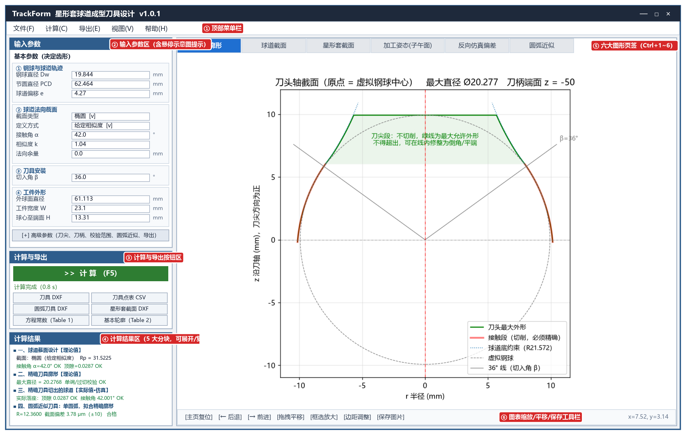

# TrackForm 用户指南

欢迎使用 **TrackForm 星形套球道成型刀具设计软件**用户指南！本指南旨在帮助工艺工程师、刀具设计工程师、数控磨刀编程与质量检测人员快速掌握软件的各项操作，高效、精准地完成球笼式等速万向节星形套（内圈）球道成型刀具的设计、圆弧近似、钢球实际落座仿真审核与数据导出。

## 概述

**TrackForm** 是一款专为星形套硬铣/硬车球道成型刀具（实心回转体刀头）设计的工程软件。用户只需对照产品零件图输入球道与工件参数，软件即可自动完成空间包络计算與反向仿真落座校核，并输出可直接用于数控磨刀、CAD 出图及三坐标检测的工程文件：

- **精确成型刀具廓形计算**：根据星形套球道法向截面与刀具安装切入角，自动计算刀头切削接触段的精确母线廓形，并给出刀尖不切削区的最大允许外形（自动做让刀与平滑过渡处理）。
- **三种球道截面类型与多种图纸定义方式**：
  - **椭圆截面**：支持 **`给定相似度`**（接触角 $\alpha$ + 相似度 $k$）、**`给定顶隙`**（接触角 $\alpha$ + 顶隙 $c$）、**`给定半轴`**（直接输入横向半轴 $a$、径向半轴 $b$ 与中心高 $u_c$）三种图纸标注方式。
  - **双圆弧截面**（哥特式尖底）：支持 **`给定相似度`**（接触角 $\alpha$ + 相似度 $k$）、**`给定顶隙`**（接触角 $\alpha$ + 顶隙 $c$）以及新增的 **`给定半径 R`**（直接输入接触角 $\alpha$ + 两段圆弧半径 $R$）三种定义方式。
  - **点表（CSV）截面**：支持直接导入客户图纸给定的截面坐标点表（如 Table 2），自动完成样条光顺、钢球贴合检验与点表曲率质量检查。
- **单圆弧 / 多段相切圆弧近似与“按审核优化”**：
  - **单圆弧近似（`圆弧段数 = 1`）**：支持 **`拟合精确廓形`**（对椭圆与常规点表截面快速拟合“圆弧 + 圆柱”刀具）和 **`按审核优化`**（针对双圆弧等尖底截面，自动调整单圆弧尺寸使切出球道的实际接触角、接触角跨距、顶隙全部落在图纸公差范围内，球道底自动圆滑适应）。
  - **多段相切圆弧近似（`圆弧段数 = 2 ~ 5`）**：针对双圆弧（尖底）等带凹凸拐点的截面，自动拟合首尾相切（$G^1$ 连续）的多段圆弧 + 圆柱刀具，兼顾极高轮廓精度与标准圆弧磨刀便利性。
- **理论值 vs 实际值（钢球实际落座）双重校核**：不仅校核理论设计截面，还会反向仿真精确刀具与圆弧刀具实际切出的球道，并**把钢球实际放进切出的球道中（实际落座）**，自动测量并对照图纸公差范围校核 **`实际顶隙`**、**`实际接触角`**、**`实际接触角跨距`** 与 **`钢球中心径向移动量`**。
- **客户图纸轮廓方程常数（Table 1）与基本轮廓（Table 2）生成**：一键算出单圆弧刀具对应的产品开发图参数方程常数 $C_1 \sim C_{10}$（Table 1）与等弧长基本轮廓坐标表（Table 2）。
- **一键导出 CAD 图纸与数据表**：支持导出 1:1 比例的 `刀具 DXF`、`圆弧刀具 DXF`（支持单圆弧与多段相切圆弧真实 `ARC` 实体）、`星形套截面 DXF` 以及 `刀具点表 CSV`、`方程常数 CSV（Table 1）`、`基本轮廓 CSV（Table 2）`。

## 目录结构

本指南按实际工程使用流程分为以下 9 个部分，方便您随时查阅：

1. [快速开始](1_getting_started/README.md)：了解软件安装、主界面六大功能区布局、鼠标悬停图文提示及三分钟快速上手流程。
2. [基本参数设置](2_basic_params/README.md)：对照零件图纸，逐项详解决定刀具廓形的 19 项基本参数（含双圆弧 `给定半径 R` 等新定义方式）及常见图纸换算方法。
3. [高级参数设置](3_advanced_params/README.md)：掌握刀尖高度优化、让刀过渡、刀柄方向防干涉、新增校验范围（接触角/跨距上下限）、圆弧段数（`1~5` 段）与 `按审核优化` 求法及导出选项设置。
4. [计算结果面板解读](4_result_panel/README.md)：读懂结果面板五大分块中的**【理论值】**与**【实际值·仿真】（钢球实际落座）**指标、绿色 `OK` / `合格` 判据、红色报警提示及 Table 1 常数含义。
5. [图形页签（Tab 图表）详解](5_tabs_charts/README.md)：学会看懂右侧 6 个图形页签（刀具廓形、球道截面含球道底放大窗与跨距标注、星形套截面、加工姿态、反向仿真偏差含实际落座、圆弧近似四视图）与缩放工具栏操作。
6. [导出文件与工程应用](6_exports_data/README.md)：详解导出的 3 种 DXF 图纸图层规范与 3 种 CSV 表格在数控磨刀、机床对刀编程及三坐标检测中的应用。
7. [菜单功能、快捷键与参数管理](7_menus_session/README.md)：掌握菜单栏命令、快捷键、自动会话记忆与内置/自定义参数文件（`.json`）的管理。
8. [典型设计实战案例](8_workflows_cases/README.md)：通过椭圆截面、客户点表导入、双圆弧截面（`AC10000` 给定半径 $R$ 的三种制造方案对比）、预留余量与刀柄防干涉 4 个完整案例演练全流程。
9. [常见提示与故障排除](9_troubleshooting/README.md)：汇总参数输入提示、点表曲率质量提醒、计算结果标红报警的原因分析与快速调整方案。

## 系统需求

为了确保软件运行流畅、图形清晰显示，请确保您的计算机满足以下要求：
- **操作系统**：Windows 10 / Windows 11（64 位）
- **内存**：建议 4GB 及以上
- **硬盘空间**：至少 500MB 可用空间
- **显示器**：支持标准屏幕及高分屏（2K / 4K DPI 自动高清适配）

## 获取帮助

如需帮助或技术支持，请参考以下资源：

1. **在线用户手册**  
   浏览最新在线文档：[https://trackform-manual.niekun.net/](https://trackform-manual.niekun.net/)

2. **常见问题与排错 (FAQ)**  
   查看常见报警与排错指南：[常见提示与故障排除](9_troubleshooting/README.md)

3. **技术支持与联系我们**  
   - **官方网站**：[https://xincore.niekun.net/](https://xincore.niekun.net/)  
   - **支持邮箱**：[xincore@niekun.net](mailto:xincore@niekun.net)

感谢您选择 **TrackForm**，祝您设计高效、加工顺利！
