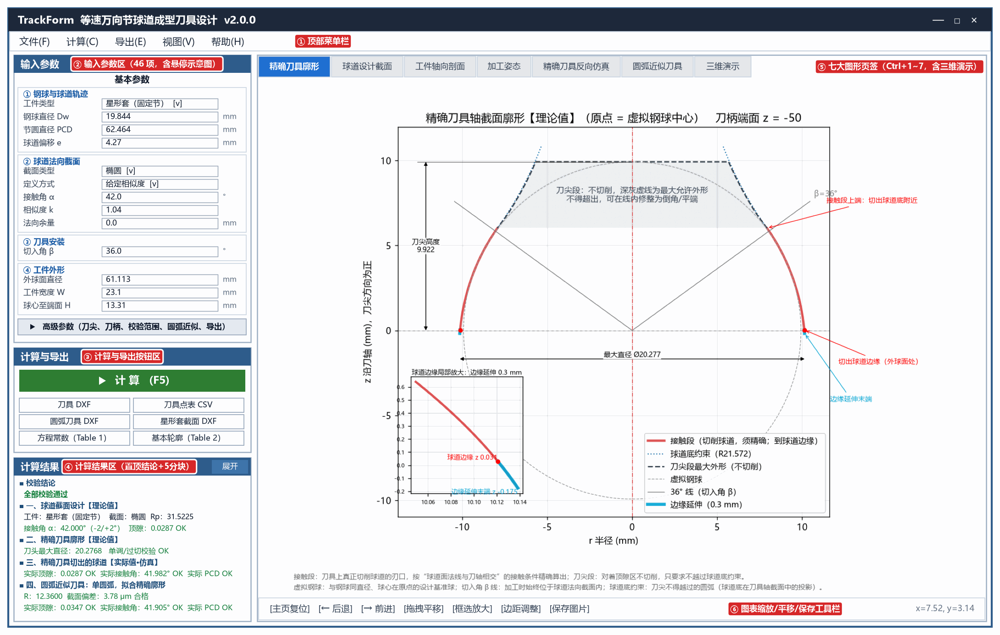

# TrackForm 用户指南

欢迎使用 **TrackForm 等速万向节球道成型刀具设计软件**用户指南！

本指南面向**工艺工程师、刀具设计工程师、数控磨刀编程与质量检测人员**，以清晰的图文列表助您快速完成等速万向节球道成型刀具的设计、圆弧近似、钢球实际落座仿真审核、三维加工演示与工程文件导出。

---

## 核心功能速览

- **六大万向节工件类型（内圈 / 外框，圆弧 / 直线 / 斜交球道）**
  - **星形套（固定节）**：固定节内圈，圆弧球道，工作面为外球面（**已完整实现计算、7 大图表与全部 6 类导出**）。
  - **扩展工件类型（几何计算与三维演示内核已接入，工件 DXF 与 Table 1 仍在开发中）**：`钟形壳（固定节）`、`星形套（DO 直球道）`、`筒形壳（DO 直球道）`、`星形套（VL 斜球道）`、`斜筒形壳（VL 斜球道）`（内部版开放试算与刀颈干涉检查，客户发行版提示“开发中”）。
  - 支持 VL 伸缩节斜球道的 **`球道斜角 γ`**，按工件类型自动适配界面参数标签、外形约束与结果判定。
- **精确成型刀具廓形计算**
  - 根据球道法向截面与刀具安装切入角 $\beta$，自动求解刀头切削接触段的精确母线廓形（固定外框/伸缩节同时完成工件本体与摆动刀具碰撞干涉校核）。
  - 自动生成刀尖不切削区的最大允许外形（深灰虚线，含让刀避空与平滑过渡）及球道边缘延伸余量段（青色）。
- **三种球道截面类型与七种图纸定义组合**
  - **椭圆截面**：支持 `给定相似度`（$\alpha + k$）、`给定顶隙`（$\alpha + c$）、`给定半轴`（$a, b, u_c$）。
  - **双圆弧截面（哥特式尖底）**：支持 `给定相似度`（$\alpha + k$）、`给定顶隙`（$\alpha + c$）、`给定半径 R`（$\alpha + R$）。
  - **点表（CSV）截面**：支持直接导入客户图纸截面坐标表（如 Table 2），自动完成样条光顺、钢球贴合检验与点表曲率质量诊断。
- **单圆弧 / 多段相切圆弧近似、三种审核优化目标与刀尖延伸**
  - **单圆弧近似（`圆弧段数 = 1`）**：支持 `拟合精确廓形` 与 `按审核优化`（提供 **`贴合设计截面`**、**`审核范围硬约束`**、**`审核范围中值`** 三种优化目标）。
  - **多段相切圆弧近似（`圆弧段数 = 2 ~ 5`）**：自动拟合首尾相切（$G^1$ 连续）的多段圆弧 + 圆柱刀具，完美贴合双圆弧尖底截面的凹凸拐点。
  - **刀尖沿原圆弧延伸（`刀尖延伸`）**：将圆弧刀具刀尖沿原圆弧继续延伸（不多切球道底），使切削点避开刀尖平端尖角、减缓刀尖磨损。
- **【理论值】与【实际值·仿真】（钢球实际落座）+ OpenGL 三维演示**
  - **7 大图形页签（`Ctrl+1` ~ `Ctrl+7`）**：6 个二维高精度工程图表采用全新统一工程配色，新增 **Tab 7 `三维演示`**（OpenGL MSAA 硬件抗锯齿渲染，直观演示工件旋转与成型刀具沿球道轨迹包络切削）。
  - **成品截面钢球实际落座**：当设置 `法向余量`（粗磨/半精加工）时，仿真会自动在留余量截面还原精加工成品边界后再放球校验 `实际顶隙`、`实际接触角`、`实际跨距` 与 `实际 PCD`。
  - **置顶校验结论与宽窗口浏览**：顶部 **`■ 校验结论`** 一眼汇总 `全部校验通过` 或标红警示；展开窗口支持**四列斑马纹表格、`Ctrl+F` 查找与一键复制粘贴到 Excel**。
- **客户图纸 Table 1 / Table 2 生成与 CAD / CSV 一键导出**
  - 自动计算单圆弧刀具对应的产品开发图参数方程常数 $C_1 \sim C_{10}$（Table 1）与等弧长基本轮廓坐标表（Table 2）。
  - 一键导出 1:1 比例的 `刀具 DXF`、`圆弧刀具 DXF`（含完整刀具外形与右半刃口四分段双视图）、`工件截面 DXF` 以及 3 种 `CSV` 数据表。

---

## 章节导航

| 章节 | 主题 | 核心内容 |
| :---: | :--- | :--- |
| **第 1 章** | **[快速开始](1_getting_started/README.md)** | 软件安装升级、硬件加密狗保护、主界面分区、悬停图文提示与三分钟快速上手流程 |
| **第 2 章** | **[基本参数设置](2_basic_params/README.md)** | 对照零件图纸，逐项详解 **21 项基本参数**（含 6 种 `工件类型`、`球道斜角 γ`、双圆弧 `给定半径 R` 等） |
| **第 3 章** | **[高级参数设置](3_advanced_params/README.md)** | 详解 **25 项高级参数**（全软件共 **46 项**）：刀尖高度、校验范围、圆弧段数、审核优化目标、刀尖延伸及导出选项 |
| **第 4 章** | **[计算结果面板解读](4_result_panel/README.md)** | 读懂置顶 `■ 校验结论`、五大分块（含工件与刀具干涉校验、刃口分段）及展开窗口查找/复制 |
| **第 5 章** | **[图形页签（Tab 图表）详解](5_tabs_charts/README.md)** | 详解右侧 **7 个图形页签（`Ctrl+1~7`）**：2D 统一工程配色、子图独立放大（`⤢`）与 **OpenGL 三维实时演示** |
| **第 6 章** | **[导出文件与工程应用](6_exports_data/README.md)** | 详解 3 种 DXF 图纸（图层编码、刃口分段视图与引线标注）与 3 种 CSV 表格的下游应用 |
| **第 7 章** | **[菜单功能、快捷键与参数管理](7_menus_session/README.md)** | 掌握分组示例菜单、全局快捷键、自动会话记忆与 `.json` 参数档案管理 |
| **第 8 章** | **[典型设计实战案例](8_workflows_cases/README.md)** | 椭圆截面、点表导入、双圆弧（`AC10000` 三种方案与审核优化目标对比）、余量与防干涉 4 个完整案例 |
| **第 9 章** | **[常见提示与故障排除](9_troubleshooting/README.md)** | 汇总参数输入报错、硬件加密狗断狗保护、点表曲率提醒、3D 渲染与结果标红的解决办法 |

---

## 系统需求与技术支持

- **运行环境**：Windows 10 / Windows 11（64 位），内存建议 4 GB 及以上，支持 2K / 4K 高分屏 DPI 自动高清适配。
- **在线用户手册**：[https://trackform-manual.niekun.net/](https://trackform-manual.niekun.net/)
- **常见问题速查**：[常见提示与故障排除](9_troubleshooting/README.md)
- **官方网站与邮箱**：[https://xincore.niekun.net/](https://xincore.niekun.net/) ｜ [xincore@niekun.net](mailto:xincore@niekun.net)

